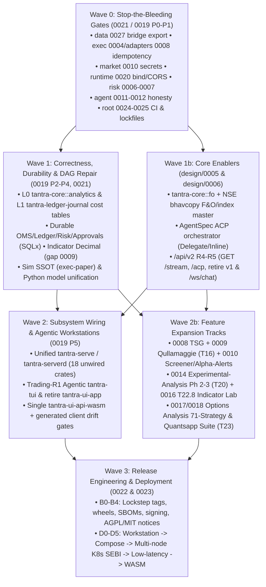

# 0001 — Fincept & Quantcepts Feature Parity, Gap Closure, and Platform Expansion Master Plan

> **Status**: Active Umbrella Master Plan — **Original Layers 0–6 & Core Parity Substantially Implemented (2026-11-09..2026-11-23)**; **Revised 2026-11-24** to incorporate `docs/design/0001`–`0006` and `docs/plans/0005`–`0023`.  
> **Target Scope**: Platform-wide across all 15 submodules + `tantra-ui-web` (`tantra-core`, `tantra-risk`, `tantra-ledger`, `tantra-market`, `tantra-exec`, `tantra-agent`, `tantra-runtime`, `tantra-data`, `tantra-strategies`, `tantra-adapters`, `tantra-ffi`, `tantra-ui`, `tantra-ui-web`, `tantra-examples`, `tantra-docs`).  
> **Canonical Governance & Active Plans**:
> - [`AGENTS.md`](../../AGENTS.md) & [`.agents/rules/`](../../.agents/rules/) (Tier DAG, Zero-I/O, Zero-Floats, Parallel `tests/`, `prod` profile, Fail-Closed Security, Gap Tracking)
> - [`docs/design/architecture.md`](../design/architecture.md) & Design Series [`0001`](../design/0001-crate-topology-audit-and-target.md)–[`0006`](../design/0006-runtime-api-surface.md)
> - [`docs/plans/README.md`](README.md) (Master index of active plans `0005`–`0023` and implemented plans `0002`–`0007`)
> - [`docs/future-work-bottoms-up-build-order.md`](../future-work-bottoms-up-build-order.md) (Layers 0–6 of the initial Fincept/Quantcept parity batch — **Complete**)
> - [`docs/task-list-tracks-and-phases.md`](../task-list-tracks-and-phases.md) (Live execution ledger across Tracks `T0`–`T24`)
> - [`tantra-docs/docs/ai/fincept-vs-quantcept.md`](../../tantra-docs/docs/ai/fincept-vs-quantcept.md) & `tantra-agent/docs/plans/0007` (MCP Ecosystem Guide)

---

## 0. Executive Summary & Vision

Fincept (18 stateful toolsets, 443 tools, 17 stateless analytics engines, desktop terminal) and Quantcept (AI research desk for financial markets) served as the initial capability benchmark for `tantra-labs`.

### 0.1 Where We Started vs. Where We Stand (2026-11-24)
1. **Tantra's Domain Core & Parity Foundation Have Landed**:
   - **Layers 0–6 Complete** (`docs/future-work-bottoms-up-build-order.md`): `tantra-core::quant`, `tantra-ledger-allocation` (MVO, Risk Parity, HRP, Black-Litterman, MPO, discrete shares), `tantra-risk` MCP annotations + reduce-only/collar/OTR gates, `tantra-market-pricing` (Black-Scholes, Greeks, IV solver), `tantra-exec-angelone`, `tantra-agent-forecast` (ARIMA, ETS, Theta, TBATS, GBDT), `tantra-agent-panel` (FE, RE, Fama-MacBeth, GMM), `tantra-agent-analytics` (GARCH, HMM, CUSUM change points, Copulas, Cointegration, DSR/PBO/WFO/MC), `tantra-agent-mcp` (Two-Tier Discovery, `_jq`, `TantraResultEnvelope`, `DataReferenceStore`), `tantra-ffi` (`tantra` Python wheel + Arrow zero-copy), and `tantra-docs` (16 toolset reference pages + `llms.txt` + `docs/paper-trading/` + `docs/user-guide/`).
   - **Major Cross-Repo Tracks Shipped (`T0`–`T18`, `T21`–`T22`, `0020`, `runtime 0016`)**:
     - **Crate Topology & Facades (`design/0001`, `plan 0003`)**: Deleted 12 stub/duplicate crates and standardized repo-named facade crates across all multi-crate Rust workspaces.
     - **Standalone Paper Exchange (`plan 0007` / `T14`)**: `tantra-exec-paper` single exchange matching engine powering REST `/orders`, `/ws/live`, strategy dispatch, backtest, `tantra.paper` Python wheel, WASM browser session, and `paper_serve`, verified with byte-identical `paper_golden.json` vectors.
     - **Lakehouse v3 (`design/0004`, `plan 0011` / `T17` Ph 1–3)**: Git-style content-addressed Parquet store (`objects/sha256`, `catalog.duckdb`, `refs/{heads,tags}`), `Decimal128(18, 4)` instrument master, `(instrument_uid, ts)` RowGroup pruning, and deterministic backtest `data_ref`/`commit_sha` pinning.
     - **Elephant Edge (EE+) & Composable `OverlayScene` Loop (`plans 0005`, `0015` / `T12`, `T21`)**: `tantra-core::{levels,options,order_blocks,signals}`, `tantra-market-finance::studies::pipeline` (`StrategyLoopKernel`, `SweepRunner`, `HedgeOverlayPolicy`), `OverlayScene` 6-layer interactive graphic contract, `/api/v2/studies/strategy-loop/*`, and `tantra-tui` `StrategyLab` tab.
     - **Concept & Indicator Library (`plan 0016` / `T22`)**: `tantra_library` in `tantra-strategies` (44 entries, 12 LuxAlgo-style concept pages, `SignalStudy`), `tantra-library-mcp` stdio server, `/api/v2/studies/*`, and `IndicatorLibraryPort`.
     - **Dockview Workstation & VibePrompt Agentic Pane (`plan 0020`)**: `tantra-ui-web` migrated to MIT `dockview-react` (23 `DockPanelKind` panels), 324-icon taxonomy, multi-theme/4-family typography bridge, `agent-copilot` VibePrompt pane, `SqlxSessionStore` threads CRUD, and `DisplayBlock::CodeDiff`.
     - **Live Option Chain (`tantra-runtime` gap `0016`)**: `GET /api/v2/options/chain` with `OptionsChainQuery`/`OptionsChainResponse`, Tuesday expiry schedule, PCR/Max Pain/IV regime, live quotes + `ParquetOpenInterestStore` + honest `theoretical_bs` fallback wired into `tantra-ui-web`.

2. **How the Architecture Evolved Beyond Original `0001`**:
   - **UI Split Resolved (`plans 0019`, `0020`)**: `tantra-ui-web` (Next.js + Dockview + WASM charts) is the canonical browser workstation; `tantra-ui-app` (Leptos 0.8 CSR) is superseded and scheduled to have its unique pure models (`paper.rs`, `studio_ee.rs`, `system.rs`, `simulator.rs`) merged into `tantra-ui-core` / `tantra-tui` as `tantra-tui` adopts `Trading-R1`-inspired agentic TUI patterns before retiring `tantra-ui-app`.
   - **ACP Orchestrator + Specialist Sub-Agents (`design/0005`)**: Moves beyond a flat 40-tool loop to an ACP v1 orchestrator + specialist `AgentSpec` sub-agents (`Delegate` / `Inline` `CoordinationMode`), host-side turn blackboard (`_meta.tantra.summary`), deterministic `tantra-core::fo` expiry/symbology, and NSE bhavcopy F&O/index data.
   - **Canonical `/api/v2` Contract (`design/0006`)**: Consolidates ~95 duplicated routes into one fail-closed, route-registry-enforced, `ResponseEnvelope<T>` `/api/v2` surface (`openapi.v2.json`), unified `GET /api/v2/stream` WS, `GET /api/v2/acp` (retiring `/ws/chat`), and generated Rust/TS/Python clients (`tantra-runtime-client`, `api-schema.d.ts`, `tantra.client` + `Client.inproc`).
   - **New Domain Workbenches & Hardening Plans**: Trade Signal Generator (`0008`), Qullamaggie Swing (`0009`), Screener QVM & Alpha-Alerts (`0010`), `Experimental-Analysis` Statistical & Event Workbench (`0014`), 71-Strategy Options Analysis & Quantsapp Parity Suite (`0017`, `0018`), Audit/DAG/Wiring (`0019`), Workspace Design Review (`0021`), Deployment Architecture (`0022`), and Build/CI/Release Engineering (`0023`).

### 0.2 Non-Negotiable Core Invariants
- **Zero Floats Rule**: `f32`, `f64`, and Python `float` are banned in monetary, price, quantity, margin, fee, statutory tax, and risk paths; use `rust_decimal::Decimal` / `decimal.Decimal` / Arrow `Decimal128`. Numerical solvers (`BlackScholesModel`, SVI, `erf`/GARCH internals) isolate `f64` strictly internally and return `Decimal` at public boundaries.
- **Zero-I/O & Zero-Clock Purity**: Core domain and compute crates (`tantra-core`, `tantra-risk`, `tantra-ledger`, `tantra-market-{indicators,signals,normalizer}`, `tantra-runtime-strategy`, `tantra-agent-tools`) contain zero network, disk, DB, or wall-clock calls; timestamps are injected explicitly.
- **NoFX Untrusted AI Principle**: All LLM and specialist outputs deserialize with `deny_unknown_fields` into closed schemas (`Decision`, `AgentSpec` handoffs, `ViewKind`) and pass `tantra-risk::RiskEngine` unconditionally.
- **Data Honesty (`PortError::unavailable`)**: Missing feeds or catalogs must never be fabricated; every response carries explicit provenance (`live` | `delayed_public` | `theoretical_model` | `unavailable(gap_ref)`).

---

## 1. System Architecture Topology

The evolved platform maps across Tantra's 7 tiers (`L0`–`L6`), incorporating `design/0001`–`0006` and the `0019` DAG repair targets:

```text
┌───────────────────────────────────────────────────────────────────────────────────────────────────────────────┐
│                         LAYER 5: DUAL WORKSTATIONS (tantra-ui-web & tantra-ui)                                │
│  ┌─────────────────────────────────────────────────┐ ┌──────────────────────────────────────────────────────┐ │
│  │ tantra-ui-web (Next.js + MIT Dockview v8)       │ │ tantra-tui & tantra-cli (Rust Static Binary)         │ │
│  │ • 23 Dockview panels + 324-icon taxonomy        │ │ • Ratatui TUI (8 tabs + Trading-R1 Agentic UX:       │ │
│  │ • VibePrompt agent-copilot + OverlayScene       │ │   Plan/Sources rail, Ctrl+P Palette, Questionnaire)    │ │
│  │ • Experimental-Analysis (13 tabs) & Options     │ │ • CLI: tools, mcp config, study-loop, export (Typst) │ │
│  │   Analysis (6 sub-tabs + AI Dossier)            │ │ • tantra-ui-api-wasm (canonical WASM engine)         │ │
│  │ • Unified WASM ChartCanvas + api-schema.d.ts    │ │ • Absorbs unique tantra-ui-app models -> retire app  │ │
│  └────────────────────────┬────────────────────────┘ └───────────────────────────┬──────────────────────────┘ │
└───────────────────────────┼──────────────────────────────────────────────────────┼────────────────────────────┘
                            │ /api/v2 (REST + /stream WS + /acp WS)                │ In-proc / tantra-runtime-client
┌───────────────────────────▼──────────────────────────────────────────────────────▼────────────────────────────┐
│                                 LAYER 3: AI AGENTS & ACTOR RUNTIME                                            │
│  ┌────────────────────────────────────────────────────────┐ ┌───────────────────────────────────────────────┐ │
│  │ tantra-agent (ACP + MCP + Research + Analytics)        │ │ tantra-runtime (tantra-serve / tantra-serverd) │ │
│  │ • tantra-agent-acp: Orchestrator + AgentSpec subagents │ │ • Canonical /api/v2 route registry + OpenAPI  │ │
│  │   (Delegate / Inline modes, turn blackboard, _meta)    │ │ • Fail-closed auth + Caller scoping + SQLx    │ │
│  │ • tantra-agent-mcp: Stdio + SSE/HTTP, Two-Tier Gateway │ │ • Supervised actors (Market -> Risk -> Exec)  │ │
│  │   (search, describe, read_result, _jq, library proxy)  │ │ • Backtest (via tantra-exec-paper) + Enhancer │ │
│  │ • tantra-agent-core: TantraResultEnvelope, RefStore,   │ │ • Study APIs (/studies/{loop,library,exp})    │ │
│  │   Jobs (cron/budgets), UserMemory (Vector+BM25)        │ │ • Live Option Chain + Alpha-Alerts Engine     │ │
│  │ • research (AST verify), genetic (Odysseus), report    │ │ • Supervised tantra-library-mcp child         │ │
│  └────────────────────────┬───────────────────────────────┘ └──────────────────────┬────────────────────────┘ │
└───────────────────────────┼────────────────────────────────────────────────────────┼──────────────────────────┘
                            │ Ports (R1-R4)                                          │ L3 -> L2 / L1 / L0
┌───────────────────────────▼────────────────────────────────────────────────────────▼──────────────────────────┐
│                     LAYER 2 & LAYER 1: MARKET EYE, EXECUTION HAND, RISK GATE, LEDGER HEART                    │
│  ┌────────────────────────────────────────────────────────┐ ┌───────────────────────────────────────────────┐ │
│  │ L2: tantra-market & tantra-exec                        │ │ L1: tantra-risk & tantra-ledger               │ │
│  │ • tantra-market-indicators (47+ files -> 201 Decimal)  │ │ • tantra-risk: <15µs SEBI gate (OTR, collars, │ │
│  │ • tantra-market-finance::studies (Period, Markov 6x6,  │ │   reduce-only, freeze, stop-protection, WASM) │ │
│  │   Outliers, ORB-15, StrategyLoopKernel, OverlayScene)  │ │ • tantra-ledger-oms + portfolio (FIFO/T+1)    │ │
│  │ • tantra-market-pricing (BS, IV, Greeks -> 2nd-order,  │ │ • tantra-ledger-allocation (MVO, HRP, BL, MPO)│ │
│  │   SVI/SABR, American, Dual-Measure MC)                 │ │ • tantra-ledger-journal: Canonical Decimal    │ │
│  │ • tantra-market-{dhan,zerodha} WS + Lakehouse v3 store │ │   Indian statutory cost tables (0019 P4.1)    │ │
│  │ • tantra-exec-paper (SSOT matching), router, slicer,   │ │   + contract notes + performance              │ │
│  │   audit WAL, auth, zerodha/upstox/angelone             │ │                                               │ │
│  └────────────────────────┬───────────────────────────────┘ └──────────────────────┬────────────────────────┘ │
└───────────────────────────┼────────────────────────────────────────────────────────┼──────────────────────────┘
                            │                                                        │
┌───────────────────────────▼────────────────────────────────────────────────────────▼──────────────────────────┐
│                       LAYER 0, 4, 6: SHARED KERNEL, PYTHON FFI, LAKEHOUSE & LIBRARY                           │
│  ┌────────────────────────────────────────────────────────┐ ┌───────────────────────────────────────────────┐ │
│  │ L0: tantra-core (Zero-I/O, Zero-Floats)                │ │ L4 & L6: Bridge, Library, Lakehouse & Docs    │ │
│  │ • Price/Qty/Money, Decision, Wire DTOs, Ports          │ │ • tantra-ffi: PyO3 + Arrow PyCapsule,         │ │
│  │ • levels, options, order_blocks, signals, chart_pattern│ │   tantra.{paper,options,risk,portfolio,client}│ │
│  │ • screener (converged Decimal AST), classification     │ │ • tantra-strategies: SDK + tantra_library (44 │ │
│  │ • trade_plan (TradePlanner/Presets)                    │ │   entries, 12 concept pages, MCP server)      │ │
│  │ • fo (ExpiryCalendar, ContractSymbol — design/0005)    │ │ • tantra-data: Lakehouse v3 CAS (sha256),     │ │
│  │ • quant & analytics (0019 P4.2 canonical L0 math)      │ │   catalog.duckdb, filings, deals, MF, F&O     │ │
│  └────────────────────────────────────────────────────────┘ └───────────────────────────────────────────────┘ │
└───────────────────────────────────────────────────────────────────────────────────────────────────────────────┘
```

### 1.1 Key DAG & Ownership Repairs Active (`plan 0019` §3 & `plan 0021` §2.2)
- **L0 Pure Analytics (`0019` P4.2, root `0015`)**: Move pure zero-I/O statistical and validation engines (`EquityStats`, `TradeStats`, `WalkForward`, `Holdout`, `MonteCarlo`, `DSR`, `PBO`, `CostStress`, `FactorAttribution`, `GARCH`, `HMM`, `Cointegration`, `Copula`, `ChangePoint`, `erf`) into `tantra-core::analytics`, eliminating the illegal `L2 → L3` edge (`tantra-market-store` → `tantra-agent-analytics`) and 3-way analytics duplication.
- **L1 Statutory Cost Tables (`0019` P4.1)**: Move canonical NSE/BSE/NFO/MCX/CDS `Decimal` statutory fee/STT/stamp/SEBI/GST tables into `tantra-ledger-journal`, eliminating the illegal `L1 → L2` edge (`tantra-ledger-journal` → `tantra-market-finance`), deleting `f64` schedules in `tantra-market-finance/src/india/costs/`, and exposing fee previews via WASM/REST.
- **Single Simulation SSOT (`0019` P2.1, root `0021`)**: Retire duplicated `tantra-runtime-backtest/src/sim/{l2_book,slippage,mis,latency}.rs` in favor of `tantra-exec-paper` (`L2`).
- **Single-Source Pricing, Enums & Clients (`root 0014`, `0015`, `0022`)**: Consolidate `Bar`/`Order`/`Position` models in `tantra-core` and `tantra` Python wheel (`0019` P4.5); bind `tantra-market-pricing` via wheel/WASM so TS/Python do not duplicate Black-Scholes (`ui-web 0080`).

---

## 2. Platform, ACP & MCP Infrastructure

### 2.1 Hosted Multi-Tenant MCP Server & Streamable HTTP
- **Shipped**: `tantra-agent-mcp` (`transport.rs`, `server.rs`, `client.rs`) implements `StdioTransport` + Axum HTTP/SSE transport (`mcp_stdio_server`), plus `tantra-library-mcp` (Python stdio MCP server for `tantra_library`).
- **Remaining Gaps**:
  - Upgrade Axum SSE to full **MCP Streamable HTTP** specification and add **OAuth 2.1 PKCE / bearer auth**, tenant isolation, and per-tenant quota/rate metering (`tantra-agent` gap `0016`, `plan 0022`).
  - Replace the `mpsc::unbounded_channel` in `tantra-agent-mcp/src/transport.rs` with bounded backpressure channels (`plan 0019` P1.5).

### 2.2 Terminal & Workstation Host Architecture (ACP + MCP)
- **Evolution**: The original `McpHostManager` sketch in `tantra-ui-core` evolved into a cleaner two-door architecture (`design/0005`, `design/0006`):
  - **ACP Host (`tantra-agent-acp`)**: `tantra-runtime` exposes `GET /api/v2/acp` (JSON-RPC over WebSocket); `tantra-tui` connects via `AcpClient` (`agent_link.rs`), and `tantra-ui-web` connects via its `agent-copilot` VibePrompt Dockview pane (`plan 0020`; Web migration from `/ws/chat` → `/api/v2/acp` tracked in `tantra-agent` plan `0019` Ph 4).
  - **CLI MCP Client & Generator (`tantra-cli`)**: `tantra tools search|describe|call` and `tantra mcp config --client <claude-code|cursor|vscode|gemini>` shipped (`T10.5`).
  - **LLM Provider Configuration (`tantra-agent/docs/design/provider-config.md`)**: Configured via `tantra.jsonc` (`model`, `agents.coordination`, `agents.<id>.model`, `{file:}` secrets); **zero** LLM-style environment variables.
  - **Remaining**: Complete `tantra-tui` `Trading-R1`-style agentic workstation upgrades (`plan 0019` §5.2: Plan/Sources rail, `Ctrl+P` Command Palette, Capability Browser, structured Approval Questionnaire) and `tantra-agent` plan `0019` Ph 4–6 (retire `/ws/chat`).

### 2.3 Two-Tier Tool Discovery Gateway & `_jq` Filtering
- **Shipped (`tantra-agent-mcp/src/tools.rs`, `jq.rs`)**:
  - **Discovery Tools**: `tantra_search_tools(query, category)`, `tantra_describe_tool(tool_name)`, and `tantra_read_result(ref_id, offset, limit)`, plus `tantra_library_search` / `tantra_library_describe` / `tantra_indicator_compute` / `tantra_signal_study`. *(Note: Tool invocation uses native MCP `tools/call` directly—no redundant `tantra_call_tool` wrapper.)*
  - **Response Filtering (`_jq`)**: `serde_json_path`-based `_jq` filter supported across MCP tools to trim context tokens.
  - **Registered MCP Surface**: 32+ quantitative, library, strategy-loop, and presentation tools across `discovery`, `market`, `technicals`, `scanner`, `analytics`, `allocation`, `derivatives`, `regimes`, `volatility`, `research`, `ledger`, `study-loop`, and `view` categories.
- **Remaining**: Decompose `tantra-agent-mcp/src/tools.rs` (3,325L) into per-domain modules (`0019` P3.1), repair R1/R4 compliance (`tantra-agent-mcp` currently imports `tantra-ledger-allocation` & `tantra-market-pricing` directly — `design/0003` §1.2, `0019` P4.2), and eliminate stub/fabricated MCP responses (`tantra-agent` gap `0011`).

### 2.4 Universal Result Envelope (`tantra/result/v1`)
- **Shipped (`tantra-agent-core/src/result.rs`)**:
  ```rust
  pub struct TantraResultEnvelope<T> {
      pub schema: String,                    // "tantra/result/v1"
      pub status: ResultStatus,              // Ok | Error
      pub meta: ExecutionMeta,               // elapsed_ms, timestamp_ist, version, precision = "exact_decimal_zero_floats"
      pub summary: String,                   // 1-line plain language summary
      pub data: T,                           // Strongly-typed domain payload
      pub blocks: Vec<DisplayBlock>,         // Presentation blocks
      pub refs: HashMap<String, String>,     // Ephemeral data handles ($tantra/ref/...)
  }
  ```
- **Evolved `DisplayBlock` Variants (7 variants)**:
  1. `Table { title, columns, rows }`
  2. `MetricGrid { items: Vec<MetricItem> }`
  3. `Chart { title, chart_type, series_ref }` *(client-side `series_ref` resolution tracked in `tantra-agent` gap `0009`)*
  4. `Alert { level, message }`
  5. `OverlayScene { title, symbol, timeframe, scene, time_axis }` *(added in Track `T21` / `plan 0015`)*
  6. `View { kind: ViewKind, title, symbols, summary, highlights, include_tools }` *(added via `present_view`, `agent 0020`)*
  7. `CodeDiff { title, lang, code, hunks: Vec<CodeDiffHunk> }` *(added in `plan 0020` for interactive `StrategyDiffCard` hunk accept/reject)*
- **Renderers**: Shipped in `tantra-cli` (`block_render.rs`), `tantra-tui` (`result_block.rs`), and `tantra-ui-web` (`AgentPane` / `StrategyDiffCard` / `OverlayScenePrimitive`).

### 2.5 In-Memory Ephemeral Data References (`$tantra/ref/...`) & Turn Blackboard
- **Shipped (`tantra-agent-core/src/ref_store.rs`)**: `DataReferenceStore` emits `$tantra/ref/<id>` handles and supports `export` / `resolve` / `tantra_read_result` pagination (`offset`/`limit`).
- **Evolved (`design/0005` §4.3 & §8.4)**: Host-side **turn blackboard** keeps large `$tantra/ref/...` payloads server-side during specialist orchestration and streams compact `_meta.tantra.summary` step cards to UI clients. *(Note: current `DataReferenceStore` stores `serde_json::Value` with `RwLock<HashMap>`; optional Arrow/DuckDB mmap backing and TTL/memory-cap eviction remain future scale enhancements.)*

### 2.6 Tool Safety Annotations & Approval Gates
- **Shipped**: `ToolRisk` taxonomy (`ReadOnly`, `LocalWrite`, etc.) in `tantra-agent-core` / `tantra-agent-chat`, `propose_trade` formulating a closed `Decision::PlaceOrder` (`NoFX` approval-queue pattern), `tantra-risk` annotation hooks (`T1`), and interactive chat permission checks (`tantra-agent-chat/src/permission.rs`).
- **Remaining**: Wire `propose_trade` cleanly through `Decision` → `RiskEngine` (`tantra-agent` gap `0012`), expose explicit MCP `readOnlyHint`/`destructiveHint`/`idempotentHint` fields on all tool schemas, and persist `ApprovalQueue` + `TradingState` via SQLx (`tantra-runtime` gap `0021`, `plan 0019` P2.7).

### 2.7 Agent Orchestration over ACP (`docs/design/0005`)
- **Planned Architecture (Option B — Accepted 2026-11-21)**:
  - **Deterministic F&O Resolution (`tantra-core::fo`)**: Pure, zero-I/O, WASM-clean `ExpiryCalendar` (handling Sep 2025 NSE Tuesday cutover and holiday shifts via injected `&[NaiveDate]`) and `ContractSymbol` builders, backed by `fo_contracts` tool (`ContractMasterPort`) and NSE bhavcopy F&O/index ingestion in `tantra-data`.
  - **Specialist `AgentSpec` Registry & `CoordinationMode`**: `resolver`, `options_analyst`, `market_analyst`, `strategist` specs running in `Delegate` mode (nested budgeted `run_turn` for capable models) or `Inline` mode (merged toolset/prompt for local CPU models like Qwen3-30B-A3B), emitting ACP `plan` updates and nested `tool_call` `_meta.tantra.{agent,parent_call_id,summary}` updates.

### 2.8 Canonical `/api/v2` Runtime API Surface (`docs/design/0006`)
- **Accepted 2026-11-22 (Phases `R0`–`R3` Landed; `R4`–`R5` Remaining)**:
  - Single resource-oriented `/api/v2` contract driven by one route registry (`v2_canonical.rs`) uniting router construction, fail-closed `Caller` auth scopes, per-route body caps, `ResponseEnvelope<T>`, and `openapi.v2.json`.
  - Generated clients (`tantra-runtime-client` in Rust, `api-schema.d.ts` in TS, `tantra.client` + `Client.inproc` in `tantra-ffi` wheel).
  - Unified authenticated multiplexed WebSocket `GET /api/v2/stream` (replacing `/ws`, `/ws/market`, `/ws/live`) and `GET /api/v2/acp` (retiring `/ws/chat`), followed by removal of un-prefixed root and `/api/v1` mounts (`R5`).

---

## 3. The 18 Stateful Toolsets (Parity Status & Roadmap Alignment)

Mapping the original 18 Fincept stateful domains onto Tantra's actual crates, shipped tools, and active plans:

| Toolset Namespace | Capabilities & Parity Scope | Actual Target Crate(s) | Status (2026-11-24) & Next Actions |
|---|---|---|---|
| **1. `market`** | Quotes, L2 depth, OHLCV (`1s`–`1M`), CA adjustments, live option chains with Greeks/PCR/Max Pain, F&O expiries, holiday & economic calendars | `tantra-market-{core,store,dhan,zerodha}`, `tantra-runtime-api-rest`, `tantra-agent-chat-tools` | **Substantially Shipped**: Quotes, bars, `market_depth`, `OptionsChainTool`, `GET /api/v2/options/chain` (gap `0016`), Dhan + Zerodha WS feeds, NSE holidays, Forex Factory calendar. **Open**: Upstox/Fyers/AngelOne WS (`T3.3`), NSE bhavcopy F&O/index master (`design/0005` P2), `tantra-market` gap `0010` WS resilience. |
| **2. `backtest`** | Event-driven backtesting, multi-asset baskets, GA/Bayesian/WFO sweeps, DSR/PBO, slippage/impact, `$tantra/ref` equity curves | `tantra-runtime-backtest`, `tantra-runtime-enhancer`, `tantra-exec-paper`, `tantra-agent-mcp` | **Substantially Shipped**: `tantra-exec-paper` unified fill engine (`T14`), `CatalogLoader` v3 `data_ref` pinning (`T17.4`), `StrategyLoopKernel` + `/api/v2/studies/strategy-loop/*` (`T21`). **Open**: Deduplicate backtest sim clone (`0019` P2.1), wire `tantra-runtime-enhancer` GA/Bayesian/WFO/MC/Stress into `/api/v2/sweeps` (`0019` P5.1). |
| **3. `algo`** | Strategy registry, semantic versions, baskets, TradePlanner/TradeManager presets, live/paper/shadow routing, SOR & freeze slicing | `tantra-strategies`, `tantra-core::trade_plan`, `tantra-runtime-strategy`, `tantra-exec-{router,slicer}` | **Partial**: Versioned manifests, `BasketManifest`, `strategy_manage`, `TradePlanner` P1 (`core 0005`), EE+ (`T12`/`T21`). **Open**: `TradeManager` + presets (`0008`), `Qullamaggie` (`0009`), wire `tantra-exec-{router,slicer,angelone,upstox}` & `tantra-runtime-actors` into `tantra-serve` (`0019` P5.1), decouple `dispatch.rs` (`runtime 0028`). |
| **4. `crypto`** | Spot/perps connectivity, funding rates, custody | *(Out of scope for SEBI core)* | **Resolved NO-GO (`tantra-exec` `d529bc9`)**: Kept out of Indian brokerage execution to maintain clean SEBI boundaries; multi-asset non-equity breadth focuses on **FX & Commodities** via `Experimental-Analysis` (`0014`). |
| **5. `data`** | Historical lakehouse, CA adjustments, fundamentals, macro series, yield curves, CAS pinning | `tantra-data`, `tantra-market-{store,normalizer}`, `tantra-runtime-backtest` | **Substantially Shipped**: Lakehouse v3 CAS (`objects/sha256`, `catalog.duckdb`, `refs/` — `0011` Ph 1–3), fundamentals/macro/calendar stores, `CatalogInstrumentMaster` `Decimal128`. **Open**: Fix `bridge_exporter` tree drop (`data 0027`), F&O spreads/basis (`0014`), `tantra_library` `BarSource` (`data 0026`), Phase 4 legacy deprecation (`0011`). |
| **6. `filings`** | NSE/BSE corporate filings, XBRL/PDF financial disclosures, shareholding, PIT insider, SAST | `tantra-data`, `tantra-market-store`, `tantra-agent-chat-tools` | **Substantially Shipped**: `FilingsProjectionReader`, `filings_search`, `financial_statements`, BSE shareholding + NSE PIT (`T5.5`, `T18.5`). **Open**: Wire `read_bse_ixbrl` (`0019` P5.2); SAST + analyst estimates remain open-and-documented (`data 0024`). |
| **7. `deals`** | Bulk/block deals, FII/DII flows, delivery %, promoter pledges | `tantra-data`, `tantra-market-store`, `tantra-agent-chat-tools` | **Shipped**: `BlockDealsTool`, `GET /market-data/block-deals`, `InstitutionalFlowsTool` (FII/DII), `DeliveryAnalysisTool`, pledge records (`T5.3`, `T5.9`, `T5.10`, `T18.5`). |
| **8. `portfolio`** | MTM valuation, FIFO/LIFO tax lots, STCG/LTCG, Indian statutory fees, performance & Brinson attribution | `tantra-ledger-{portfolio,journal,performance}`, `tantra-agent-chat-tools` | **Substantially Shipped**: `PortfolioView`/`Positions`/`Orders`/`TaxLots`/`Pnl`, `TaxReportTool` + `LedgerStatementTool` (STCG/LTCG), FIFO bracket exits (`T12.7`), `SharedLedger`. **Open**: Per-caller paper accounts (`runtime 0017`), durable OMS/ledger event log (`ledger 0019`), L1 cost-table consolidation (`0019` P4.1), contract-note reconciliation (`0019` P5.1). |
| **9. `paper`** | Virtual exchange account, realistic L2 matching, latency/slippage/MIS, margin & equity curves | `tantra-exec-paper`, `tantra-runtime-api-rest`, `tantra-ffi`, `tantra-ui-api-wasm` | **Shipped (`plan 0007` / `T14`)**: Unified `tantra-exec-paper` across REST, `/ws/live`, strategies, backtest, `tantra.paper`, WASM, and `paper_serve`. **Open**: Per-caller isolation (`runtime 0017`), `is_delivery` statutory tax fix (`0019` P1.3). |
| **10. `workspace`** | Watchlists, multi-condition alerts, layouts, notes, notebooks, report exports | `tantra-ui-web`, `tantra-runtime-api-rest`, `tantra-agent-report` | **Partial**: Watchlists, `PriceAlert`, Dockview `toJSON()`/`fromJSON()` layouts, Typst/MD `ResearchNote` (`tantra-agent-report`). **Open**: First-class `/api/v2/alerts` (`Alpha-Alerts` group edge + event alerts, `0010` / `runtime 0007`), wire `tantra-agent-report` into CLI/TUI/REST (`0019` P5.2). |
| **11. `research`** | Autonomous quant loop: hypothesis, genetic synthesis, AST verification, strategy loops | `tantra-agent-{research,genetic}`, `tantra-strategies::tantra_library` | **Partial**: `tantra-agent-research` (incl. static AST `verify`) & `tantra-agent-genetic` (Odysseus) crates built; `strategy_loop_*` MCP/chat tools + `tantra_library` shipped (`T21`, `T22`). **Open**: Wire `research` & `genetic` into `tantra-runtime-jobs` & MCP (`0019` P5.2). |
| **12. `agents`** | Multi-agent orchestration, cron jobs, persistent Vector+BM25 memory, checkpoints, budgets | `tantra-agent-{acp,core,chat,plugins}`, `tantra-runtime-jobs` | **Substantially Shipped**: `UserMemory` + `ProfileBudget`, `tantra-runtime-jobs` monitor bridge (`T6.3`), `SqlxSessionStore` threads + trace (`0020`), `tantra-agent-acp` TUI pipeline. **Open**: Specialist `AgentSpec` orchestrator (`design/0005`), wire `tantra-agent-plugins` + `trader-loop` (`0019` P5.2), single IST cron runner (`runtime 0032`). |
| **13. `account`** | Multi-tenant auth, scoped API tokens, rate metering, audit logging | `tantra-runtime-api-rest::auth`, `tantra-exec-audit` | **Partial**: Fail-closed auth middleware (`tokens_file` + JWT) + `Caller` extraction + `auth_scope` drift guard (`design/0006` R0). **Open**: Fail-closed bind/CORS (`runtime 0020`), unified `AuditSink` (`runtime 0033`), tenant billing/quotas (`plan 0022`). |
| **14. `analytics`** | Factor decomposition, GARCH, HMM regimes, changepoints, copulas, options positioning, `Experimental-Analysis` | `tantra-core::analytics`, `tantra-agent-analytics`, `tantra-market-finance::studies` | **Substantially Shipped**: All core quant engines built (`T6.9`, `T20`, `T21`). **Open**: Consolidate pure math into L0 `tantra-core::analytics` (`0019` P4.2), complete `Experimental-Analysis` Ph 2–3 (`0014`) & Quantsapp positioning/VRP models (`0017`, `0018`). |
| **15. `screener`** | Vectorized screening, nested `Decimal` DSL, QVM score, F&O/technical scanners | `tantra-core::screener`, `tantra-market-indicators`, `tantra-data`, `tantra-ui-web` | **Partial (`0010` P1 Shipped)**: Converged recursive `Decimal` AST + `classification` VOs + `ScreenerQueryTool` + CLI/Web scanner. **Open**: QVM composite, `ADR%(20)` / cross-sectional rank (`0009`), 4,000-field DuckDB/Parquet `ScreenerEvaluatorPort` & MCP (`0010` P2–P9, `agent 0013`). |
| **16. `quantlab`** | Experiment lineage, trial history, DSR, PBO, permutation tests, Signal Study | `tantra-core::analytics`, `tantra-agent-analytics`, `tantra-strategies::tantra_library`, `tantra-runtime-persistence` | **Substantially Shipped**: `DsrResult`, `PboResult`, `permutation_test_*`, `SignalStudy` (`tantra_library`), `RunManifest.{data_commit_sha, data_as_of_ist}`, `LoopSessionStore`. **Open**: Unified experiment catalog UI & cross-run lineage (`0015`/`0019`). |
| **17. `news`** | Financial news ingestion, search, outlier-dated news, sentiment & topic monitors | `tantra-data`, `tantra-agent-chat-tools` | **Partial**: Moneycontrol RSS ingestion, `DuckDbNewsStore`, `NewsSearchTool` (`T5.4`), `HistoricalOutlierNewsTool` design (`0014` / `agent 0016`). **Open**: Multi-source sentiment pipeline & real-time desktop alert monitors. |
| **18. `altdata`** | Indian high-frequency macro proxies (GST, power, freight, PMI), sovereign yield curves | `tantra-data`, `tantra-market-finance` | **Partial**: `MacroSeriesTool` (`T7.7`), sovereign/macro scaffolding. **Open**: Dedicated Indian high-frequency proxy connectors and NSS sovereign curve integration (`tantra-data`). |

---

## 4. Stateless Analytics Compute Engines (Actual Crate Mapping & Additions)

All stateless compute engines enforce zero-I/O purity, `rust_decimal::Decimal` boundaries (isolating any numerical `f64` solvers internally), and `wasm32-unknown-unknown` targetability where applicable. Note that the original plan's hypothetical `tantra-math-*` crate names were realized under the actual workspace crates below:

| # | Original Fincept Engine | Canonical Tantra Crate(s) & Modules | Status & Implemented Capabilities | Remaining Additions |
|---|---|---|---|---|
| **4.1** | **Fincept Stats** | `tantra-core::analytics::stats` *(consolidating `tantra-agent-analytics` per `0019` P4.2)* | **Partial**: Core descriptive/distribution stats, normal CDF/`erf`, OLS/regression primitives. | WLS with HC0–HC3/HAC Newey-West SEs, VAR lag selection (AIC/BIC/HQIC), ADF/KPSS unit-root, R-style formula parser, Jarque-Bera/Durbin-Watson/Breusch-Pagan. |
| **4.2** | **Fincept Forecast (ML)** | `tantra-agent-forecast` (`gradient_boost.rs`, `features.rs`) | **Partial**: Native Rust gradient-boosted trees (`gradient_boost`) + automated lag/feature engineering (`features`). | Conformal prediction intervals (90%/95% distribution-free coverage) & cross-sectional panel ML. |
| **4.3** | **Fincept Allocation** | `tantra-ledger-allocation` (`lib.rs`, `mpo.rs`) | **Shipped (`T2.1`–`T2.4`, `T6.9`)**: MVO, Risk Parity / ERC, `Hrp`, `BlackLitterman`, exact bound-constrained solve, discrete whole-share allocator, `MpoConfig`. | HERC, NCO, Entropy Pooling, full 26-measure tail-risk suite (EVaR, MAD, Semivariance). |
| **4.4** | **Fincept Portfolio Optimizer** | *(Merged into `tantra-ledger-allocation` + `tantra-core::sizing`)* | **Shipped**: Unified with `4.3` (no separate crate); `calculate_position_size` (`FixedFractional`/`VolTarget`/`Kelly`/`ERC`). | Markowitz Critical Line Algorithm (CLA) & LP-formulated CVaR/Semivariance frontier; weight/ADV caps (`0008`). |
| **4.5** | **Fincept Quant** | `tantra-core::quant` + `tantra-core::analytics` | **Shipped (`core 0001`, `T0.7`)**: Exact `Decimal` simple/log/cumulative returns, realized/EWMA volatility, rolling stats, Sharpe/Sortino/Calmar. | Parkinson/Garman-Klass/Rogers-Satchell/Yang-Zhang range vol in L0 (`Yang-Zhang` partly in `market-finance`), Omega ratio, SIR/SEIR contagion models. |
| **4.6** | **Fincept Volatility** | `tantra-agent-analytics::{volatility,cointegration}` → `tantra-core::analytics` (`0019` P4.2) | **Shipped (`T6.6`, `T6.9`)**: `fit_garch11`, `test_engle_granger` cointegration, parametric/historical VaR & CVaR. | EGARCH, GJR-GARCH, Student-t GARCH, Lo-MacKinlay Variance Ratio, Johansen multivariate cointegration. |
| **4.7** | **Fincept Panel** | `tantra-agent-panel` (`fixed_effects`, `random_effects`, `fama_macbeth`, `asset_pricing`, `gmm`) | **Shipped (`Layer 4A`)**: Pooled OLS, Fixed Effects, Random Effects (GLS), Fama-MacBeth two-step, 2SLS/IV, GMM, factor risk decomposition. | Wire `panel_regression` & `fama_macbeth` into `tantra-agent-chat-tools` & `tantra-agent-mcp` (`0019` P5.2). |
| **4.8** | **Fincept TS Forecast** | `tantra-agent-forecast` (`arima`, `ets`, `theta`, `tbats`) | **Shipped (`Layer 4A`)**: `ARIMA`, `ETS`, `Theta`, `TBATS` univariate forecasting + `tantra_forecast_series` MCP tool. | Automated SARIMA Hyndman-Khandakar order search, Croston & SBA intermittent demand models. |
| **4.9** | **Fincept Technicals** | `tantra-market-indicators` (47 Rust files) + **`tantra-strategies::tantra_library`** (`0016`/T22) + `tantra-market-signals` | **Shipped (`T22.1`–`T22.7`)**: 47 Rust streaming indicator files + **44 `tantra_library` entries** (LuxAlgo-style Predictive Ranges, VIDYA-trend, Reversal Bars, 12 concept pages, `tantra-library-mcp`, `/api/v2/studies/*`). | Complete `Decimal` migration of ~25 remaining `f64` indicators (`tantra-market` gap `0009` / `0019` P4.4); expand to 201 indicators + 61 candlesticks with golden parity (`root 0016`); optional Rust port (`tantra-market` `0005`). |
| **4.10** | **Fincept Scanner** | `tantra-core::screener` + `tantra-market-indicators::screener` + `tantra-data` | **Shipped (`0010` P1)**: Converged recursive `Decimal` AST (`AND`/`OR`, `CrossesAbove/Below`, `RelativeTo`, `ClassificationFilter`). | 4,000-field DuckDB/Arrow `ScreenerEvaluatorPort` + QVM scoring (`0010` P2–P9) + `ADR%(20)` & cross-sectional rank (`0009`). |
| **4.11** | **Fincept Performance** | `tantra-ledger-performance` + `tantra-core::analytics` + `tantra-agent-analytics` | **Shipped (`T2.5`, `T2.6`, `T6.6`)**: `EquityStats`, `TradeStats`, `DsrResult`, `PboResult` (CSCV), `CostStressResult`, `PerformanceReport`, tearsheets. | Consolidate pure stats into L0 `tantra-core::analytics` (`0019` P4.2); wire `tantra-ledger-performance` into REST/CLI (`0019` P5.1). |
| **4.12** | **Fincept Change Points** | `tantra-agent-analytics::changepoint` → `tantra-core::analytics` (`0019` P4.2) | **Shipped (`T6.9`)**: `detect_cusum_change_points`, `detect_structural_break`, `tantra_change_point` MCP tool. | Exact PELT (`O(n)`) & Binary Segmentation (BinSeg) multi-parameter break search. |
| **4.13** | **Fincept Regimes** | `tantra-agent-analytics::regime` → `tantra-core::analytics` (`0019` P4.2) | **Shipped (`T6.9`)**: Gaussian HMM (Baum-Welch + Viterbi) + `RegimeLabel` + `tantra_detect_regimes` MCP tool. | Student-t emissions, 3-state (`Calm`/`Volatile`/`Crash`) defaults, forward occupancy matrix. |
| **4.14** | **Fincept Copula** | `tantra-agent-analytics::copula` → `tantra-core::analytics` (`0019` P4.2) | **Shipped (`T6.9`)**: Bivariate Clayton & Gumbel copulas + seeded Copula-VaR + `tantra_copula_tail_risk`. | Gaussian, Student-t, Frank copulas + R-vine / C-vine multi-asset tail dependence. |
| **4.15** | **Fincept Multi-Period** | `tantra-ledger-allocation::mpo` + `tantra-runtime-enhancer` | **Shipped (`T6.9`)**: `MpoConfig` + `tantra_multi_period_optimize` MCP tool. | Almgren-Chriss temporary + permanent square-root impact simulation harmonized with `tantra-risk`. |
| **4.16** | **Fincept Portfolio Lab** | `tantra-agent-research` + `tantra-agent-analytics` + `tantra-runtime-enhancer` | **Shipped (`T6.6`, `T6.9`)**: Purged/embargoed walk-forward (`evaluate_walk_forward`), permutation tests (`sharpe`/`win_rate`), `HoldoutResult`. | 46-metric Factor Lab (quintile spreads, IC / Rank IC time-series) & full experiment lineage UI. |
| **4.17** | **Fincept Pricing** | `tantra-market-pricing` + `tantra-ui-api-wasm` | **Shipped (`Layer 1c`, `runtime 0016`)**: `BlackScholesModel`, 5 classic Greeks (`Decimal` 8dp), Brent/NR IV solver. | **Track `T23` (`0017`, `0018`)**: 2nd-order Greeks (Vanna, Volga, Charm), Bjerksund-Stensland (2002) American, CRR binomial tree, SVI/SABR vol surface fit, dual-measure ($\mathbb{P}/\mathbb{Q}$) Monte Carlo, NSS yield curves; single-source WASM/wheel binding (`root 0015`). |

### New Compute Engines Added Post-`0001` (4.18 – 4.21)
- **4.18 Statistical & Event Study Kernel (`tantra-market-finance::studies` — `0014` / `T20`)**: Pure `Decimal` (`wasm32`-clean) regime-aware `PeriodSchedule` (pre/post Sep 3, 2025 NSE `Fri→Thu` → `Wed→Tue` expiry cutover), `6×6` Markov transition equilibrium, empirical distributions (`16-bucket`, `10-bps`, probability levels), Abraham Wald survivability outliers, `5m` ORB-15, cross-asset correlation, CAR event studies, and F&O spread/basis/statutory cost evaluation.
- **4.19 Composable Strategy & Loop Kernel (`tantra-market-finance::studies::pipeline` — `0015` / `T21`)**: Orthogonal `ZoneExtractor` × `IndicatorEvaluator` × `SignalPrimitive` × `StopExitPolicy` × `HedgeOverlayPolicy` × `FrictionModel` primitives, `StrategyLoopKernel`, `SweepRunner` (IS/OOS + DSR), and `OverlayScene` 6-layer projection (**Implemented**).
- **4.20 Trade Signal Generator & Geometric Patterns (`tantra-core::{trade_plan,chart_pattern}` — `0008`, `0009`)**: Versioned `TradePlanner` presets (`qullamaggie`, `ee_plus`, `atr_swing`, `pattern_breakout`) (`trade_plan` P1 **Shipped**), `TradeManager` profit-booking ladders & trailing stops, and `Decimal` geometric chart patterns (VCP, flags, triangles, double bottoms).
- **4.21 Deterministic F&O Calendar & Symbology (`tantra-core::fo` — `design/0005`)**: Zero-I/O, WASM-clean `ExpiryCalendar` (rule versions + holiday shift) and `ContractSymbol` builders (**Planned**).

---

## 5. Workstation UI & Architectural Patterns (`0019`, `0020`, `0014`–`0018`)

### 5.1 Architecture Rigor, Single-Source Contracts & WASM Convergence
- **Dual-Workstation Split (`0019` Decision 3, `0020`)**:
  - **Browser (`tantra-ui-web`)**: Next.js + MIT `dockview-react` v8 workstation shell (`/workspace` sole shell; legacy `(app)/*` routes redirected), 324-icon taxonomy (`<TantraIcon>`), unified `--color-*`/`--dv-*`/WASM chart theme & 4-family typography bridge, `api-schema.d.ts` generated from `openapi.v2.json` (`design/0006`), `decimal.js` zero-float parsing.
  - **Terminal & CLI (`tantra-tui` + `tantra-cli`)**: Static Rust binary using `tantra-runtime-client` and `AcpClient`. Unique pure models from `tantra-ui-app` (`paper.rs`, `studio_ee.rs`, `system.rs`, `simulator.rs`) merge into `tantra-ui-core` / `tantra-tui`, `tantra-tui` adopts `Trading-R1` agentic UX patterns (`0019` §5.2), and `tantra-ui-app` (Leptos CSR) is retired.
- **WASM Single Source**: Merge `tantra-ui-web-wasm` into `tantra-ui-api-wasm` (`tantra-ui-web` gap `0002`, `0019` P5.3) so chart rendering, `tantra-exec-paper`, `tantra-market-pricing`, and statutory fee previews share one canonical `wasm32` artifact.
- **Resilience & Anti-Corruption**: `BrokerEnumMap<T>` declarative wire mappings (`tantra-exec`, `tantra-market`), `PortError::unavailable` on offline feeds (never synthetic fabrication — `root 0012`), and zero `f64` leakage across REST/WASM/TS boundaries.

### 5.2 Consolidated Screen & Panel Inventory (Fincept 54-Screen Parity → Dockview + TUI)

Rather than 54 separate Leptos routes, Fincept/Quantcept capabilities map cleanly onto **`tantra-ui-web`'s 23 Dockview `DockPanelKind` panels + integrated study/options tabs** and **`tantra-tui`'s 8+ agentic tabs**:

| Domain Group | Original Fincept Screens | Current `tantra-ui-web` Dockview Panel / Sub-Tab | Current `tantra-tui` / `tantra-cli` Surface | Parity Status (2026-11-24) |
|---|---|---|---|---|
| **1. Markets & Feeds** | Live Overview, Charting (201 indicators), L2 Depth, Derivatives Chain, Term Structure, Corp Actions, Econ Calendar, Sector Heatmap | `chart` (`ChartWorkspace` + WASM `ChartCanvas` + `OverlayScene`), `order-book`, `option-chain` (`/api/v2/options/chain`), `calendar` (`CalendarBoard`), `data-window`, `object-tree` | `MarketFeed`, `Positioning`, `StrategyLab`, `TuiApp` Watchlist/Depth | **Substantially Shipped**: Dockview `chart`, `option-chain`, `order-book`, `calendar` live. **Open**: `options-analysis` 6-subtab + Dealer Positioning/Term Structure (`0017`/`0018`), sector heatmap (`0014`), TUI `Trading-R1` UX. |
| **2. Universe Screener & Scanners** | Multi-Field Screener (4,000 fields), Pattern Scanner (61 candles), Fundamental/QVM, Volume/OI Spike, Saved Screens | `screener` (`ScreenerTabContent` + `ScreenerTable` + `ScreenerExplainDrawer`) | `Screener` tab + `tantra scan --server` | **Partial**: Converged `Decimal` DSL + UI table/explain drawer + CLI live scan. **Open**: 4,000-field QVM/fundamental joins, `Alpha-Alerts` group rules (`0010`), Qullamaggie `ADR%`/leader scanner (`0009`), F&O UOA/Trap scanners (`0018`). |
| **3. Trading & Execution** | Order Ticket (AMO/Iceberg/TWAP), Orders Blotter, Positions MTM, Basket Algo, Pre-Trade Risk, Kill-Switch, SOR Diagnostics, Paper Sandbox | `order-panel`, `trading-panel` (`TradingDock`: Positions/Orders/History/Trades/Activity/Analytics), `workbench` (`TradeWorkbenchView`), `alerts` | `/positions` (`/ws/live`), `tantra paper`, `paper.rs` import (`0019` P5.3) | **Partial**: Paper order ticket, `TradingDock`, `TradeWorkbench`, `/ws/live` TUI panel shipped. **Open**: `tantra-exec-{router,slicer}` SOR/TWAP/VWAP UI, Kill-Switch & Risk Gate console, `GET /api/v2/stream` WS unification (`design/0006`). |
| **4. Portfolio & Risk** | Portfolio Summary/Holdings, Performance Tearsheet, Brinson Attribution, Factor Risk, Scenario Stress, FIFO Tax Lots, Statutory Costs, Benchmark | `portfolio` (`PortfolioScreen`), `portfolio-detail` (`PortfolioRiskTab`, `PortfolioActivityTab`, `PortfolioSettingsTab`), `journal` (`JournalDashboard`), `reports` | `Portfolio` tab + `tantra-ui-core` `system.rs` | **Substantially Shipped**: Portfolio/detail/risk/journal/reports panels shipped. **Open**: Brinson & Fama-French factor screens, scenario shock studio, L1 WASM statutory fee inspector (`0019` P4.1), per-caller isolation (`runtime 0017`). |
| **5. Quant Analytics, Experimental & Options** | Portfolio Optimizer, Vol Lab, Options Pricing/Greeks, IV Surface, Forecasting, Regimes, Change Points, Copulas, Stat Arb | `analysis` (`ExperimentalAnalysisTab` — Tabs 1–13), **new `options-analysis`** (`0017`/`0018`: Builder, AI Optimizer, GEX/Vanna/Charm/Trap, Vol/VRP, Chain, Repair/MC, AI Dossier) | `StrategyLab` (`OverlayScene`), `tantra study-loop`, `tantra elephant` | **In Progress**: `Experimental-Analysis` Ph 1 shipped (`0014`), `OptionChainPanel` wired (`runtime 0016`). **Open**: `Experimental-Analysis` Ph 2–3 (`0014` — ORB-15, Correlation, Event CAR, Outliers), `options-analysis` 6 sub-tabs + Dossier (`0017`/`0018`), Optimizer/Copula/Regime UI panels. |
| **6. Research, Strategy & Backtesting** | Backtest Runner, Walk-Forward DSR/PBO, Odysseus Genetic, AST Verification, Code Editor, Lineage Catalog, Typst PDF, Notebooks | `python-editor`, `pine-editor`, `workbench`, `reports`, `tables` | `StrategyLab` (`/ee-study`, `/loop-eval`, `/loop-sweep`, `/hedge`), `tantra export` (`0019` P5.2) | **Partial**: `python-editor`, `pine-editor`, `StrategyLab`, `DisplayBlock::CodeDiff` (`StrategyDiffCard`) shipped. **Open**: `T21.5` Web Layer Pill Bar & Hint Inspector, `Indicator Lab` tab (`T22.8`), Typst PDF export wiring (`0019` P5.2), `QuantLab` lineage UI. |
| **7. AI Agent & Conversational Studio** | AgentChat Console, Tool Gateway Browser, Scheduled Jobs, Memory Browser, Persona/MCP Exporter | `agent-copilot` (`AgentPane` VibePrompt UI: `AgentRunTrace`, `PromptBudgetBar`, `StrategyDiffCard`, `ToolPayloadTree`, `SupportPanel`) | `AgentChat` (`tantra-agent-acp`), `tantra tools`, `tantra mcp config` | **Substantially Shipped**: Dockview `agent-copilot` (`0020`), ACP TUI chat (`agent 0019` Ph 0–3), `present_view` (`agent 0020`). **Open**: Web → ACP migration (`agent 0019` Ph 4), Plan/Sources rail + Capability Browser + Questionnaire in TUI (`0019` §5.2), Jobs/Memory/Persona manager panels. |
| **8. News, Filings & Workspace** | News & Sentiment, Corporate Filings (NSE/BSE XBRL), Workspace Preferences & Sync | `SettingsModal` (4-family fonts, theme bridge), `WorkspaceSwitcher`, `CommandPalette` (`Ctrl+K`), `watchlist` | CLI `memory`/`plugin`/`skills`/`doctor`, `~/.tantra` | **Partial**: `SettingsModal`, `CommandPalette`, `watchlist`, `NewsSearch`/`FilingsSearch` tools shipped. **Open**: Dedicated News/Sentiment & Filings browser panels, cloud/SQLx profile sync (`runtime 0021`). |

---

## 6. Phased Implementation Roadmap (Original Phases + Active Next-Wave Tracks)

### 6.1 Status of Original `0001` Phases 1–6
- **Phase 1 — Protocol & MCP Infrastructure**: **✅ Core Shipped** (`TantraResultEnvelope`, `DataReferenceStore`, `tantra_search_tools`/`describe_tool`/`read_result`, `_jq`, SSE/Stdio transports, `ToolRisk` annotations). *Remaining*: Streamable HTTP + OAuth 2.1 (`agent 0016`), `Chart` client ref resolution (`agent 0009`), R1/R4 MCP decoupling.
- **Phase 2 — Pure Quant Compute Engines**: **✅ Foundations Shipped** (`tantra-core::quant`, `tantra-ledger-allocation`, `tantra-agent-{analytics,forecast,panel}`, `tantra-market-pricing`, `tantra-market-finance::studies`, `tantra_library`). *Remaining*: L0 `tantra-core::analytics` consolidation (`0019` P4.2), `tantra-market-indicators` `Decimal` migration (`market 0009`), advanced variants (EGARCH/Johansen/PELT/Vine Copulas/Bjerksund-Stensland/SVI-SABR/CLA).
- **Phase 3 — Data Lakehouse, Screeners & Disclosures**: **✅ Core Shipped** (Lakehouse v3 CAS Ph 1–3, `tantra-core::screener` AST, deals/news/filings/FII-DII/delivery/MF/shareholding/holidays/option-chain). *Remaining*: `bridge_exporter` tree fix (`data 0027`), NSE bhavcopy F&O/index master (`design/0005` P2), F&O spread/event tables (`0014`), 4,000-field QVM screener & Alpha-Alerts (`0010`), SAST/estimates (`data 0024`).
- **Phase 4 — Agent Platform & Verification**: **✅ Core Shipped** (`UserMemory`, `tantra-runtime-jobs` monitor bridge, `tantra-agent-research::verify`, `SqlxSessionStore` threads + trace, `tantra-agent-acp` TUI). *Remaining*: `AgentSpec` specialist orchestrator (`design/0005`), wiring `research`/`genetic`/`trader-loop`/`plugins`/`report` (`0019` P5.2), `propose_trade` `RiskEngine` boundary (`agent 0012`).
- **Phase 5 — Workstations & UI**: **✅ Core Shipped** (`tantra-ui-web` Dockview + VibePrompt `0020`, `DisplayBlock` CLI/TUI/Web renderers, `tantra-tui` `StrategyLab`/`/ws/live`, `tantra tools`/`mcp config`). *Remaining*: `T21.5` Web OverlayScene, `T22.8` Indicator Lab, `0014` Ph 2–3 (`Experimental-Analysis`), `0017`/`0018` (`Options Analysis`), `0019` §5.2 (`Trading-R1` TUI & `tantra-ui-app` retirement).
- **Phase 6 — Docs, FFI & Verification**: **✅ Core Shipped** (`tantra-docs` 16 toolset pages + `llms.txt` + `paper-trading` + `user-guide` + `reading-list`, `tantra` PyO3/Arrow wheel + `tantra.paper`). *Remaining*: Options training curriculum (`0017`), `Client.inproc` (`design/0006`), `make verify-architecture` & `make verify-generated` CI gates (`0019`, `0023`).

### 6.2 Forward Execution Sequence (Waves 0–3, Feature Tracks & Deployment)



---

## 7. Architectural Invariants & Verification Matrix

Every deliverable across `tantra-labs` must pass the binding gates in [`.agents/checklists/pre-commit-gate.md`](../../.agents/checklists/pre-commit-gate.md), [`.agents/rules/testing-and-verification.md`](../../.agents/rules/testing-and-verification.md), and [`.agents/rules/build-discipline.md`](../../.agents/rules/build-discipline.md):

| Requirement / Invariant | Validation Mechanism | Pass Criteria |
|---|---|---|
| **Canonical `prod` Profile** | `make prod` (`cargo build --workspace --profile prod`); `make check`; `cargo clippy --all-targets -- -D warnings`; `cargo fmt --check`. *(Never bare `cargo build --release`.)* | Zero warnings, zero format diffs, green `prod` build (or targeted test binaries where `tantra-runtime-api-rest` hits 15 GiB LTO OOM). |
| **Zero Floats Rule** | Static clippy lints, `tantra-core`/`tantra-ledger`/`tantra-risk` audits, `proptest` / `hypothesis` suites (`0019` P4.6 `make verify-architecture`). | Zero `f32`/`f64` in monetary, price, quantity, statutory fee, margin, and risk paths (`Decimal` / `Decimal128` exclusively). |
| **Strict L0–L6 Tier DAG & Zero-I/O** | `cargo tree` / `cargo metadata` DAG checker (`dependency_rules.rs` R1–R4 + `make verify-architecture`) + `wasm32-unknown-unknown` build check. | Zero cross-repo cycles, zero upward edges, zero network/FS/clock calls in pure domain crates. |
| **Parallel Test Directory Rule** | Structural scan (`grep -rn "cfg(test)" */src */crates/*/src`). | **0** inline `#[test]` or `#[cfg(test)] mod tests` blocks inside `src/`. All tests live in parallel `tests/`. |
| **Fail-Closed Security & Untrusted AI** | Negative auth/scope tests (`401`/`403`), `Caller` scoping tests, `deny_unknown_fields` on `Decision`/handoffs, `ZeroizeOnDrop`/redacted `Debug`, parameterized SQL. | Zero unauthenticated non-loopback binds, zero unscoped routes, zero AI bypasses of `RiskEngine`, zero secret leaks in logs/URLs. |
| **Generated Contract & Parity Gates** | `make verify-generated` (`openapi.v2.json`, `domain_schema.json`, `.pyi`, `api-schema.d.ts`, single WASM), `paper_golden.json` cross-runtime parity, `tantra-docs/scripts/verify_conformance.py`. | Zero schema/client drift; byte-identical golden parity across Rust, Python wheel, and WASM. |
| **Per-Stack Full Suites** | Python: `ruff check . && ruff format --check . && mypy --strict && pytest -v`; Web: `npx tsc --noEmit && npm run lint && npx vitest run && npm run build`; Docs: `mkdocs build --strict`. | All stack gates green prior to commit/merge. |

---

## 8. Summary of Parity Closed & Forward Trajectory

1. **MCP & Agent Protocol**: Evolved from local-only stdio into a dual-mode system with Two-Tier Discovery, `_jq` filtering, `TantraResultEnvelope` (`7 DisplayBlock`s incl. `OverlayScene`, `View`, `CodeDiff`), `$tantra/ref/...` caching, `tantra-agent-acp`, and upcoming `AgentSpec` specialist orchestration (`design/0005`) + OAuth 2.1 Streamable HTTP (`plan 0022`).
2. **Unified Execution, Lakehouse & API Contracts**: Closed major structural gaps via `tantra-exec-paper` (`0007`), Lakehouse v3 CAS (`0011`), and canonical `/api/v2` route-registry contracts (`design/0006`).
3. **Stateless & Domain Compute**: Shipped core engines across `tantra-core`, `tantra-ledger-allocation`, `tantra-market-{pricing,finance,indicators}`, `tantra-agent-{analytics,forecast,panel}`, and `tantra_library` (44 entries), with L0/L1 DAG consolidation (`0019`), `Experimental-Analysis` (`0014`), Trade Signal Generator / Qullamaggie (`0008`/`0009`), Screener QVM (`0010`), and 71-Strategy Options Analysis (`0017`/`0018`) sequenced cleanly.
4. **Workstations & Production Readiness**: Delivered the `tantra-ui-web` Dockview + VibePrompt workstation (`0020`) and `tantra-tui` `StrategyLab` / `/ws/live` surfaces, with `0019` (`Trading-R1` TUI + `tantra-serve`), `0021` (Wave 0–3 remediation), `0022` (SEBI-aware deployment), and `0023` (CI/lockfiles/SBOM/release train) governing the path to full production release.
