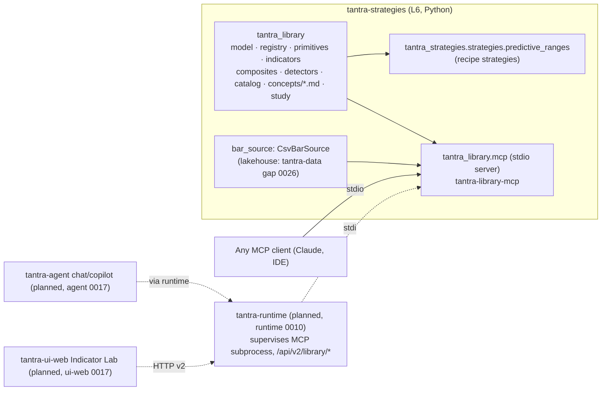

# 0016 — Concept & Indicator Library for AI Agents, MCP and Experimental Analysis (Track T22)

**Status**: **Library + MCP server implemented 2026-11-20 in `tantra-strategies`** (T22.1–T22.5);
runtime + agent wiring **implemented 2026-11-20** (T22.6 runtime `/api/v2/studies/*` + supervised
`LibraryMcpClient`; T22.7 agent `IndicatorLibraryPort` + `tantra_library_*` MCP proxy + library-backed
`IndicatorCatalog`); T22.8 ui-web: client + generic `OverlayScenePrimitive` done, Indicator Lab tab UI remains.

**Decision (2026-11-20)**: the whole library lives in **`tantra-strategies`** as the new Python
package **`tantra_library`** (next to `tantra_strategies`), not across the Rust repos. The project
is **non-commercial research**, so LuxAlgo / Skyrexio / BigBeluga ideas are used as clean-room
reimplementations with provenance + attribution in every entry. Rust/TS layers reach the library
only through its **stdio MCP server** (a process boundary — no upward compile-time edge from L3/L5
into L6).

**Research basis**: LuxAlgo *Predictive Ranges* study (2026-11-20) — indicator math, the two video
strategies (trend pullback + Reversal Bars; breakout + VIDYA), and LuxAlgo's
**Library → Family → Concept → Implementation** model.

| Repo | Document | Role |
|---|---|---|
| `tantra-strategies` | `docs/plans/0005-predictive-range-strategies.md` | **Implemented** library, recipes, MCP server |
| `tantra-strategies` | `docs/gaps/0008-recipe-exits-at-bar-close.md` | Recipe exits fill at bar close, not stop/target price |
| `tantra-data` | `docs/gaps/0026-strategies-lakehouse-bar-source.md` | Lakehouse v3 `BarSource` for `tantra_library` (CSV stand-in today) |
| `tantra-runtime` | `docs/plans/0010-library-rest-and-signal-study.md` | Wiring plan: supervise MCP subprocess, `/api/v2/library/*` proxy |
| `tantra-agent` | `docs/plans/0017-library-port-and-mcp-tools.md` | Wiring plan: chat/copilot reach the library MCP tools |
| `tantra-ui-web` | `docs/plans/0017-indicator-lab-study-tab.md` | Wiring plan: Indicator Lab tab in Experimental-Analysis |
| `tantra-market` | `docs/plans/0005-concept-indicator-library.md` | **Deferred**: optional Rust port of hot indicators if Python is too slow |

---

## 0. Executive Summary

One typed, self-describing registry an agent can browse, read and compute with:

1. **Explanatory** — LuxAlgo-style concept pages (What / Formula / Use / Compared with / Pitfalls /
   FAQ) as Markdown, composed into an LLM-ready page by `Registry.describe_markdown(id)`.
2. **Computable** — every non-concept entry is a streaming, `Decimal`-exact computation buildable
   by `id + params`; `Registry.evaluate(...) -> Frame`.
3. **Compositional** — entries declare `depends_on`; the registry validates references and
   acyclicity at build time.
4. **Studiable** — `signal_study(...)` turns any detector column into forward-return / hit-rate /
   MFE-MAE / by-year statistics (the Experimental-Analysis "Signal Study").
5. **Reachable** — `tantra-library-mcp` (stdio JSON-RPC, zero third-party deps) exposes
   `tantra_library_search`, `tantra_library_describe`, `tantra_indicator_compute`,
   `tantra_signal_study` to any MCP client today.

## 1. Entry Model

`Entry(id, kind, title, summary, family, concepts, depends_on, params, outputs, inputs,
volume_quality, determinism, aliases, related, provenance, body_md, factory)` —
`tantra_library/model.py`. Kinds: `family`, `concept`, `primitive`, `indicator`, `composite`,
`detector`, `recipe`. Params are typed (`int`/`decimal`/`enum`/`bool`) with bounds; floats are
rejected at the boundary (`ParamSpec.coerce`). `volume_quality: real` entries refuse tick-volume
sources (`InputQualityError`).

## 2. Catalog (44 entries, `tantra_library/catalog.py`)

| Layer | Entries |
|---|---|
| Families (6) | volatility, trend, momentum, volume, support-resistance, price-action |
| Concepts (12, `tantra_library/concepts/*.md`) | atr, volatility-range, adaptive-ma, momentum-oscillator, volume-delta, reversal-bar, alligator, support-resistance, swing-structure, trend-pullback, breakout, r-multiple |
| Primitives (8) | true-range, rma, sma, highest, lowest, swing-pivot, up-down-volume, linreg |
| Indicators (7) | atr, atr-bands, cmo, vidya, volume-delta-pct, alligator, awesome-oscillator |
| Composites (3) | **predictive-ranges** (on atr), **vidya-trend** (vidya + atr + volume delta), **reversal-bars** (alligator + AO + highest/lowest) |
| Detectors (6) | pr-center-step, pr-trend-regime, pr-zone-touch, pr-zone-close-break, reversal-bar, vidya-trend-flip |
| Recipes (2, not computable) | pr-trend-pullback → `PrTrendPullbackStrategy`; pr-vidya-breakout → `PrVidyaBreakoutStrategy` |

Predictive Ranges (clean-room of the Pine original): `a = ATR(length)·factor`; center steps by
exactly `±a` (at most once per bar) when `|src − center| > a`; `hold = a/2` frozen at each step;
bands `center ± hold`, `center ± 2·hold`. Zone/break detectors compare against the **previous
bar's** levels, because a breakout re-centers the range on the same bar.

Reversal Bars and VIDYA-trend rules are reconstructed from the authors' published descriptions
(every rule is a parameter; the MFI "squat" filter is not implemented) — see entry provenance.

## 3. Architecture



- The runtime treats the library as an **external MCP server process** (same pattern as any
  third-party MCP server), so no Rust crate imports Python and the tier DAG is preserved.
- Relationship to the Rust catalogs: `render::CATALOG`, `tantra-agent-core::IndicatorCatalog` and
  `tantra-market-signals::DETECTORS` stay as they are for now; unifying them is out of scope until
  the wiring lands (agent plan 0017 proposes surfacing the library alongside the existing catalog).

## 4. Invariants (enforced in code + tests)

- Zero floats: `Decimal` everywhere; JSON parsed with `parse_float=Decimal`; float params rejected.
- Closed-bar determinism; no look-ahead (pinned pre-bar levels in detectors and the study).
- Bounded work: ≤ 200 000 bars per evaluate, ≤ 5 000 inline bars per MCP call, ≤ 10 horizons,
  ≤ 2 000 returned rows, ≤ 8 MiB per JSON-RPC line; CSV reads confined to `TANTRA_LIBRARY_DATA_ROOT`.
- Untrusted AI: MCP inputs validated against entry manifests (`additionalProperties: false`,
  bounds, enums); the library never places orders — recipes trade only via `Strategy` →
  `RiskEngine` like every other strategy.

## 5. Phases

| Phase | Track | Repo | Deliverable | Status |
|---|---|---|---|---|
| P1 | T22.1 | strategies | model, registry, primitives, base indicators | ✅ `cb7efbb` |
| P2 | T22.2 | strategies | composites + detectors | ✅ `24c8aa3` |
| P3 | T22.3 | strategies | catalog (44 entries) + 12 concept pages | ✅ `86c6b63` |
| P4 | T22.4 | strategies | signal study + recipe strategies | ✅ `2487490` |
| P5 | T22.5 | strategies | stdio MCP server + CSV bar source | ✅ `4eef653` |
| P6 | T22.6 | runtime | MCP subprocess supervisor + `/api/v2/studies/library/*` proxy | Implemented 2026-11-20 (runtime 0010: `7e33319`, `d17dea8`) |
| P7 | T22.7 | agent | chat/copilot tool exposure via runtime | Implemented 2026-11-20 (agent 0017: `429c097`, `9984310`) |
| P8 | T22.8 | ui-web | Indicator Lab study tab | Partial 2026-11-20 — library client + `OverlayScenePrimitive` (`c0e6575`); tab UI remains (ui-web 0017) |
| — | — | data / strategies | lakehouse bar source; stop-price exits | Gaps data 0026, strategies 0008 |
| — | — | market | Rust port of hot paths | Deferred (market 0005) |

## 6. Running it

```bash
cd tantra-strategies
TANTRA_LIBRARY_DATA_ROOT=/path/to/csv/bars .venv/bin/tantra-library-mcp   # or: python -m tantra_library.mcp
```
Register as a stdio MCP server in any client (command `tantra-library-mcp`).

## 7. Open Questions

1. Confirm Reversal Bars / VIDYA-trend rules against the authors' open-source scripts and adjust
   defaults if they differ (all rules are parameters, so no API change).
2. Whether the runtime should also expose the library to the existing `tantra-agent-mcp` server
   (one tool namespace) or keep it a separate MCP server — decided in agent plan 0017.
3. Existing T20 Experimental-Analysis routes are mounted under `/api/v1` while plans say `/api/v2`;
   reconciliation tracked in runtime plan 0010.
