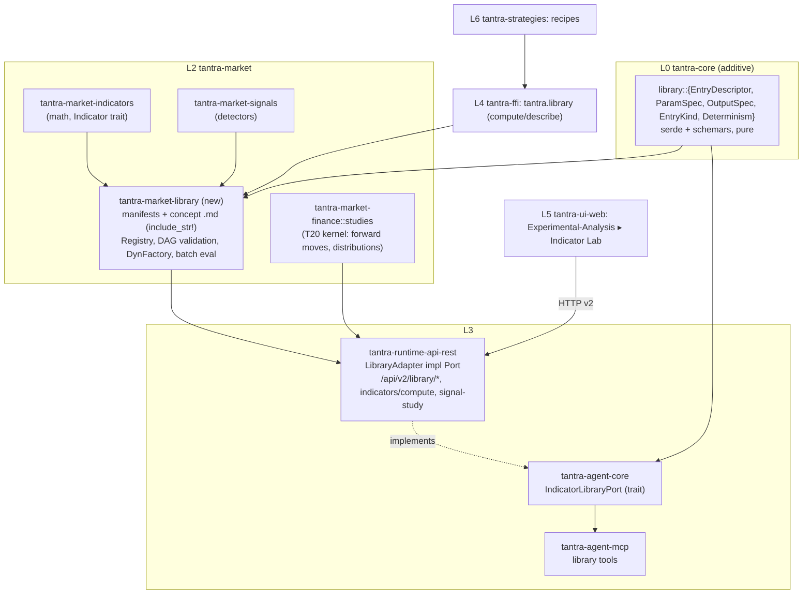

# 0016 — Concept & Indicator Library for AI Agents, MCP and Experimental Analysis (Track T22)

**Status**: Proposed (2026-11-20) — design only, no implementation. Track **T22** (`T22.1–T22.6`).

**Research basis**: LuxAlgo *Predictive Ranges* study (2026-11-20 session) — the indicator, the two
video strategies (trend pullback + Reversal Bars, breakout + VIDYA), and LuxAlgo's
**Library → Family → Concept → Implementation** model (`luxalgo.com/library/concept/*`).

**Per-repo plans** (details live there; this document owns the cross-repo contract):

| Repo | Plan | Scope |
|---|---|---|
| `tantra-market` | `docs/plans/0005-concept-indicator-library.md` | `tantra-market-library` crate, primitive/composite DAG, Decimal migration, detectors |
| `tantra-agent` | `docs/plans/0017-library-port-and-mcp-tools.md` | `IndicatorLibraryPort`, MCP tools, retire `IndicatorCatalog` |
| `tantra-runtime` | `docs/plans/0010-library-rest-and-signal-study.md` | Port adapter, `/api/v2/library/*`, `indicators/compute`, `signal-study` |
| `tantra-ui-web` | `docs/plans/0017-indicator-lab-study-tab.md` | "Indicator Lab" study tab in Experimental-Analysis |
| `tantra-strategies` | `docs/plans/0004-predictive-range-strategies.md` | Strategy recipes on top of the library (via `tantra-ffi`) |

---

## 0. Executive Summary & Objective

Today the workspace has **three disconnected indicator catalogs** and no way for an agent to ask
"what is this concept, which indicators implement it, compute it on NIFTY 5m, and tell me what
happened after its signals":

| Catalog | Location | Entries | Problem |
|---|---|---|---|
| `render::CATALOG` | `tantra-market-indicators/src/render.rs` | 8 names + render contract | Names only, no params/semantics |
| `IndicatorCatalog` | `tantra-agent-core/src/indicators.rs` | 11 hand-written `IndicatorSpec`s | Duplicates market truth; drifts; can't compute |
| `DETECTORS` | `tantra-market-signals/src/catalog.rs` | 8 detector specs | Signals not linked to the indicators they use |

T22 builds **one Concept & Indicator Library** — a typed, versioned, self-describing registry that is:

1. **Explanatory** (LuxAlgo "concept" pages): what an idea is, its formula, how traders use it, how it
   differs from neighbours, pitfalls — as Markdown that an LLM can read verbatim ("copy for LLM").
2. **Computable**: every implementation entry is backed by a Rust `Indicator`, buildable by id+params
   and evaluable over bars in the Strategy Tester, Experimental Analysis, MCP and Python.
3. **Compositional**: complex indicators/detectors/strategies declare `depends_on` edges to simpler
   ones, forming an acyclic graph (primitive → indicator → composite → detector → strategy).
4. **Studiable**: any detector's events can be fed into the existing Experimental-Analysis kernel
   (T20 conditional forward moves, distributions) → "what happened N bars after a Predictive-Range
   support touch on NIFTY 5m, 2019–2026?".

## 1. Entry Model (Family → Concept → Implementation → Composite → Detector → Recipe)

Every library entry is one **manifest** (front-matter + Markdown body) with a stable `id`.

| Kind | Meaning | Computable | Example |
|---|---|---|---|
| `family` | Grouping for navigation | no | `volatility`, `trend`, `momentum`, `volume`, `support-resistance`, `price-action`, `india-microstructure` |
| `concept` | The idea, implementation-agnostic | no | `concept.atr`, `concept.adaptive-ma`, `concept.volatility-range`, `concept.volume-delta`, `concept.reversal-bar` |
| `primitive` | Building-block series op | yes | `prim.true-range`, `prim.rma`, `prim.highest`, `prim.swing-pivot` |
| `indicator` | A concrete, parameterised computation | yes | `ind.atr`, `ind.vidya`, `ind.cmo` |
| `composite` | Indicator built on other indicators + state | yes | `ind.predictive-ranges`, `ind.vidya-trend` |
| `detector` | Emits discrete events (`Signal`) from series | yes | `det.pr-support-touch`, `det.pr-range-break`, `det.reversal-bar` |
| `recipe` | Strategy blueprint: filters + trigger + stop + target | via `tantra-strategies` | `recipe.pr-trend-pullback`, `recipe.pr-vidya-breakout` |

### 1.1 Manifest fields (wire contract — see §3 for where the type lives)

```text
id               "ind.predictive-ranges"          (stable, kebab, kind-prefixed)
kind             composite
version          1                                 (bumped on any output-changing math change)
family           volatility
concepts         [concept.volatility-range, concept.atr, concept.support-resistance]
aliases          ["PR", "ATR step ranges"]
depends_on       [ind.atr]                         (DAG edge; validated acyclic at build)
inputs           ohlc | ohlcv | ohlcv+oi           (volume_quality: real | tick | none — gates use)
params           [{name: length, type: int, default: 200, min: 2, max: 5000},
                  {name: factor, type: decimal, default: "6", min: "0.1", max: "50", step: "0.1"},
                  {name: source, type: enum[close,hl2,hlc3,ohlc4], default: close},
                  {name: timeframe, type: timeframe?, default: chart}]
outputs          [{name: r2, unit: price}, {name: r1, unit: price}, {name: center, unit: price},
                  {name: s1, unit: price}, {name: s2, unit: price},
                  {name: center_step, unit: state, values: [-1, 0, 1]}]
warmup_bars      "length"                          (expression over params)
determinism      closed-bar-stable | repaints-live | htf-repaints-until-htf-close
numeric          decimal | f64-legacy              (f64-legacy = migration debt, §4.3)
render           pane: price, plots/zones          (subsumes render::Presentation)
provenance       {origin: "LuxAlgo (open-source, 2023)", license_note, clean_room: true}
related          [ind.keltner-channels, ind.supertrend, ind.predictive-channels]
body             Markdown: What it is · Formula · How it's used · vs neighbours · Pitfalls · FAQ
```

Rules:
- **Concept prose is our own.** LuxAlgo/TradingView text is research input only; never copied. LuxAlgo
  open-source scripts carry non-commercial share-alike terms, so implementations are **clean-room**
  from the published math, with `provenance` recording origin. Licence review is a T22.1 exit gate.
- `depends_on` is the *only* way a composite reuses another entry; the factory composes by id, so
  `ind.predictive-ranges` holds an `ind.atr` instance rather than re-implementing TR/RMA.
- `version` + `params` + data commit (lakehouse v3 ref) fully determine an output → reproducible studies.

## 2. Initial Content — refactored from the research list

Layered so each row only builds on rows above it. **Have** = exists in
`tantra-market-indicators`/`-signals` today (to be wrapped, not rewritten).

### 2.1 Primitives (L-a)

| id | Builds on | Status |
|---|---|---|
| `prim.true-range` | — | inside `Atr` today → extract |
| `prim.rma` (Wilder) / `prim.sma` / `prim.ema` | — | **Have** (`rma.rs`, `sma.rs`, `ema.rs`) |
| `prim.highest` / `prim.lowest` (rolling) | — | inside `donchian.rs` → extract |
| `prim.median-price` (hl2), `prim.typical-price` | — | new (trivial) |
| `prim.swing-pivot` (fractal high/low, N-left/right) | — | **Have** as `FractalPivot` detector → expose as series |
| `prim.up-down-volume` (signed volume by bar direction) | — | new |
| `prim.linreg` (slope/intercept over N) | — | new (for Predictive Channels) |

### 2.2 Indicators (L-b)

| id | Builds on | Status |
|---|---|---|
| `ind.atr` | true-range, rma | **Have** (`atr.rs`, **f64** → migrate to Decimal) |
| `ind.atr-bands` | atr, source | new (thin) |
| `ind.cmo` (Chande Momentum Oscillator) | — | **Have** (`cmo.rs`) |
| `ind.vidya` (Chande VIDYA: EMA with α·\|CMO\|) | ema-style α, cmo | new |
| `ind.volume-delta-pct` (Σup−Σdown)/Σtotal over window | up-down-volume | new — requires `volume_quality: real` |
| `ind.alligator` (Williams: SMMA of hl2, shifted) | rma, median-price | new (needed by Reversal Bars) |
| existing ~40 (`adx`, `supertrend`, `keltner`, `donchian`, `vwap`, `cpr`, `elephant_zones`, `order_block`, …) | — | **Have** → wrap with manifests in T22.2 |

### 2.3 Composites (L-c)

| id | Builds on | Logic summary |
|---|---|---|
| `ind.predictive-ranges` | `ind.atr` | `a = ATR(len)·factor`; center steps ±a when `|src−center| > a`; `hold = a/2` frozen at each step; outputs `center ± hold`, `center ± 2·hold`, `center_step ∈ {−1,0,1}`. HTF variant reads **closed** HTF bars only. |
| `ind.vidya-trend` (BigBeluga-style) | `ind.vidya`, `ind.atr`, `ind.volume-delta-pct` | VIDYA ± k·ATR bands; trend flips when close crosses the opposite band; per-trend volume delta. |
| `ind.reversal-bars` (Skyrexio-style, Bill Williams) | `ind.alligator`, `prim.highest/lowest` | Bullish bar = new N-bar low, close in upper half, below Alligator (mirror for bearish). Exact rules confirmed in T22.3 before coding. |
| `ind.predictive-channels` (later) | `prim.linreg`, `ind.atr` | Sloped channel variant — listed so the concept page can contrast it. |

### 2.4 Detectors (L-d) — emit `tantra-market-signals::Signal`

| id | Builds on | Event |
|---|---|---|
| `det.pr-center-step` | predictive-ranges | center stepped up/down (new range; also the "breakout" event) |
| `det.pr-trend-regime` | predictive-ranges | last K steps all up / all down / mixed |
| `det.pr-zone-touch` | predictive-ranges | bar low ≤ S1 (support zone) / high ≥ R1 (resistance zone) |
| `det.pr-zone-close-break` | predictive-ranges | close beyond R1/S1 *without* a center step |
| `det.reversal-bar` | reversal-bars | bullish/bearish reversal bar |
| `det.vidya-trend-flip` | vidya-trend | trend cloud flips |
| existing `Candlestick`, `BreakOfStructure`, `FractalPivot`, `RsiTurn`, `MacdCross`, `CprBreakout`, `VwapCross`, `OrbBreakout` | — | **Have** → manifests + `depends_on` |

### 2.5 Recipes (L-e) — strategy blueprints, implemented in `tantra-strategies`

| id | Filter | Trigger | Stop | Target |
|---|---|---|---|---|
| `recipe.pr-trend-pullback` | `det.pr-trend-regime` = up (K≥2 steps) | `det.pr-zone-touch`(support) **and** `det.reversal-bar`(bull) in zone | below S2 (or zone low − buffer·ATR) | R1 / center-to-R1 ladder |
| `recipe.pr-vidya-breakout` | `ind.vidya-trend` = up **and** `volume-delta-pct ≥ +30%` | close > R1 of **the range active before the bar** (pinned, see §5) | last swing low (`prim.swing-pivot`) or below R1 | 1.5R |

Mirrors for shorts. Recipes are declarative manifests (filters/trigger/stop/target as library ids +
params) so the agent can explain and vary them; execution logic stays in Python strategies and goes
through `RiskEngine` like any other strategy.

### 2.6 Concept pages to author (first batch)

`concept.atr`, `concept.volatility-range` (ATR bands / Keltner / Predictive Ranges / Supertrend compared),
`concept.adaptive-ma` (VIDYA, KAMA, Hull compared), `concept.volume-delta`, `concept.reversal-bar`,
`concept.support-resistance`, `concept.swing-structure`, `concept.trend-pullback`, `concept.breakout`,
`concept.r-multiple`. Each: What · Formula · How it's used · vs neighbours · Pitfalls (repaint, HTF,
volume quality) · FAQ · implementations (auto-listed from manifests) · related concepts.

## 3. Architecture & Tier Placement



Key decisions:

1. **Descriptor types in `tantra-core::library` (additive, pure).** Needed because both
   `tantra-market-library` (producer) and `tantra-agent-core` (consumer port) must share one
   schemars-derived DTO, and R1 forbids `tantra-agent-*` → `tantra-market-*`. This is the only
   `tantra-core` touch and is additive (new module, no changes to existing types).
   *Alternative considered*: JSON-only contract with agent-local structs — rejected (two diverging
   DTOs, violates single-source-of-truth).
2. **New crate `tantra-market-library`** rather than growing `tantra-market-indicators`: keeps math
   crates WASM-pure and free of Markdown/registry concerns; the library crate depends on
   indicators + signals and is re-exported by the `tantra-market` facade.
3. **Object-safe evaluation surface.** `Indicator` has a GAT `Input<'a>` and is not object-safe. The
   library adds `trait DynIndicator { fn update_bar(&mut self, bar: &Bar) -> Option<OutputRow>; fn reset(&mut self); }`
   adapters, and a batch `evaluate(entry_id, params, bars) -> Result<IndicatorFrame, LibraryError>`.
   `IndicatorFrame` = named columns (Decimal / state / event) aligned to bar timestamps → maps to
   Arrow `Decimal128(38,8)` for FFI. This **is** T21's Layer-3 `eval_indicators` (root plan 0015) —
   T21.3+ consumes it instead of building a second evaluator.
4. **Agent access through a port.** `tantra-agent-core::IndicatorLibraryPort` (list/search/describe/
   compute/study); implemented in `tantra-runtime` composition root (per R4: market-needing MCP
   wiring belongs in runtime). `tantra-agent-core::IndicatorCatalog` becomes a thin view over the
   port, then is deleted.
5. **One render contract.** `render::Presentation` moves into the manifest `render` block;
   `render::CATALOG` becomes "entries with a render block".

## 4. Cross-Cutting Invariants

### 4.1 Determinism & no-lookahead
- Every computable entry declares `determinism`. Studies and backtests use **closed bars only**;
  HTF inputs (e.g. Predictive Ranges `timeframe`) resolve to the last *closed* HTF bar.
- Golden-vector tests per entry (`tests/golden/<id>.json`): fixed bars → exact Decimal outputs.
  Predictive Ranges goldens cross-checked once against TradingView output for a public symbol.

### 4.2 Data-quality gating
- `inputs.volume_quality: real` entries (`volume-delta-pct`, VIDYA-trend's delta) refuse or flag
  tick-volume instruments (spot FX/gold) with a typed `LibraryError::InputQuality` — never silent.

### 4.3 Zero-floats
- New entries are Decimal-native. `ind.atr` is currently `f64` internally and feeds price-denominated
  levels (Predictive Ranges bands) → **must migrate before `ind.predictive-ranges` ships**. Other
  `f64` indicators are tagged `numeric: f64-legacy` and filed as a gap in `tantra-market`
  (`docs/gaps/0009-f64-indicator-internals.md`), migrated incrementally.

### 4.4 Untrusted AI
- Agent-supplied `{id, params}` are validated against the manifest (`deny_unknown_fields`, bounds,
  enum values, max bars/window, max DAG depth) before any compute. Agent recipe *variations* are
  research artefacts only; trading goes through strategies → `RiskEngine` unconditionally.

### 4.5 Bounded resources
- `indicators/compute` and `signal-study` cap instruments × bars × entries per request; large results
  returned as a handle readable via the existing `tantra_read_result` MCP tool.

## 5. Experimental-Analysis Integration ("Signal Study")

New study type next to T20's returns/intraday/events: **Signal Study**.

```text
input : universe (instrument ids) · timeframe · date range · data commit
        detector id + params (e.g. det.pr-zone-touch{side: support}, filtered by det.pr-trend-regime=up)
        horizons [1, 3, 5, 10, 20 bars] · optional cost model (T20 SpreadCostModel)
output: event count, hit-rate & mean/median forward return per horizon (Decimal),
        MFE/MAE distribution, R-multiple distribution if recipe stop/target given,
        by-year / by-regime breakdown, event list (handle)
```

Reuses `tantra-market-finance::studies` conditional-forward-move and distribution code; only the
event source is new. Pitfall handled explicitly: for breakout studies the trigger level is **pinned
to the range active before the bar**, because a close beyond R2 re-centers the indicator on that
same bar.

## 6. Phases

| Phase | Track | Repos | Deliverable | Exit gate |
|---|---|---|---|---|
| P0 | T22.0 | root | This design + per-repo plans | Reviewed |
| P1 | T22.1 | core, market | `tantra-core::library` DTOs; `tantra-market-library` skeleton, manifest loader, DAG validation, `DynIndicator`, `evaluate`; ATR Decimal migration; manifests for ~10 existing indicators; licence review | Goldens green; `wasm32` check for indicators |
| P2 | T22.2 | market | New primitives + `vidya`, `volume-delta-pct`, `alligator`, `predictive-ranges`, `vidya-trend`, `reversal-bars`; detectors §2.4; first concept pages; wrap remaining indicators | Goldens + proptests (center steps only on threshold, hold frozen between steps) |
| P3 | T22.3 | runtime, agent | Port + adapter; `/api/v2/library/*`, `POST /api/v2/indicators/compute`; MCP `tantra_library_search/describe/compute`; retire `get_indicator_catalog` (alias for one release) | Contract tests; dependency_rules R1–R4 green |
| P4 | T22.4 | runtime, market-finance, agent | `POST /api/v2/experimental-analysis/signal-study`; MCP `tantra_signal_study` | Study on NIFTY 5m reproduces across runs (pinned commit) |
| P5 | T22.5 | ui-web | Indicator Lab tab: library browser, concept page, overlay chart, signal-study panel | tsc/lint/vitest/build |
| P6 | T22.6 | ffi, strategies | `tantra.library` Python surface; `recipe.pr-trend-pullback`, `recipe.pr-vidya-breakout` strategies + Strategy Tester runs | Research-live parity test (Rust vs Python frames identical) |

## 7. Open Questions

1. Exact Reversal Bars (Skyrexio) and VIDYA-trend (BigBeluga) rules — confirm from their open-source
   scripts before P2 coding; manifests carry `provenance` either way.
2. Should recipes live as manifests in `tantra-market-library` (agent-discoverable) with execution in
   `tantra-strategies`, or only in `tantra-strategies/manifests/`? Proposed: manifest in library,
   code in strategies, linked by id.
3. Existing REST code mounts experimental-analysis under `/api/v1` while plans say `/api/v2`. T22
   routes go to `/api/v2`; reconciling the T20 routes is tracked in `tantra-runtime` plan 0010.
4. Licence: confirm clean-room reimplementation + attribution is acceptable for commercial use of
   LuxAlgo-derived ideas (math is not copyrightable; code/prose are).
