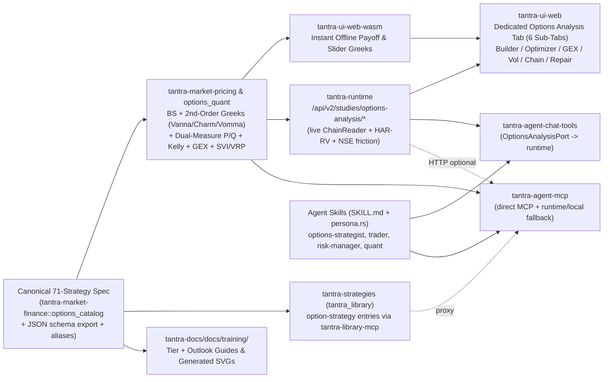

# 0017 — Options Strategy Training (`docs/training`), Dedicated `Options Analysis` Web-UI Tab & AI Quant Options Suite (Track T23)

**Status**: Proposed Design Document (2026-11-20) — Track **T23** (`T23.1–T23.6`) · Companion: [Plan 0018 — Quantsapp Tool Audit, Canonical Data Models & AI-Agent Options Research Dossier](0018-quantsapp-tool-models-and-ai-analysis-page.md)

**Architecture Rule**: **Zero edits to `tantra-core`**. Reuses existing `tantra_core::{Exchange, InstrumentId, InstrumentKind, Money, OptionType, Price, Quantity}` and `tantra_market_pricing::{BlackScholesModel, PriceParams, Greeks}`. Zero floats in financial contracts/storage; `f64` stays strictly isolated inside `tantra-market-pricing` / `options_quant` numerical internals and browser SVG/canvas pixel projection. Zero fabricated quotes when `ChainReader` is unconfigured.

---

## 0. Executive Summary & Objective

Incorporate a complete **71-strategy Options Taxonomy** — unifying **OptionStrat's 58 skill-tiered strategies** (`Novice`, `Intermediate`, `Advanced`, `Expert`) with **Quantsapp's Indian F&O outlook-grouped extensions** (`#bullish`, `#bearish`, `#neutral`, `#volatile`, `#arbitrage` — adding 13 NSE-native structures plus canonical aliases) — together with an institutional **AI-Driven Quantitative Options Analysis Suite** across three synchronized surfaces:

1. **Interactive Training Curriculum (`tantra-docs/docs/training/`)**:
   - Dual-index navigation: browse by **Skill Tier** (`Novice`, `Intermediate`, `Advanced`, `Expert`) **or** by **Market View** (`Bullish`, `Bearish`, `Neutral`, `Volatile`, `Arbitrage`, matching Quantsapp's `/learn/option-strategies#<outlook>` anchors).
   - Standardized strategy cards featuring **Outlook / Profit / Risk / Net Flow / Greek Bias tags**, leg construction recipes, deterministic **build-time generated SVG payoff graphs**, **"How the Greeks affect it"**, **"When to use"**, **"Things to watch"**, Indian F&O (NIFTY / BANKNIFTY Tuesday expiry, lot size, strike intervals, statutory cost) worked examples, NSE backtest cross-links, and one-click **"Open in Options Analysis"** deep links.
2. **Dedicated `Options Analysis` Web-UI Tab (`tantra-ui-web` + `tantra-market` + `tantra-runtime`)**:
   - First-class **`options-analysis`** workspace tab (`?open=options-analysis&tab=builder|optimizer|positioning|vol-surface|chain|repair|dossier&symbol=...&strategy=...`, with `?open=strategy-builder` alias) structured around **6 integrated workbench sub-tabs + the AI Research Dossier view (`tab=dossier`, detailed in [Plan 0018](0018-quantsapp-tool-models-and-ai-analysis-page.md))**:
     1. **Strategy Builder** — OptionStrat + Quantsapp dual-mode 71-strategy picker (mini payoff SVGs + tags), 8-leg multi-expiry workbench, WASM-accelerated `T+N` Black-Scholes payoff & 1st/2nd-order Greeks, Indian margin/statutory friction, `OverlayScene` chart push, and Paper Ticket / `TradePlan` export.
     2. **AI Spread Optimizer (+EV & Fractional Kelly)** — Dual-measure ($\mathbb{P}$ real-world vs $\mathbb{Q}$ risk-neutral) spread scanner ranking liquid strike/expiry combinations across all 71 templates by **Expected Value (`+EV`)**, **Continuous Fractional Kelly (`f*`)**, **Return Skewness**, **95% CVaR**, **Sortino**, and **`PoP` / `PoP50`**, plus AI technical/regime setup synthesis.
     3. **Dealer Positioning (GEX, Vanna, Charm & Trap)** — Strike-wise Gamma Exposure (`GEX`), Delta (`DEX`), Vanna (`VEX`), Charm (`CHEX`), Zero-Gamma / Gamma Flip level, Call/Put OI walls, Max Pain, intraday OI buildup (`Long`/`Short`/`Short Covering`/`Long Unwinding`), FII/DII flow overlay, and **Option Writer Trap Indicator** pushable to `ChartCanvas`.
     4. **Vol Surface, Skew & VRP Lab** — $25\Delta$ Risk Reversal & Butterfly wing skew, Term Structure (Contango/Backwardation, Partial Vega, event-variance isolation), SVI/SABR fair-smile rich/cheap strike heatmap, and **Variance Risk Premium (`VRP = IV − E[RV]`)**.
     5. **Live Option Chain & Multi-Strike OI** — Indian Tuesday-expiry / multi-asset live chain with Bid/Ask/LTP/IV/1st+2nd-order Greeks/OI/ΔOI, liquidity spread badges, and 1-click leg injection into Strategy Builder.
     6. **Position Repair & Dual-Measure Monte Carlo** — Outer $\mathbb{P}$ (jump-GARCH/Heston fat tails) + inner $\mathbb{Q}$ repricing for calendars/early exits, Spot × IV × DTE stress matrix, and **AI Strategy Repair** proposing rolling / Broken Wing / Condor / Jade Lizard adjustments.
3. **AI Agent Skills, Direct Tools & MCP Exposure (`tantra-agent` + `tantra-strategies`)**:
   - Dedicated **`options-strategist`** `SKILL.md` (and updated `trader`, `risk-manager`, `quant`, `tantra-ai` personas) encoding dual-measure `+EV`, VRP, GEX/Vanna/Charm, Continuous Kelly sizing, and Strategy Repair workflows across all 71 strategies.
   - Seven `ToolRisk::ReadOnly` tools (`option_strategy_catalog`, `option_strategy_build`, `option_strategy_compare`, `option_spread_optimize`, `option_dealer_positioning`, `option_strategy_repair`, plus `prepare_options_analysis_page` in [Plan 0018](0018-quantsapp-tool-models-and-ai-analysis-page.md)) exposed **both** directly to chat/copilot agents (`tantra-agent-chat-tools` via `OptionsAnalysisPort`) **and** over MCP (`tantra-agent-mcp`), plus `tantra_library` / `tantra-library-mcp` registration (`kind = "option-strategy"`) and `TantraResultEnvelope` deep-links + `OverlayScene` visual push.

---

## 1. Canonical 71-Strategy Taxonomy, Tags & Aliases

Every strategy has a stable slug ID (`<slug>`), skill tier, category, normalized tag set, canonical relative leg specification, and alias list (resolving OptionStrat vs. Quantsapp naming differences without duplicate entries).

### Tag Schema
- **Outlook**: `Bullish` | `Bearish` | `Neutral` | `Directional (Volatile)` | `Arbitrage`
- **Profit**: `Limited` | `Unlimited` | `Substantial` *(capped only by underlying falling to `0`)*
- **Risk**: `Limited` | `Unlimited` | `Substantial` *(underlying falling to `0`, e.g., Covered Call / Cash-Secured Put)*
- **Cashflow**: `Debit` | `Credit` | `Either` *(zero-cost / ratio-dependent)*
- **Term**: `Single-Expiry` | `Multi-Expiry` *(Calendar / Diagonal / Double Calendar / Double Diagonal / Reverse Calendar)*

### 1.1 Novice (6 Strategies: 5 OptionStrat + 1 Quantsapp)

| ID | Strategy | Category | Outlook | Profit | Risk | Cashflow | Canonical Legs (Relative) | Source |
|---|---|---|---|---|---|---|---|---|
| `long_call` | Long Call | Basic | Bullish | Unlimited | Limited | Debit | `+1 ATM Call` | Both |
| `long_put` | Long Put | Basic | Bearish | Substantial | Limited | Debit | `+1 ATM Put` | Both |
| `covered_call` | Covered Call | Income | Bullish | Limited | Substantial | Credit *(overlay)* | `+100 Underlying (or +1 Fut), -1 OTM Call` | Both |
| `cash_secured_put` | Cash-Secured Put | Income | Bullish | Limited | Substantial | Credit | `-1 OTM Put (+ cash collateral)` | OptionStrat |
| `protective_put` | Protective Put | Other | Bullish | Unlimited | Limited | Debit *(overlay)* | `+100 Underlying (or +1 Fut), +1 OTM Put` | Both |
| `protective_call` | Protective Call | Other | Bearish | Substantial | Limited | Debit *(overlay)* | `-100 Underlying (or -1 Fut), +1 OTM Call` | Quantsapp |

### 1.2 Intermediate (22 Strategies: 19 OptionStrat + 3 Quantsapp)

| ID | Strategy | Category | Outlook | Profit | Risk | Cashflow | Canonical Legs (Relative) | Source |
|---|---|---|---|---|---|---|---|---|
| `bull_put_spread` | Bull Put Spread | Credit Spreads | Bullish | Limited | Limited | Credit | `-1 Higher Put, +1 Lower Put` | Both |
| `bear_call_spread` | Bear Call Spread | Credit Spreads | Bearish | Limited | Limited | Credit | `-1 Lower Call, +1 Higher Call` | Both |
| `iron_butterfly` | Iron Butterfly *(Short Iron Butterfly)* | Neutral | Neutral | Limited | Limited | Credit | `+1 Lower Put, -1 ATM Put, -1 ATM Call, +1 Higher Call` | Both |
| `iron_condor` | Iron Condor *(Short Iron Condor)* | Neutral | Neutral | Limited | Limited | Credit | `+1 K1 Put, -1 K2 Put, -1 K3 Call, +1 K4 Call` (`K1<K2<K3<K4`) | Both |
| `long_put_butterfly` | Long Put Butterfly | Neutral | Neutral | Limited | Limited | Debit | `+1 K3 Put, -2 K2 Put, +1 K1 Put` (`K1<K2<K3`) | Both |
| `long_call_butterfly` | Long Call Butterfly | Neutral | Neutral | Limited | Limited | Debit | `+1 K1 Call, -2 K2 Call, +1 K3 Call` (`K1<K2<K3`) | Both |
| `calendar_call_spread` | Calendar Call Spread | Calendar Spreads | Neutral | Limited | Limited | Debit | `-1 Near ATM Call, +1 Far ATM Call` *(Multi-Expiry)* | Both |
| `calendar_put_spread` | Calendar Put Spread | Calendar Spreads | Neutral | Limited | Limited | Debit | `-1 Near ATM Put, +1 Far ATM Put` *(Multi-Expiry)* | Both |
| `diagonal_call_spread` | Diagonal Call Spread | Calendar Spreads | Bullish | Limited | Limited | Debit | `-1 Near OTM Call, +1 Far ITM/ATM Call` *(Multi-Expiry)* | Both |
| `diagonal_put_spread` | Diagonal Put Spread | Calendar Spreads | Bearish | Limited | Limited | Debit | `-1 Near OTM Put, +1 Far ITM/ATM Put` *(Multi-Expiry)* | Both |
| `bull_call_spread` | Bull Call Spread | Debit Spreads | Bullish | Limited | Limited | Debit | `+1 Lower Call, -1 Higher Call` | Both |
| `bear_put_spread` | Bear Put Spread | Debit Spreads | Bearish | Limited | Limited | Debit | `+1 Higher Put, -1 Lower Put` | Both |
| `inverse_iron_butterfly` | Inverse Iron Butterfly *(Long Iron Butterfly)* | Directional | Directional | Limited | Limited | Debit | `-1 Lower Put, +1 ATM Put, +1 ATM Call, -1 Higher Call` | Both |
| `inverse_iron_condor` | Inverse Iron Condor *(Long Iron Condor)* | Directional | Directional | Limited | Limited | Debit | `-1 K1 Put, +1 K2 Put, +1 K3 Call, -1 K4 Call` | Both |
| `short_put_butterfly` | Short Put Butterfly | Directional | Directional | Limited | Limited | Credit | `-1 K3 Put, +2 K2 Put, -1 K1 Put` | Both |
| `short_call_butterfly` | Short Call Butterfly | Directional | Directional | Limited | Limited | Credit | `-1 K1 Call, +2 K2 Call, -1 K3 Call` | Both |
| `straddle` | Straddle *(Long Straddle)* | Directional | Directional | Unlimited | Limited | Debit | `+1 ATM Call, +1 ATM Put` | Both |
| `strangle` | Strangle *(Long Strangle)* | Directional | Directional | Unlimited | Limited | Debit | `+1 OTM Call, +1 OTM Put` | Both |
| `collar` | Collar | Other | Bullish | Limited | Limited | Either | `+100 Underlying (or +1 Fut), +1 OTM Put, -1 OTM Call` | Both |
| `covered_put` | Covered Put | Income | Bearish | Limited | Unlimited | Credit *(overlay)* | `-100 Underlying (or -1 Fut), -1 OTM Put` | Quantsapp |
| `bullish_seagull` | Bullish Seagull | Other | Bullish | Limited | Unlimited | Either | `+1 ATM Call, -1 OTM Call, -1 OTM Put` | Quantsapp |
| `bearish_seagull` | Bearish Seagull | Other | Bearish | Substantial | Unlimited | Either | `+1 ATM Put, -1 OTM Put, -1 OTM Call` | Quantsapp |

### 1.3 Advanced (31 Strategies: 22 OptionStrat + 9 Quantsapp)

| ID | Strategy | Category | Outlook | Profit | Risk | Cashflow | Canonical Legs (Relative) | Source |
|---|---|---|---|---|---|---|---|---|
| `short_put` | Short Put | Naked | Bullish | Limited | Substantial | Credit | `-1 ATM/OTM Put` | Both |
| `short_call` | Short Call | Naked | Bearish | Limited | Unlimited | Credit | `-1 ATM/OTM Call` | Both |
| `short_straddle` | Short Straddle | Neutral | Neutral | Limited | Unlimited | Credit | `-1 ATM Call, -1 ATM Put` | Both |
| `short_strangle` | Short Strangle | Neutral | Neutral | Limited | Unlimited | Credit | `-1 OTM Call, -1 OTM Put` | Both |
| `long_call_condor` | Long Call Condor *(incl. Bull Call Condor)* | Neutral | Neutral | Limited | Limited | Debit | `+1 K1 Call, -1 K2 Call, -1 K3 Call, +1 K4 Call` | Both |
| `long_put_condor` | Long Put Condor *(incl. Bear Put Condor)* | Neutral | Neutral | Limited | Limited | Debit | `+1 K4 Put, -1 K3 Put, -1 K2 Put, +1 K1 Put` | Both |
| `call_ratio_backspread` | Call Ratio Backspread | Ratio Spreads | Bullish | Unlimited | Limited | Either | `-1 Lower Call, +2 Higher Calls` | Both |
| `put_broken_wing` | Put Broken Wing *(Put BWB)* | Ratio Spreads | Bullish | Limited | Limited | Credit | `+1 K3 Put, -2 K2 Put, +1 K1 Put` (`K2-K1 > K3-K2`) | Both |
| `inverse_call_broken_wing` | Inverse Call Broken Wing | Ratio Spreads | Bearish | Limited | Limited | Either | `-1 K1 Call, +2 K2 Call, -1 K3 Call` (`K3-K2 > K2-K1`) | OptionStrat |
| `put_ratio_backspread` | Put Ratio Backspread | Ratio Spreads | Bearish | Substantial | Limited | Either | `-1 Higher Put, +2 Lower Puts` | Both |
| `call_broken_wing` | Call Broken Wing *(Call BWB)* | Ratio Spreads | Bearish | Limited | Limited | Credit | `+1 K1 Call, -2 K2 Call, +1 K3 Call` (`K3-K2 > K2-K1`) | Both |
| `inverse_put_broken_wing` | Inverse Put Broken Wing | Ratio Spreads | Bullish | Limited | Limited | Either | `-1 K3 Put, +2 K2 Put, -1 K1 Put` (`K2-K1 > K3-K2`) | OptionStrat |
| `covered_short_straddle` | Covered Short Straddle | Income | Bullish | Limited | Substantial | Credit | `+100 Underlying (or +1 Fut), -1 ATM Call, -1 ATM Put` | OptionStrat |
| `covered_short_strangle` | Covered Short Strangle | Income | Bullish | Limited | Substantial | Credit | `+100 Underlying (or +1 Fut), -1 OTM Call, -1 OTM Put` | OptionStrat |
| `short_call_condor` | Short Call Condor | Directional | Directional | Limited | Limited | Credit | `-1 K1 Call, +1 K2 Call, +1 K3 Call, -1 K4 Call` | Both |
| `short_put_condor` | Short Put Condor | Directional | Directional | Limited | Limited | Credit | `-1 K4 Put, +1 K3 Put, +1 K2 Put, -1 K1 Put` | Both |
| `bull_call_ladder` | Bull Call Ladder | Ladders | Neutral | Limited | Unlimited | Either | `+1 K1 Call, -1 K2 Call, -1 K3 Call` (`K1<K2<K3`) | Both |
| `bear_call_ladder` | Bear Call Ladder | Ladders | Bullish | Unlimited | Limited | Either | `-1 K1 Call, +1 K2 Call, +1 K3 Call` (`K1<K2<K3`) | Both |
| `bull_put_ladder` | Bull Put Ladder | Ladders | Bearish | Substantial | Limited | Either | `-1 K3 Put, +1 K2 Put, +1 K1 Put` (`K1<K2<K3`) | Both |
| `bear_put_ladder` | Bear Put Ladder | Ladders | Neutral | Limited | Substantial | Either | `+1 K3 Put, -1 K2 Put, -1 K1 Put` (`K1<K2<K3`) | Both |
| `jade_lizard` | Jade Lizard | Other | Bullish | Limited | Substantial | Credit | `-1 OTM Put, -1 OTM Call, +1 Higher OTM Call` *(credit >= call width -> no upside risk)* | Both |
| `reverse_jade_lizard` | Reverse Jade Lizard | Other | Bearish | Limited | Unlimited | Credit | `-1 OTM Call, -1 OTM Put, +1 Lower OTM Put` *(credit >= put width -> no downside risk)* | Both |
| `call_christmas_tree` | Call Christmas Tree | Ratio Spreads | Bullish | Limited | Limited | Debit | `+1 ATM Call, -3 OTM Calls, +2 Further OTM Calls` | Quantsapp |
| `put_christmas_tree` | Put Christmas Tree | Ratio Spreads | Bearish | Limited | Limited | Debit | `+1 ATM Put, -3 OTM Puts, +2 Further OTM Puts` | Quantsapp |
| `double_calendar` | Double Calendar | Calendar Spreads | Neutral | Limited | Limited | Debit | `-1 Near OTM Call, +1 Far OTM Call, -1 Near OTM Put, +1 Far OTM Put` *(Multi-Expiry)* | Quantsapp |
| `reverse_calendar` | Reverse Calendar | Calendar Spreads | Directional | Limited | Limited | Credit | `+1 Near ATM Call, -1 Far ATM Call` *(Multi-Expiry)* | Quantsapp |
| `big_lizard` | Big Lizard | Other | Neutral | Limited | Unlimited | Credit | `-1 ATM Call, -1 ATM Put, +1 OTM Call` | Quantsapp |
| `batman` | Batman | Ratio Spreads | Neutral | Limited | Limited | Either | `+1 K1 Put, -2 K2 Put, +1 K3 Put, +1 K4 Call, -2 K5 Call, +1 K6 Call` | Quantsapp |
| `box_spread` | Box Spread | Arbitrage | Arbitrage | Limited | Limited | Debit | `+1 K1 Call, -1 K2 Call, +1 K2 Put, -1 K1 Put` | Quantsapp |
| `conversion` | Conversion | Arbitrage | Arbitrage | Limited | Limited | Either | `+100 Underlying (or +1 Fut), +1 ATM Put, -1 ATM Call` | Quantsapp |
| `reversal` | Reversal | Arbitrage | Arbitrage | Limited | Limited | Either | `-100 Underlying (or -1 Fut), -1 ATM Put, +1 ATM Call` | Quantsapp |

### 1.4 Expert (12 Strategies)

| ID | Strategy | Category | Outlook | Profit | Risk | Cashflow | Canonical Legs (Relative) | Source |
|---|---|---|---|---|---|---|---|---|
| `call_ratio_spread` | Call Ratio Spread *(Ratio Call Spread)* | Ratio Spreads | Neutral | Limited | Unlimited | Either | `+1 Lower Call, -2 Higher Calls` | Both |
| `put_ratio_spread` | Put Ratio Spread *(Ratio Put Spread)* | Ratio Spreads | Neutral | Limited | Substantial | Either | `+1 Higher Put, -2 Lower Puts` | Both |
| `long_synthetic_future` | Long Synthetic Future *(Synthetic Long)* | Synthetic | Bullish | Unlimited | Substantial | Either | `+1 ATM Call, -1 ATM Put` *(same strike)* | Both |
| `short_synthetic_future` | Short Synthetic Future *(Synthetic Short)* | Synthetic | Bearish | Substantial | Unlimited | Either | `-1 ATM Call, +1 ATM Put` *(same strike)* | Both |
| `synthetic_put` | Synthetic Put | Synthetic | Bearish | Substantial | Limited | Debit | `-100 Underlying (or -1 Fut), +1 ATM/OTM Call` | OptionStrat |
| `long_combo` | Long Combo *(Bullish Risk Reversal)* | Arbitrage | Bullish | Unlimited | Substantial | Either | `+1 OTM Call, -1 OTM Put` *(split strikes)* | Both |
| `short_combo` | Short Combo *(Bearish Risk Reversal)* | Arbitrage | Bearish | Substantial | Unlimited | Either | `-1 OTM Call, +1 OTM Put` *(split strikes)* | Both |
| `strip` | Strip | Other | Bearish *(Volatile)* | Substantial | Limited | Debit | `+1 ATM Call, +2 ATM Puts` | Both |
| `strap` | Strap | Other | Bullish *(Volatile)* | Unlimited | Limited | Debit | `+2 ATM Calls, +1 ATM Put` | Both |
| `guts` | Guts | Other | Directional | Unlimited | Limited | Debit | `+1 ITM Call (K1), +1 ITM Put (K2)` (`K1<K2`) | Both |
| `short_guts` | Short Guts | Other | Neutral | Limited | Unlimited | Credit | `-1 ITM Call (K1), -1 ITM Put (K2)` (`K1<K2`) | Both |
| `double_diagonal` | Double Diagonal | Other | Neutral | Limited | Limited | Debit | `-1 Near K2 Put, -1 Near K3 Call, +1 Far K1 Put, +1 Far K4 Call` *(Multi-Expiry)* | Both |

### 1.5 Canonical Name & Alias Mapping
Search, URLs (`?strategy=<slug>`), and docs anchors resolve aliases cleanly:
- `synthetic_long` → `long_synthetic_future`; `synthetic_short` → `short_synthetic_future`
- `bullish_risk_reversal` → `long_combo`; `bearish_risk_reversal` → `short_combo`
- `short_iron_butterfly` → `iron_butterfly`; `long_iron_butterfly` → `inverse_iron_butterfly`
- `short_iron_condor` → `iron_condor`; `long_iron_condor` → `inverse_iron_condor`
- `bull_call_condor` → `long_call_condor` (with OTM shift preset); `bear_put_condor` → `long_put_condor` (with OTM shift preset)
- `ratio_call_spread` → `call_ratio_spread`; `ratio_put_spread` → `put_ratio_spread`
- `beginner` tier filter ↔ `novice`

---

## 2. Single Source of Truth & Cross-Repo Architecture

Rather than duplicating strategy metadata across Markdown, TypeScript, Python, and Rust, define **one canonical schema + quant engine** compiled into both native Rust (`tantra-market` / `tantra-runtime`) and browser `wasm32` (`tantra-ui-web-wasm`), alongside Python docs/library exports:

### Key Design Decisions
1. **Canonical Rust Catalog & Quant Analytics Engine (`tantra-market`)**:
   - In `tantra-market-pricing` ([`lib.rs`](../../tantra-market/crates/tantra-market-pricing/src/lib.rs)), extend `Greeks` / add `SecondOrderGreeks`: **Vanna** ($\partial \Delta / \partial \sigma = -\varphi(d_1) d_2 / \sigma$), **Charm** ($\partial \Delta / \partial t$), **Vomma/Volga** ($\partial^2 V / \partial \sigma^2$), and **Speed** ($\partial \Gamma / \partial S$). Keep `f64` strictly inside `BlackScholesModel` and return `Decimal` (8 dp) at boundaries.
   - In `tantra-market-finance::options_catalog`: define `OptionStrategyTemplate`, `SkillTier` (`Novice | Intermediate | Advanced | Expert`), `StrategyCategory` (12 categories), `StrategyOutlook` (`Bullish | Bearish | Neutral | Directional | Arbitrage`), `BoundProfile` (`Limited | Unlimited | Substantial`), `CashflowKind` (`Debit | Credit | Either`), `aliases`, and `LegTemplate`.
   - In `tantra-market-finance::options_quant`:
     - **`PayoffEvaluator`**: Expiration & `T+N` BS theoretical curves across spot range `[S_min .. S_max]` (handling multi-expiry calendars/diagonals where near expiry resolves before far expiry), exact breakevens, max profit/loss, net Greeks (`Δ, Γ, Θ, V, ρ, Vanna, Charm, Vomma`), and `PoP` / `PoP50` (50%-max-profit probability).
     - **Dual-Measure ($\mathbb{P}$ vs $\mathbb{Q}$) Expected Value & Tail-Risk Engine**: Combines real-world $\mathbb{P}$-measure terminal distribution (estimated from HAR-RV / GARCH / Yang-Zhang historical bars + user directional drift $\mu$ / event jump) against live `ChainReader` $\mathbb{Q}$-measure option prices to compute true **`+EV`**, **Sortino**, **Calmar**, **Return Skewness**, **95% CVaR (Expected Shortfall)**, **Profit Factor**, and **Continuous Fractional Kelly Sizing**:
       $$f^* = \arg\max_{f \in [0, 1]} \int \ln\big(1 + f \cdot R(S_T)\big)\, p_{\mathbb{P}}(S_T)\, dS_T$$
       scaled to Quarter-Kelly ($0.25 f^*$) / Half-Kelly ($0.50 f^*$) to tame multi-leg short-tail convexity.
     - **Dealer Positioning Aggregator**: Computes strike-wise `GEX`, `DEX`, `VEX`, `CHEX`, Zero-Gamma (Gamma Flip) interpolation, Call/Put OI walls, Max Pain, PCR, intraday OI buildup classification (`Long`, `Short`, `Short Covering`, `Long Unwinding`), and **Option Writer Trap Score**.
     - **Vol Surface & VRP Analyzer**: $25\Delta$ Risk Reversal ($\text{IV}_{25\Delta C} - \text{IV}_{25\Delta P}$), Butterfly curvature, Term Structure slope + per-leg **Partial Vega**, SVI/eSSVI smooth smile fit flagging "rich" vs "cheap" strikes, and **Variance Risk Premium** ($\text{VRP} = \text{IV}_{\text{ATM}} - \mathbb{E}[\text{RV}_{\text{HAR}}]$).
     - **Dual-Measure Monte Carlo & AI Repair Scanner**: Outer $\mathbb{P}$ jump-GARCH/Heston sample paths + inner $\mathbb{Q}$ repricing at intermediate DTEs (for calendars/diagonals and early profit-taking/stop-loss exits), plus structural repair search over live chain strikes.
   - Export `option_strategies.json` (checked by CI test) so `tantra_library` and `tantra-docs`'s SVG generator stay **byte-identical** to `tantra-market`.
2. **Deterministic Payoff SVG Generator (Shared Math, Dual Output)**:
   - Every strategy's SVG uses the same payoff projection logic:
     - **Compact Thumbnail (`120×44` viewBox)** for dropdown rows and training index cards: crisp zero-line dashed axis, green profit fill (`#089981` @ 18% opacity), red loss fill (`#f23645` @ 18% opacity), and payoff polyline (for multi-expiry calendars/diagonals, render the curved `T=NearExpiry` Black-Scholes tent in accent gold/indigo plus dotted long-dated curve).
     - **Full Training Diagram (`560×240` viewBox)** for `tantra-docs/docs/training/` pages: labeled spot axis (`S`), breakeven dot(s), strike markers (`K1..K4`), shaded Profit/Loss regions, Max Profit / Max Risk callouts, and `prefers-color-scheme` CSS tokens compatible with MkDocs Material light/slate themes.
   - Generated by a deterministic build script (`tantra-docs/tools/gen_training_svgs.py` consuming `option_strategies.json`) with a `--check` CI gate so zero hand-edited SVGs drift from payoff math.

---

## 3. `tantra-docs/docs/training/` Design

### 3.1 Information Architecture & `mkdocs.yml` Navigation
Add a top-level **Training** section in [`tantra-docs/mkdocs.yml`](../../tantra-docs/mkdocs.yml):
- `docs/training/index.md` — **Options Strategy Training Hub**: dual-entry matrix mirroring **both** OptionStrat (`Novice (6)` / `Intermediate (22)` / `Advanced (31)` / `Expert (12)`) and Quantsapp (`#bullish` / `#bearish` / `#neutral` / `#volatile` / `#arbitrage`), quick risk filter (`Defined Risk` vs `Uncapped Risk`), and link to the Indian F&O Mechanics primer (`docs/india/options.md`).
- **Four Tier Curriculum Pages** (with anchor IDs `<slug>` and outlook sub-anchors `#bullish`, `#bearish`, `#neutral`, `#volatile`, `#arbitrage` on the hub + outlook index):
  - `docs/training/novice.md` — Basic, Income, Protective Put/Call
  - `docs/training/intermediate.md` — Credit Spreads, Debit Spreads, Neutral Butterflies/Condors, Calendar & Diagonal Spreads, Directional, Collar, Covered Put, Seagulls
  - `docs/training/advanced.md` — Naked, Neutral Straddles/Condors, Ratio Backspreads & Broken Wings, Christmas Trees, Covered Straddles/Strangles, Short Condors, Ladders, Lizards, Double/Reverse Calendar, Batman, Arbitrage (Box/Conversion/Reversal)
  - `docs/training/expert.md` — Front Ratio Spreads, Synthetics, Arbitrage Combos, Strip/Strap/Guts/Double Diagonal
  - `docs/training/by-outlook.md` — Quantsapp-style `#bullish`, `#bearish`, `#neutral`, `#volatile`, `#arbitrage` cross-index linking directly to every strategy card.
- `docs/training/assets/payoffs/*.svg` — 71 deterministic SVGs generated from the canonical spec.
- `docs/training/options-analysis-guide.md` — How to progress from textbook payoffs to `+EV` spread optimization, Continuous Fractional Kelly sizing, GEX/Vanna/Charm dealer flows, Vol Surface VRP, and Position Repair inside the Web UI.

### 3.2 Standardized Strategy Card Anatomy (in `docs/training/*.md`)
Each of the 71 strategies renders a uniform, scannable block combining OptionStrat & Quantsapp pedagogy:
1. **Header & Badges**: Strategy Name (+ aliases) · Tier · Category · Pill Tags (`Outlook` · `Max Profit` · `Max Risk` · `Net Credit/Debit` · `Greek Bias`).
2. **Payoff SVG Diagram**: Embedded `assets/payoffs/<id>.svg` showing Profit/Loss zones, Breakevens, and Strike positions.
3. **Construction & Greeks ("How the Greeks affect it")**: Leg table (`Side`, `Type`, `Moneyness / Strike`, `Ratio`, `Expiry`), Net `Δ`/`Γ`/`Θ`/`V` (+ `Vanna`/`Charm` sensitivity for near-expiry setups), Ideal IV / VRP Environment (`High IV Rank & Positive VRP` vs `Low IV Rank`).
4. **When to Use & Things to Watch**: Concise bulleted checklist (e.g., assignment/pin risk, early exercise, gap-through risk, margin expansion, Gamma Flip crossing).
5. **Formulas**: Max Profit, Max Loss, Breakeven(s), and Margin / Collateral note.
6. **Indian F&O Worked Example (NIFTY / BANKNIFTY)**: Concrete Tuesday-expiry example with strike steps (`25`/`50`/`100` pts), lot size, net credit/debit in ₹, and statutory friction caveat (STT on exercised ITM options, physical settlement on stock F&O), plus cross-link to NSE backtest presets in `Experimental-Analysis`.
7. **Launch Action**: Deep link `[Open in Options Analysis →](/workspace?open=options-analysis&tab=builder&strategy=<id>&symbol=NSE:NIFTY50-INDEX)`.

---

## 4. Dedicated `Options Analysis` Web-UI Tab (`tantra-ui-web` & AI Quant Engine)

### 4.1 Workspace Placement, Deep Links & Platform Bridges (`tantra-ui-web`)
- Add `"options-analysis"` to `WORKSPACE_TAB_KINDS` in [`workspace-deeplink.ts`](../../tantra-ui-web/src/lib/workspace-deeplink.ts), [`WorkspaceTabBar.tsx`](../../tantra-ui-web/src/components/organisms/WorkspaceTabBar.tsx) (`"Options Analysis"`), and [`WorkspaceShell.tsx`](../../tantra-ui-web/src/components/organisms/WorkspaceShell.tsx). Resolve legacy `?open=strategy-builder` to `options-analysis` with `tab=builder`.
- Deep-link schema: `?open=options-analysis&tab=<builder|optimizer|positioning|vol-surface|chain|repair|dossier>&symbol=<SYM>&strategy=<id>&dossier=<id>` (Quantsapp tool-by-tool UI/DTO mapping & `OptionsDossierView` spec in [Plan 0018](0018-quantsapp-tool-models-and-ai-analysis-page.md)).
- **Shared Top Underlying & Regime Context Bar** (persisted across all 6 sub-tabs):
  - Symbol selector (`NIFTY50`, `BANKNIFTY`, F&O stocks, MCX commodities), Spot price, India VIX, IV Rank / Percentile, VRP (`IV − RV20`), Expiry selector (`Near Weekly Tuesday`, `Next Weekly`, `Monthly`), Lot size, and T21.3 honesty pill (`Live Option Chain` vs `Theoretical BS Model — No Fabricated Bid/Ask`).
- Cross-surface bridges:
  - From `docs/training/`: `[Open in Options Analysis]` lands on `tab=builder` with template legs loaded.
  - From `Experimental-Analysis` Tab 8 ([`OptionsOverlayViews.tsx`](../../tantra-ui-web/src/components/organisms/experimental-analysis/OptionsOverlayViews.tsx)): **"Open in Options Analysis"** preserves underlying, expiry, and wing width.
  - From `ChartCanvas` / `OrderPanelDock` / AI `ChatRail`: load `HedgeRecommendation` or live multi-leg positions into `tab=builder` or `tab=repair`.

### 4.2 Sub-Tab 1: Strategy Builder (`StrategyTemplatePicker` + Leg & Payoff Workbench)
1. **OptionStrat + Quantsapp Dual-Mode First Dropdown (`StrategyTemplatePicker.tsx`)**:
   - **Trigger Button**: Shows current strategy's mini payoff SVG, name, tier badge, and outlook tag (e.g., `Jade Lizard · Advanced · Neutral / Bullish`).
   - **View Switcher**: `By Skill Tier` (`Novice (6)` / `Intermediate (22)` / `Advanced (31)` / `Expert (12)`) **|** `By Market Outlook` (`Bullish` / `Bearish` / `Neutral` / `Directional` / `Arbitrage`).
   - **Search & Tag Filter Chips**: Fuzzy search (name, aliases like `Risk Reversal` / `Synthetic Long`, leg pattern) + chips (`Limited Profit`, `Unlimited Profit`, `Limited Risk`, `Unlimited Risk`, `Credit`, `Debit`, `Multi-Expiry`).
   - **Every Row/Card Displays**: Mini Payoff SVG (`96×34`), Strategy Name + alias + canonical legs (`-1 PE / -1 CE / +1 CE`), color-coded Tag Pills (amber/red warning icon for `Unlimited Risk`), and a `"?"` popover linking to `docs/training/<tier>.md#<id>`.
2. **Leg Builder Table**: Up to 8 legs; toggle `BUY`/`SELL`, `CE`/`PE`/`FUT`/`EQ`, strike stepping, per-leg expiry (`Near`/`Far`), custom ratios, and IV/Price override.
3. **Interactive Payoff & Greeks Canvas (`StrategyPayoffChart.tsx`)**:
   - Expiration P&L + WASM `T+N` BS curve, probability-density overlay toggle ($\mathbb{P}$ log-normal vs empirical bar distribution), DTE / IV-shift / Spot-range sliders, and crosshair cursor showing Spot, Expiration P&L, `T+N` P&L, and 1st + 2nd-order Greeks (`Δ, Γ, Θ, V, ρ, Vanna, Charm`).
   - **KPI & Sizing Strip**: `Net Debit/Credit`, `Max Profit`, `Max Loss`, `Risk/Reward`, `Breakeven(s)`, `PoP %`, `Expected Value (+EV)`, `Quarter-Kelly Lots`, `Est. Margin`, and `Indian Statutory Friction` (STT, Exchange, SEBI, Stamp, GST).
4. **Action Bar**: **Plot on Chart** (`OverlayScene` `bands` + `stops`/`hedges` on `ChartCanvas`), **Send to Paper Ticket / TradePlan**, and **Send to Position Repair** / **Ask Quant Copilot**.

### 4.3 Sub-Tab 2: AI Spread Optimizer (`+EV`, Continuous Fractional Kelly & Tail Risk)
Designed around institutional spread evaluation (avoiding the classic pitfall of ranking spreads solely by risk-neutral $\mathbb{Q}$ win rate):
- **User Target & Constraint Inputs**:
  - Market View / Target (`Spot Target ₹` or `Expected Move %`, `Bullish`/`Bearish`/`Neutral`/`Breakout` or custom $\mathbb{P}$-drift $\mu$ & vol expectation), Horizon (`Hold to Expiry` vs `T+N days`, profit-take `%`, stop-loss `%`), Max Capital / Margin (`₹`), Risk Preference (`Defined Risk Only` vs `Ratio/Uncapped Allowed`), and Liquidity Guards (`Min Strike OI`, `Max Bid-Ask %`).
- **Dual-Measure ($\mathbb{P}$ vs $\mathbb{Q}$) Ranking Engine**:
  - Scans hundreds of liquid strike & expiry permutations across matching templates from the 71-strategy catalog, comparing the empirical/HAR-RV/GARCH real-world distribution ($\mathbb{P}$) against live bid/ask chain pricing ($\mathbb{Q}$).
  - Ranks and filters candidates on **net-of-friction** metrics:
    - **`+EV` (Expected Value ₹ & Edge %)** — net of bid-ask midpoint slippage and Indian statutory taxes/fees.
    - **Continuous Fractional Kelly (`f*`, Quarter-Kelly / Half-Kelly recommended lots)** — exact numerical utility maximization over the multi-leg terminal distribution rather than naive binary Kelly.
    - **`PoP` & `PoP50`** — probability of `P&L > 0` and probability of reaching `50%` of max credit early.
    - **Tail-Risk & Distribution Quality**: **Return Skewness** (explicitly flagging high-PoP credit spreads that hide severe left-tail crash risk), **95% CVaR (Expected Shortfall)**, **Sortino Ratio**, **Calmar Ratio**, **Profit Factor**, and **Theta/Vega Carry**.
- **AI Trade Thesis Card**: Natural-language explanation grounding the top-ranked spread in chart support/resistance (`level_map`), GEX/OI walls, IV Rank / VRP, and failure warnings (`Things to watch`), with one-click **Load in Builder** or **Paper Order**.

### 4.4 Sub-Tab 3: Dealer Positioning (`GEX`, `Vanna`, `Charm` & Option Writer Trap)
Combines US dealer-flow gamma/vanna/charm mechanics with Indian F&O OI microstructure:
- **Higher-Order Dealer Exposure Chart (by Strike)**:
  - Toggleable/stacked strike histograms for **Net GEX** (Gamma Exposure ₹ per 1% spot move), **DEX** (Delta Exposure), **VEX** (Vanna Exposure $\partial\Delta/\partial\sigma$ — predicting mechanical dealer buy/sell flows during IV crush/expansion), and **CHEX** (Charm Exposure $\partial\Delta/\partial t$ — tracking intraday pinning and expiry-day acceleration).
  - **Call Wall**, **Put Wall**, **Zero-Gamma / Gamma Flip Level** (positive-gamma mean-reversion regime above vs negative-gamma trend-amplification regime below), and **Max Pain** markers.
- **Indian Microstructure & Trap Panel**:
  - Strike-level **OI & Intraday ΔOI** split by Calls vs Puts, **Put-Call Ratio (`PCR-OI` & `PCR-ΔOI`)**, and automatic cycle classification (`Long Buildup`, `Short Buildup`, `Short Covering`, `Long Unwinding`).
  - **Option Writer Trap Indicator**: Flags strikes where short-gamma call/put writers are being forced to cover/delta-hedge past a breach zone, highlighting likely short-squeeze acceleration targets.
  - **Participant Net Positioning** (`FII` / `DII` / `Pro` / `Client` index & stock F&O bias when ingested).
- **One-Click Chart Push**: Sends `Gamma Flip`, `Call Wall`, `Put Wall`, and `Max Pain` as `OverlayScene` `bands` + `indicators` directly onto `ChartCanvas`.

### 4.5 Sub-Tab 4: Vol Surface, Skew & VRP Lab
Surfaces mispriced strikes and cross-expiry dislocations for structure selection:
- **Vertical Skew Curve & Wing Richness**:
  - Plots Strike / Log-Moneyness vs IV for selected expiries alongside a smooth **SVI / SABR fair-value curve**, highlighting **Rich** vs **Cheap** strikes (e.g., rich OTM puts favoring Put Credit Spreads / Jade Lizards; steep wings favoring Iron Condors / Butterflies).
  - KPI Badges: **$25\Delta$ Risk Reversal** ($\text{IV}_{25\Delta C} - \text{IV}_{25\Delta P}$), **Butterfly Curvature** ($\frac{\text{IV}_{25\Delta C} + \text{IV}_{25\Delta P}}{2} - \text{IV}_{\text{ATM}}$), and **Skew Z-Score (1Y)**.
- **Term Structure & Calendar Spread Analyzer**:
  - Plots ATM IV across `Near Weekly` → `Next Weekly` → `Monthly` → `Quarterly` expiries, classifying **Contango** vs **Backwardation** (event kink), isolating **Scheduled Event Variance** (RBI/Fed/Earnings/Budget), and computing **Per-Leg Partial Vega** (`V_near` vs `V_far`) so Calendar & Diagonal spreads are priced accurately without assuming parallel vol shifts.
- **Variance Risk Premium (`VRP`) & Regime Cone**:
  - Side-by-side comparison of `ATM IV`, `India VIX`, and multi-window realized volatility (`RV10`, `RV20`, `Yang-Zhang`, `HAR-RV` forecast) showing `VRP = IV − E[RV]` and `1Y IV Rank / Percentile`.

### 4.6 Sub-Tab 5: Live Option Chain & Multi-Strike OI
- Full Tuesday-expiry NSE/BSE (and multi-asset) split Call/Put table centered on ATM: `OI`, `ΔOI`, `Volume`, `IV`, `Δ`, `Γ`, `Θ`, `V`, `Vanna`, `Charm`, `Bid`, `Ask`, `LTP`, and **Liquidity Spread %** warning badges (red when spread exceeds threshold).
- Multi-strike cumulative OI sidebars, synthetic futures implied spot, Put-Call Parity box arbitrage check, and one-click `+B` / `-S` buttons to inject strikes directly into Sub-tab 1 (`Strategy Builder`).

### 4.7 Sub-Tab 6: Position Repair & Dual-Measure Monte Carlo Stress
- **Dual-Measure Monte Carlo Engine**:
  - Simulates `1,000–10,000` outer $\mathbb{P}$-measure spot & volatility paths (student-$t$ / jump-GARCH / Heston fat tails) and reprices multi-leg structures on inner $\mathbb{Q}$-measure Black-Scholes surfaces at intermediate target dates (`T+1 .. Expiry`), producing a P&L fan chart, **CVaR 95% / 99%**, **Early Exit Hit-Rate**, and **Spot × IV × DTE Stress Grid**.
- **AI Strategy Repair Engine**:
  - Accepts any underwater or margin-heavy position (from Paper/Live Portfolio or Strategy Builder) and automatically searches adjustments against live option chain walls & IV skew:
    - Roll untested wing closer for extra credit; convert vertical spread into Iron Butterfly / Iron Condor; convert naked short into Jade Lizard / Reverse Jade Lizard; add Broken Wing Butterfly to eliminate directional tail risk or lower breakeven.
  - Displays side-by-side **Before vs After Repair** payoff overlay (`Net Credit/Debit`, `New Breakeven`, `Max Risk Delta`, `Margin Released ₹`, and `Revised +EV`).

---

## 5. AI Agent Skills, Direct Tools & MCP Exposure

The 71-strategy catalog and AI quant options suite are first-class capabilities for AI agents across **Tantra Chat/Copilot** (`tantra-agent-chat-tools`), **`tantra-agent-mcp`** (Claude Code, Cursor, VS Code, Gemini CLI), and **`tantra-library-mcp`**.

### 5.1 Agent Skills (`SKILL.md` + `tantra-agent-prompt`)
1. **New Skill — `options-strategist`**:
   - Files: `tantra-agent/skills/options-strategist/SKILL.md` (and workspace-level `skills/finance/options-strategist/SKILL.md` for external skill-aware coding/research agents).
   - Follows the canonical frontmatter + section schema (`name: options-strategist`, `metadata: { namespace: finance }`, `Overview`, `Role Definition`, `Standard Operating Procedure`, `Output Format`, `Primary Tools`, `Safety & Compliance Invariants`).
   - **Standard Operating Procedure encoded in the skill**:
     1. Clarify / ground **Market Outlook** (`Bullish`, `Bearish`, `Neutral`, `Directional/Volatile`, `Arbitrage`), **Risk Appetite** (`Limited` vs `Unlimited`), **DTE Horizon**, **Dealer Regime** (`option_dealer_positioning` for GEX Gamma Flip, Call/Put walls, Writer Trap, Max Pain), and **Vol Regime** (`VRP = IV − E[RV]`, 25Δ skew, term structure).
     2. Never invent legs from memory: query `option_strategy_catalog` / `option_spread_optimize` (or `option_strategy_compare`) to rank liquid structures across the 71-strategy taxonomy using dual-measure **`+EV`**, **Continuous Quarter/Half Kelly sizing**, **Return Skewness**, **95% CVaR**, and **`PoP`**.
     3. Build/verify exact legs with `option_strategy_build` (live `ChainReader` quotes or explicit `theoretical_model` fallback — zero fabricated bid/ask), or evaluate distressed trades via `option_strategy_repair`.
     4. Surface failure modes ("Things to watch": assignment/pin risk, early-exercise/physical settlement on stock F&O, Gamma Flip regime shift, short-wing gap risk) and return interactive **`Open in Options Analysis`** deep-links (`?open=options-analysis&tab=...`) + **`Plot on Chart`** `OverlayScene` actions.
2. **Existing Skills & Personas Updated**:
   - Add `option_strategy_*`, `option_spread_optimize`, `option_dealer_positioning`, and `option_strategy_repair` to `Primary Tools` in `tantra-agent/skills/{trader,risk-manager,quant,tantra-ai}/SKILL.md` and `AgentPersona::primary_tools()` in [`persona.rs`](../../tantra-agent/crates/tantra-agent-prompt/src/persona.rs).

### 5.2 Direct Agent Tools (`tantra-agent-chat-tools`)
Respecting `tantra-agent-chat-tools` invariants (**Pure advisory / NoFX** + **R1/R2/R4**: zero dependency on `tantra-runtime`, `tantra-exec`, or `tantra-market`):
- Define `OptionsAnalysisPort` (`async_trait` port in `tantra-agent-chat-tools/src/ports/options_analysis.rs`) implemented in `tantra-runtime-api-rest/src/chat.rs` over `tantra-market-finance::{options_catalog, options_quant}` + `ChainReader` (with `DefaultOptionsAnalysisPort` returning explicit `Unavailable` when unconfigured — never mock data).
- Register **7 `ToolRisk::ReadOnly` tools** in [`catalog.rs`](../../tantra-agent/crates/tantra-agent-chat-tools/src/catalog.rs) (updating the tool-count pin in `tests/unit_tests.rs` from `36` → `43`, with the 7th tool `prepare_options_analysis_page` specified in [Plan 0018](0018-quantsapp-tool-models-and-ai-analysis-page.md#2-ai-agent-prepared-dynamic-options-analysis-page-research-dossier)):
  1. **`option_strategy_catalog`**: Filter & search all 71 strategies by `tier`, `outlook`, `category`, `profit_profile`, `risk_profile`, `cashflow`, `term`, or `query` (with alias resolution). Returns canonical legs, tags, formulas, and `docs/training/` + `?open=options-analysis&tab=builder` deep links.
  2. **`option_strategy_build`**: Build & evaluate a template (or up to 8 custom legs) for `symbol`, `spot` override, `expiry`/`far_expiry`, strike offsets/strikes, `lots`, `dte_shift`, and `iv_shift`. Returns a `TantraResultEnvelope` containing leg quotes (`quote_source`), expiration + `T+N` payoff, breakevens, max profit/loss, `PoP`, `+EV`, Quarter-Kelly sizing, 1st/2nd-order Greeks, est. margin, Indian statutory costs, **`Open in Options Analysis`** action, and **`Plot on Chart`** `OverlayScene` payload.
  3. **`option_strategy_compare`**: Given `symbol`, `outlook`, `iv_regime`, `max_risk_inr`, and optional target spot, compares 3–5 candidate templates side by side on Risk/Reward, `PoP`, `+EV`, Theta/Vega efficiency, and margin.
  4. **`option_spread_optimize`**: Dual-measure ($\mathbb{P}$ vs $\mathbb{Q}$) multi-leg scanner over live liquid chain strikes given `symbol`, `target_spot` / `expected_move_pct`, `horizon_days`, `max_capital_inr`, `defined_risk_only`, and liquidity constraints; ranks spreads by `+EV`, Continuous Fractional Kelly `f*`, 95% CVaR, Return Skewness, Sortino, and `PoP` / `PoP50`, linking to `?open=options-analysis&tab=optimizer`.
  5. **`option_dealer_positioning`**: Returns strike-wise `GEX`, `DEX`, `VEX` (Vanna), `CHEX` (Charm), Zero-Gamma / Gamma Flip level, Call/Put OI walls, Max Pain, PCR, intraday OI buildup classification, Option Writer Trap score, $25\Delta$ Risk Reversal skew, and `VRP` (`IV − E[RV]`), plus an `OverlayScene` chart push and `?open=options-analysis&tab=positioning` link.
  6. **`option_strategy_repair`**: Given an existing leg list (`symbol`, legs, entry credit/debit), evaluates Monte Carlo stress (`CVaR 95%`) and searches rolling / Broken Wing / Condor / Jade Lizard adjustments over the live chain, returning before/after comparison + `?open=options-analysis&tab=repair` link.

### 5.3 MCP Servers (`tantra-agent-mcp` & `tantra-library-mcp`)
1. **`tantra-agent-mcp`** ([`tools.rs`](../../tantra-agent/crates/tantra-agent-mcp/src/tools.rs) & `server.rs`):
   - Expose all 6 tools above with strict `additionalProperties: false` JSON schemas (`Decimal` inputs as strings, `legs <= 8`, `spots <= 201`).
   - **Execution Routing**: When `TANTRA_RUNTIME_URL` is configured, tools call `/api/v2/studies/options-analysis/*` to consume live `ChainReader` quotes, HAR-RV bars, and Indian lot sizes; when offline/local-only, `tantra-agent-mcp` evaluates catalog/build/compare directly via `tantra-market-finance::options_catalog` + [`BlackScholesModel`](../../tantra-market/crates/tantra-market-pricing/src/lib.rs) (explicitly marked `quote_source: "theoretical_model"`, and `positioning`/`optimize` return explicit `Unavailable` when chain/OI data is absent — never fabricating quotes or OI).
2. **`tantra-library-mcp`** (`tantra-strategies/tantra_library/` & `tantra-agent-mcp` proxy):
   - Register all 71 option structures in `tantra_library` under `family = "options"` and `kind = "option-strategy"` (generated/validated against `option_strategies.json`) so `tantra_library_search(kind="option-strategy", query=...)` and `tantra_library_describe(id="opt.jade_lizard")` work natively for any MCP client.

---

## 6. Per-Repository Implementation Plan

| Phase | Track | Owning Repo | Deliverables |
|---|---|---|---|
| **P1** | `T23.1` | `tantra-market` | Add `SecondOrderGreeks` (`Vanna`, `Charm`, `Vomma`, `Speed`) to `tantra-market-pricing`; add `tantra-market-finance::options_catalog` (71 templates, tags, aliases) + `options_quant` (`PayoffEvaluator`, Dual-Measure $\mathbb{P}/\mathbb{Q}$ `+EV` & Continuous Fractional Kelly `f*`, 95% CVaR / Skewness / Sortino, GEX/VEX/CHEX/Gamma Flip/Writer Trap aggregator, SVI skew & VRP analyzer, Dual-Measure Monte Carlo & Repair scanner) + JSON export & golden tests. |
| **P2** | `T23.2` | `tantra-runtime` | Add OpenAPI v2 DTOs & routes `/api/v2/studies/options-analysis/{catalog,evaluate,chain-populate,optimize,positioning,vol-surface,repair}` (plus `/options-builder/*` aliases) wired to `ChainReader`, HAR-RV bars, honest `theoretical_model` / `Unavailable` semantics, and Indian statutory friction; wire `OptionsAnalysisPort` into `ChatRuntime`. |
| **P3** | `T23.3` | `tantra-ui` (`wasm`) | Expose `options_catalog()`, `evaluate_option_payoff(...)` (incl. `Vanna`/`Charm`/`Vomma`), and browser-side `kelly_fraction` / `mc_fan` primitives in `tantra-ui-web-wasm` for zero-latency slider interaction. |
| **P4** | `T23.4` | `tantra-docs` | Build `docs/training/` (`index.md`, `by-outlook.md`, `novice.md`, `intermediate.md`, `advanced.md`, `expert.md`, `options-analysis-guide.md`), deterministic SVG generator (`tools/gen_training_svgs.py` + 71 SVGs), `mkdocs.yml` nav wiring, and `mkdocs build --strict` CI check. |
| **P5** | `T23.5` | `tantra-ui-web` | Add dedicated `options-analysis` workspace tab (`workspace-deeplink.ts`, `WorkspaceTabBar.tsx`, `WorkspaceShell.tsx`) with all **6 sub-tabs**: `Strategy Builder` (`StrategyTemplatePicker` + `StrategyLegTable` + `StrategyPayoffChart`), `AI Spread Optimizer`, `Dealer Positioning` (`GEX`/`VEX`/`CHEX`/Writer Trap), `Vol Surface & VRP Lab`, `Live Option Chain`, and `Position Repair & Monte Carlo`, plus `OverlayScene` chart pushes and cross-links from `Experimental-Analysis` & `docs/training/`. |
| **P6** | `T23.6` | `tantra-strategies`, `tantra-agent` | Register the 71 option structures in `tantra_library` (`tantra-library-mcp`); add `options-strategist` `SKILL.md` + update `trader`/`risk-manager`/`quant`/`persona.rs`; add all 6 read-only tools (`option_strategy_{catalog,build,compare,repair}`, `option_spread_optimize`, `option_dealer_positioning`) to `tantra-agent-chat-tools` (`OptionsAnalysisPort`) and `tantra-agent-mcp`. |

---

## 7. Verification & Acceptance Criteria

1. **Completeness**: Exact 1:1 coverage of all **71 strategies** (6 Novice, 22 Intermediate, 31 Advanced, 12 Expert; covering all 58 OptionStrat entries + 13 Quantsapp India F&O extensions + aliases) verified by automated count & slug parity tests across `tantra-market`, `tantra_library`, `tantra-docs`, `tantra-agent`, and `tantra-ui-web`.
2. **Quant & Zero-Float Parity**:
   - Golden payoff & 1st/2nd-order Greek vectors (Iron Condor, Jade Lizard, Call Ratio Backspread, Double Diagonal, Box Spread, Batman) produce identical breakevens, max profit/loss, `T+N` curves, `Vanna`/`Charm`, Continuous Kelly `f*`, and `+EV` in Rust native and `wasm32`.
   - Zero JS `number` arithmetic or serde `f64` leakage in financial DTOs/state; finite-difference checks verify analytical `Vanna` & `Charm`.
   - Explicit tests confirm zero fabricated bid/ask or OI when `ChainReader` is disconnected (`quote_source: "theoretical_model"` / explicit `Unavailable`).
3. **Docs Gate**: `mkdocs build --strict` and `gen_training_svgs.py --check` pass with zero broken links, zero missing SVGs, and valid dark/light rendering across both Skill Tier and `#bullish`/`#bearish`/`#neutral`/`#volatile`/`#arbitrage` outlook views.
4. **Web UI Gate**: `npx tsc --noEmit && npm run lint && npm test` + Playwright tests verifying the `options-analysis` tab and all 6 sub-tabs (tier/outlook/tag filtering + 71 SVGs in Builder, `+EV`/Kelly ranking in Optimizer, `GEX`/`Vanna`/`Charm` + Chart push in Positioning, Skew/VRP curves in Vol Lab, Chain leg injection, and Before/After Repair in Monte Carlo).
5. **Agent & MCP Gate**: `tantra-agent` dependency-rules tests (R1/R2/R4 preserved), `tantra-agent-chat-tools` tool-count pin (`36 → 43`), `tantra-agent-mcp` schema + parity tests (live runtime HTTP vs offline theoretical/unavailable fallback), `tantra-library-mcp` `option-strategy` search/describe tests, and `SKILL.md` validation.
