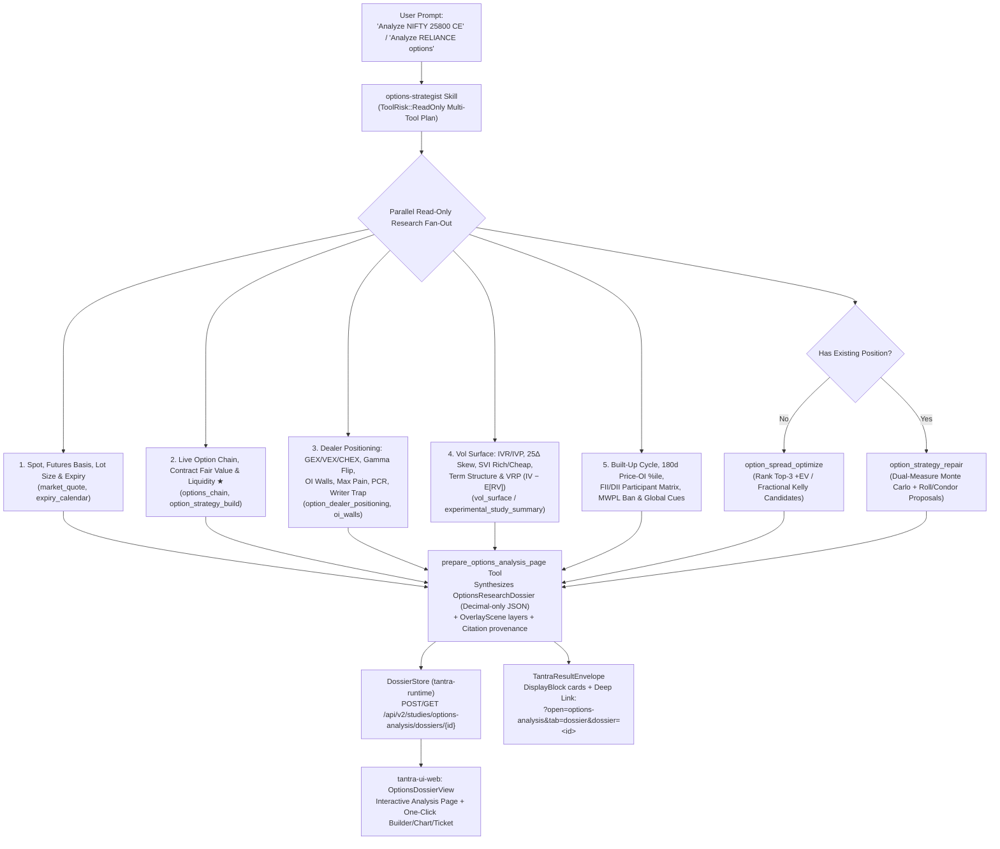

# 0018 — Quantsapp Tool Audit (UI Elements & Canonical Data Models) + AI-Agent Prepared Dynamic Options Analysis Page (Track T23 Addendum)

**Status**: Proposed Design Document (2026-11-20) — Companion to [Plan 0017](0017-options-training-and-strategy-builder.md) (Track **T23**)

**Architecture Rules**:
- **Zero edits to `tantra-core`**. Extend existing domain ports & types in `tantra-market-finance` ([`options_events.rs`](../../tantra-market/crates/tantra-market-finance/src/studies/options_events.rs)), `tantra-agent-chat-tools` ([`market.rs`](../../tantra-agent/crates/tantra-agent-chat-tools/src/ports/market.rs), [`study.rs`](../../tantra-agent/crates/tantra-agent-chat-tools/src/ports/study.rs)), `tantra-agent-core` ([`TantraResultEnvelope`](../../tantra-agent/crates/tantra-agent-core/src/result.rs)), and `tantra-ui-web` ([`workspace-deeplink.ts`](../../tantra-ui-web/src/lib/workspace-deeplink.ts)).
- **Zero floats in financial contracts/storage/JS state**: All prices, strikes, IVs, Greeks, probabilities, margins, OI deltas, and scores cross REST/WASM/MCP boundaries as `rust_decimal::Decimal` / decimal strings. `f64` is confined strictly to BS/SVI numerical solvers and pixel projection.
- **Zero fabricated quotes or feeds**: Every widget and AI dossier section carries explicit provenance (`live` | `delayed_public` | `theoretical_model` | `unavailable(gap_ref)`). Upstream gaps in `tantra-data` / `tantra-market` must never be mocked with synthetic OI, order-flow, or L2 depth.
- **R1/R2/R4 (`tantra-agent`)**: Chat tools remain `ToolRisk::ReadOnly` over async port traits; `tantra-agent-chat-tools` never depends on `tantra-runtime`, `tantra-exec`, or `tantra-market`.

---

## 0. Inspection Methodology & Verification Scope

To map Quantsapp's full tool surface faithfully without inventing unseen behavior:
- **Public Tool Pages Directly Inspected (`www.quantsapp.com`)**: `/tools`, `/pricing`, `/option-chain/nifty`, `/open-interest/nifty`, `/max-pain/nifty`, `/fii-dii`, `/india-vix`, `/option-greeks`, `/margin-calculator`, `/fo-ban-list`, `/fo-gainers-losers`, `/index-contribution`, `/nifty-heatmap`, `/expiry-calendar`, `/lot-size`, `/gift-nifty`, `/global-markets`, `/backtesting`, `/backtesting/data`, `/backtesting/strategies/short-straddle-entry-time-grid-leg-sl`, `/backtesting/glossary`, `/learn/classroom`, and `/learn/option-strategies`.
- **Authenticated SPA Routes (`web.quantsapp.com`) Documented via Public Artifacts**: Full route inventory extracted from `https://web.quantsapp.com/sitemap.xml` (23,904 URLs across ~73 tool groups / 10 categories), cross-referenced against Quantsapp's public embedded-module documentation (`iframe-doc.quantsapp.com`), feature landing descriptions, and Video Library / Classroom walkthroughs (`quantsapp.com/learn/videos`).

---

## 1. Complete Quantsapp Tool Audit: UI Elements → Canonical Data Models → Tantra Mapping

### 1.1 Category 1 — Option Chain, Greeks & Pricing Calculators

| Tool & Quantsapp URL(s) | UI Elements & Controls | Canonical Data Model (`Decimal`-First) | Tantra Mapping & Data Honesty |
|---|---|---|---|
| **Option Chain**<br>`www.quantsapp.com/option-chain/{sym}`<br>`web.quantsapp.com/option-chain/{SYM}` | Header: Symbol search, Futures/Spot price + Δ%, Lot Size, `Expiry` pills (with DTE).<br>Toolbar: Strike range filter (`ATM ±15` vs `All`), column toggles (`Greeks`, `OI/ΔOI`, `IV`), `PCR`, `Futures Ref`, synthetic future price.<br>Split Table: Call side (left) · Strike (center, ATM highlight, ITM shading) · Put side (right) with `OI`, `ΔOI`, `Vol`, `IV`, `Δ`, `Γ`, `Θ`, `V`, `Vanna`, `Charm`, `Bid/Ask`, `LTP`. Row click `+B`/`-S` leg inject. | `OptionChainSnapshot` extending [`OptionsChain`](../../tantra-agent/crates/tantra-agent-chat-tools/src/ports/market.rs#L138-L146) + `OptionChainStrikeRow { strike, is_atm, call: OptionLegQuoteGreeks, put: OptionLegQuoteGreeks, synthetic_future, parity_spread_bps }` + `liquidity_tier` ([`StrikeLabRow`](../../tantra-market/crates/tantra-market-finance/src/studies/options_events.rs#L118-L143)). | `options-analysis` Sub-tab 5 (**Live Option Chain**). Uses `ChainReader`; falls back to `theoretical_model` BS prices (with `bid=None, ask=None`) when chain feed offline. |
| **Option Greeks Calculator**<br>`www.quantsapp.com/option-greeks`<br>`web.quantsapp.com/option-calculator/{SYM}` | Calculator card: `Underlying` search, `Expiry`, `Strike`, `CE/PE` toggle, `Interest Rate` / `Dividend`, `Mode` (`Futures Black-76` vs `Spot`), `Tab 1: Fair Price & Greeks` vs `Tab 2: Implied Vol from Premium` inverse solver.<br>What-if sliders: `Spot/Fut Shift`, `IV Shift`, `DTE` stepper.<br>Output: `Per-Unit` & `Per-Lot ₹` KPI tiles (`Δ`, `Γ`, `Θ/day`, `V/1%IV`, `ρ`, `Vanna`, `Charm`, `Volga`) + Spot vs Value/Greeks curve. | `OptionGreeksCalcRequest { underlying, expiry, strike, option_type, pricing_basis: Spot \| FutureB76, risk_free_rate, spot_or_fut_price, iv_or_premium, lots }` → `OptionGreeksCalcResponse { fair_value, implied_vol, intrinsic, time_value, per_unit: Greeks + SecondOrderGreeks, per_lot_inr: Greeks, what_if_curve: Vec<GreeksCurvePoint> }`. | `tantra-market-pricing::BlackScholesModel` + `SecondOrderGreeks` + `tantra-ui-web-wasm` zero-latency slider widget inside Sub-tab 1 (**Builder**) & Sub-tab 5 (**Chain**). |
| **Margin Calculator**<br>`www.quantsapp.com/margin-calculator` | Multi-leg basket builder: `Symbol`, `Expiry`, `Instrument` (`FUT`/`CE`/`PE`), `Strike`, `Buy/Sell`, `Lots`.<br>Summary banner: `SPAN Margin`, `Exposure Margin`, `Total Margin`, `Hedge Benefit (sum(legs) − basket)`, `"Buy protective legs first"` sequence warning, `+2% Expiry-Day ELM` flag. | `MarginBasketRequest { legs: Vec<MarginLegInput>, is_expiry_day: bool }` → `MarginBasketEstimate { total_margin_inr, span_inr, exposure_inr, additional_elm_inr, standalone_sum_inr, hedge_benefit_inr, execution_order_hint, source: ExchangeTable \| Heuristic }`. | `tantra-market-finance::india::costs` + Builder KPI strip & Order Ticket pre-check. Requires exchange SPAN risk-array ingestion for exact parity; otherwise labels `Heuristic`. |
| **Liquidity Finder**<br>`web.quantsapp.com/liquidity-finder` | Filterable F&O table: `Symbol` filter, `CE / PE / Both` toggle, `Star Rating (1–5★)` badges, `Avg Bid-Ask Spread %`, `Impact Cost`, `Daily Volume`, `ATM Strike Spread`. | `LiquidityRatingRow { instrument, call_stars: u8, put_stars: u8, combined_stars: u8, avg_spread_bps, impact_cost_bps, top_depth_qty, qualified: bool }`. | Feeds **AI Spread Optimizer** (`max_bid_ask_bps` hard filter) and Chain liquidity badges (`tight` / `moderate` / `wide`). |
| **Lot Size & Expiry Calendar**<br>`www.quantsapp.com/lot-size`<br>`www.quantsapp.com/expiry-calendar` | Searchable symbol table: `Current Lot Size`, `Upcoming Revised Lot`, `Effective Date`, `Contract Value = Lot × Near Fut`.<br>Calendar view: `NSE` (NIFTY Tuesday weekly, monthly) / `BSE` (SENSEX Thursday weekly) exchange tabs, `Holiday Shifts`, `Listed` vs `Expected` expiry badges, `Next Trading Session` timings (`09:15–15:40 IST`). | `LotSizeRevisionRow { symbol, current_lot, next_lot, effective_from, near_fut_price, contract_notional_inr }` + `ExpiryScheduleEntry { exchange, symbol, kind: Weekly \| Monthly, contract_date, adjusted_date, is_holiday_shifted, listed: bool }`. | `tantra-market-finance::india::calendar` + [`expiry.rs`](../../tantra-market/crates/tantra-market-finance/src/expiry.rs). Top context bar across all `options-analysis` tabs. |

### 1.2 Category 2 — Open Interest, Max Pain, PCR & Option Writer Positioning

| Tool & Quantsapp URL(s) | UI Elements & Controls | Canonical Data Model (`Decimal`-First) | Tantra Mapping & Data Honesty |
|---|---|---|---|
| **Open Interest & Multi-Strike OI**<br>`www.quantsapp.com/open-interest/{sym}`<br>`web.quantsapp.com/multistrike-oi` | Expiry pill bar, `Live vs EOD` / `From Time -> To Time` intraday window picker, `Chart View` (grouped Call vs Put horizontal/vertical bars with `R` Call Wall & `S` Put Wall badges + ΔOI overlay) & `Multi-Strike Line Chart` (intraday time-series OI lines for user-picked strikes vs Futures price) + `Strike Table` (`OI`, `ΔOI`, `Strike PCR`, `LTP`). | `StrikeOiProfile { symbol, expiry, spot, future, pcr_oi, max_call_wall, max_put_wall, rows: Vec<StrikeOiRow { strike, ce_oi, ce_delta_oi, pe_oi, pe_delta_oi, strike_pcr, ce_ltp, pe_ltp }> }` + `MultiStrikeOiSeries { timestamps_ist, fut_series, strike_series: Vec<(Strike, OptionType, Vec<Decimal>)> }`. | Extends [`OiWallsSnapshot`](../../tantra-agent/crates/tantra-agent-chat-tools/src/ports/market.rs#L258-L268). Rendered in **Dealer Positioning** (`tab=positioning`) & **Live Chain** (`tab=chain`) + `OverlayScene` S/R bands on `ChartCanvas`. |
| **Max Pain / Option Pain & Option Gain**<br>`www.quantsapp.com/max-pain/{sym}`<br>`web.quantsapp.com/option-pain/{sym}`<br>`web.quantsapp.com/option-gain/{sym}` | Hero strip: `Max Pain Strike`, `Shift vs Prev Session`, `Spot − Max Pain`, `±1 SD Expected Range` band.<br>Charts: Stacked Writers' Payout bar chart (Call buyer payout + Put buyer payout in `₹ Cr` across strikes; minimum = Max Pain) + `Across Expiries` table (`Expiry`, `Max Pain`, `Distance %`). `Option Gain` adds Equilibrium Zone highlighting where writers' net gain peaks. | `MaxPainProfile { symbol, expiry, spot, max_pain_strike, prev_max_pain_strike, sd1_lower, sd1_upper, equilibrium_zone: (Decimal, Decimal), payouts: Vec<StrikePayout { strike, ce_payout_cr, pe_payout_cr, total_payout_cr, writer_net_gain_cr }> }`. | Computed locally whenever `OptionsChain` OI is present; pushed to `ChartCanvas` as `OverlayScene` `bands` (`Max Pain` pin zone). |
| **Put-Call Ratio (OI, Volume & Historical)**<br>`web.quantsapp.com/put-call-ratio/oi-pcr-h`<br>`web.quantsapp.com/put-call-ratio/pcr`<br>`web.quantsapp.com/put-call-ratio/vol-pcr` | Segmented toggle: `OI PCR`, `ΔOI PCR`, `Volume PCR`, `Historical PCR-OI Overlay`.<br>Dual-axis time-series line chart: `PCR` vs `Futures Price` with overbought/oversold historical percentile bands + strike-wise PCR table. | `PcrSnapshot { symbol, expiry, oi_pcr, change_oi_pcr, volume_pcr, pcr_percentile_1y, series: Vec<PcrPoint { ts, fut_price, oi_pcr, vol_pcr }> }`. | Computed from `OptionsChain` + historical OI store (`tantra-market-store` + `tantra-data/docs/gaps/0016`). |
| **Option Built-Up & Consolidated OI & Market-Wide OI**<br>`web.quantsapp.com/option-built-up`<br>`web.quantsapp.com/Consolidated-OI`<br>`web.quantsapp.com/market-wide-oi` | `Option Built-Up`: Selected strike grid classifying strike-level `CE/PE` (`Long`, `Short`, `Short Covering`, `Long Unwinding`) with ΔPrice vs ΔOI bars.<br>`Consolidated OI`: Sector/universe rollup of top Call/Put OI walls across constituents (filterable by `40–60Δ` near-ATM strikes).<br>`Market-Wide OI`: Total NSE market-wide Futures OI & Options OI historical area chart. | `StrikeOptionBuiltUp { strike, option_type, price_chg_pct, oi_chg_pct, quadrant: BuiltUpQuadrant, writer_dominance_score }` · `SectorConsolidatedOiRow { sector, symbol, near_atm_ce_wall, near_atm_pe_wall, net_oi_bias }` · `MarketWideOiPoint { date, total_fut_oi, total_opt_oi, fut_oi_chg_pct }`. | Feeds **Dealer Positioning** & **Agent Screening**. Requires intraday strike OI history (`tantra-data/gaps/0016`). |
| **Trap Indicator & Option Triggers**<br>`web.quantsapp.com/trap-indicator/{SYM}`<br>`web.quantsapp.com/option-triggers` | `Trap Indicator`: Scanner table & alert cards flagging `Call Writer Trap (Bullish Squeeze)` or `Put Writer Trap (Bearish Flush)` when spot breaches high-OI strike + OI drops/unwinds (`Symbol`, `Trapped Strike`, `Side`, `Peak OI -> Current OI`, `Trigger Spot`, `Confidence`).<br>`Option Triggers`: Live breakout/breakdown radar combining Futures price vs highest CE/PE OI strike distance + ΔOI unwinding rate. | `WriterTrapSignal { symbol, as_of, trap_side: CallWriterTrapped \| PutWriterTrapped, trapped_strike, initial_oi, unwinding_oi_pct, spot_at_trigger, breakout_bias, severity_score }` · `OptionTriggerRow { symbol, level_type: ResistanceBreak \| SupportBreak, trigger_strike, distance_to_strike_pct, oi_unwinding_pct }`. | Computed natively in `tantra-market-finance::options_quant` from intraday `ChainReader` snapshots and rendered in **Sub-tab 3 (Dealer Positioning)** + pushed as `OverlayScene` `hints`. |

### 1.3 Category 3 — Strategy Building, Optimizing, Writing & Repair

| Tool & Quantsapp URL(s) | UI Elements & Controls | Canonical Data Model (`Decimal`-First) | Tantra Mapping & Data Honesty |
|---|---|---|---|
| **Option Architect & Strategy Chart & My Position**<br>`web.quantsapp.com/architect-option-strategy-builder`<br>`web.quantsapp.com/strategy-chart`<br>`web.quantsapp.com/position` | `Architect`: Template library, Future/Option leg table, Payoff curve (`Expiry` + `Target Date T+N`), `DTE`/`IV` sliders, portfolio `Δ, Γ, Θ, V, ρ` + **2nd-order `Vanna`, `Volga`, `Charm`**, `3D Price × Vol × Time Payoff Surface`, `Save to Multi-Leg Watchlist`, `Archive`, `Trade Execution`.<br>`Strategy Chart`: Intraday net combined premium candlestick/line chart + VWAP/trendline alerts.<br>`My Position`: Real-time MTM P&L + portfolio Greek monitor. | `OptionStrategySpec` (71 templates) + `EvaluatedPayoffBundle { legs, net_cashflow, max_profit, max_loss, breakevens, expiration_curve, t_plus_n_curve, surface_3d_grid, net_greeks_1st_2nd, pop, ev, kelly_fraction, est_margin, statutory_costs }` + `CompositeSpreadBarSeries { ts, net_premium_ohlc }`. | **Sub-tab 1 (Strategy Builder)** + **Multi-Leg Chart (`StrategyChart`)** + live MTM bridge from `tantra-ledger::Portfolio`. |
| **Strategy Optimizer (`Find`, `Specific`, `My Forecasts`)**<br>`web.quantsapp.com/optimizer/find-strategy`<br>`web.quantsapp.com/optimizer/find-specific`<br>`web.quantsapp.com/strategy-optimizer/find` | Inputs: `Symbol`, `Market View` (`Bullish`/`Bearish`/`Either Way`/`Oscillate`), `Target Date`, `Target Price` / `Stop Loss`, `Max Risk / 50% Risk-to-Capital / Lot Multiple`, `Strike Range`, `Max Legs (<=4)`, `Limited Risk Only`, `Sort By` (`Optimal` / `Reward:Risk` / `Max Profit` / `ROI`).<br>Results Table: Top spreads with `Higher IV / Current IV / Lower IV` PnL scenario columns + `Open in Architect`. | `SpreadOptimizeRequest` + `RankedSpreadCandidate { template_id, legs, expected_value_inr, continuous_kelly_f, recommended_lots, pop_pct, pop50_pct, return_skewness, cvar_95_inr, sortino, margin_inr, iv_scenarios: { iv_down_pnl, iv_flat_pnl, iv_up_pnl }, thesis }`. | **Sub-tab 2 (AI Spread Optimizer)** upgrades Quantsapp's `Optimal/ROI` heuristic to full dual-measure ($\mathbb{P}$ vs $\mathbb{Q}$) `+EV` & Continuous Fractional Kelly ranking. |
| **Strategy Repair**<br>`web.quantsapp.com/strategy-optimizer/repair` | Loads distressed/open position legs → scans chain adjustments (`Roll Wing`, `Convert to Condor/Butterfly`, `Add Jade Lizard Wing`, `Broken Wing Butterfly`) → Before vs After payoff overlay + `Reduced Loss / Breakeven Shift / Extra Margin`. | `StrategyRepairRequest { symbol, current_legs, max_additional_margin, objective: ReduceMaxLoss \| ShiftBreakeven \| NeutralizeDelta }` → `Vec<RepairProposal { repair_type, added_or_rolled_legs, before_metrics, after_metrics, margin_delta_inr, revised_ev_inr }>`. | **Sub-tab 6 (Position Repair & Dual-Measure Monte Carlo)**. |
| **Option Writer & Straddle Index & Straddle/Strangle Chart**<br>`web.quantsapp.com/option-writer/{selector,writer}`<br>`web.quantsapp.com/straddle-index/{SYM}`<br>`web.quantsapp.com/straddle-strangle-chart` | `Option Writer`: Expected range forecast → ATM/OTM writer shortlist with `Straddle Premium`, `Upper/Lower Breakevens`, `Theta Yield`, `Safety Margin %`.<br>`Straddle Index` & `Straddle/Strangle Chart`: Intraday combined CE+PE premium line/bar chart plotted against Futures + Net `Δ/Γ/Θ` + MTM alert trigger. | `OptionWriterCandidate { symbol, expiry, spot, expected_range, atm_strike, straddle_premium, upper_be, lower_be, safety_margin_pct, atm_iv, ivp, theta_per_margin_pct }` + `CombinedStraddleSeries { ts, ce_ltp, pe_ltp, straddle_sum, straddle_vwap, fut_price, net_theta }`. | **Sub-tab 1/4** + `option_writer_scan` preset inside **AI Spread Optimizer**. |
| **Option Scalping**<br>`web.quantsapp.com/option-scalping` | Intraday high-velocity option contract scanner pairing underlying Futures/Spot tick bursts with active ATM/1-OTM CE/PE ΔOI & ΔPrice scalping momentum alerts. | `OptionScalpSignal { contract, ts, underlying_velocity, opt_ltp, bid_ask_bps, delta_oi_5m, volume_surge_x, bias }`. | Feeds `StrategyLab` / Intraday Signal Scanner (requires real-time tick + chain stream). |

### 1.4 Category 4 — Volatility, Skew & Optimal Stop/Target Suite

| Tool & Quantsapp URL(s) | UI Elements & Controls | Canonical Data Model (`Decimal`-First) | Tantra Mapping & Data Honesty |
|---|---|---|---|
| **India VIX Dashboard**<br>`www.quantsapp.com/india-vix` | Hero VIX card (`Value`, `Δ`, `Δ%`, `1Y Percentile`, `Long-Run Median`).<br>Expected Move Tiles: `Daily ±pts/%`, `Weekly ±pts/%`, `Monthly ±pts/%` (`VIX / sqrt(365/days)`).<br>Historical table: Co-movement stats (`NIFTY down vs up days`) + Annual VIX Min/Max/Close table. | `IndiaVixRegime { vix, change_abs, change_pct, vix_percentile_1y, historical_median, implied_move_1d_pct, implied_move_1w_pct, implied_move_1m_pct, regime_bucket: Low \| Normal \| Elevated \| Spike }`. | Top Regime Context Bar across all `options-analysis` tabs + VIX sizing input in **Sub-tab 2/4**. |
| **IV / HV, IVR / IVP, IV Chart & Vol Grid**<br>`web.quantsapp.com/Implied-Volatility/{IV-HV,IVR-IVP,chart,grid}` | `IV-HV`: Screener comparing current `ATM IV` vs `HV10/20/30` (`IV − HV` spread, VRP).<br>`IVR-IVP`: Rank & Percentile `0–100` leaderboard sorted High/Low.<br>`IV Chart`: Dual-pane Price/Futures vs Historical IV line.<br>`Vol Grid`: Strike × Expiry heatmap matrix of IVs across the entire surface. | `VolRegimeRow { symbol, atm_iv, hv_10, hv_20, vrp_spread, ivr_1y, ivp_1y, iv_1d_chg }` · `VolGridMatrix { expiries: Vec<NaiveDate>, strikes: Vec<Decimal>, iv_grid: Vec<Vec<Option<Decimal>>> }`. | **Sub-tab 4 (Vol Surface, Skew & VRP Lab)** using `tantra-market-finance` HAR-RV/Yang-Zhang estimators + `ChainReader` IVs. |
| **Volatility Skew & Vol Trader**<br>`web.quantsapp.com/Implied-Volatility/volatility-skew/{SYM}`<br>`web.quantsapp.com/vol-trader` | `Volatility Skew`: Put wing vs Call wing Smile curve + Skew Steepness & Smile Shift across expiries.<br>`Vol Trader`: Proprietary scanner spotting unusual IV expansion/contraction (`Long Vol` vs `Short Vol` setup list + 1-click Straddle launch). | `VolSkewProfile { symbol, expiry, points: Vec<{ strike, log_moneyness, market_iv, svi_fair_iv, residual_iv }>, rr_25d, bf_25d, skew_zscore_1y }` · `VolTraderAlert { symbol, direction: LongVol \| ShortVol, current_iv, expected_iv_zscore, atm_straddle_cost }`. | **Sub-tab 4 (Vol Surface & VRP Lab)** (`SVI/SABR` smile fit & Rich/Cheap wing tags). |
| **Stop & Target Guide & Optimal Stop & Target**<br>`web.quantsapp.com/stop-target`<br>`web.quantsapp.com/optimal-stop-and-target` | Inputs: `Symbol`, `Instrument (FUT/CE/PE)`, `Direction (Buy/Sell)`, `Expiry & Strike`, `Holding Horizon`, `Risk Mode` (`Conservative` \| `Moderate` \| `Aggressive`).<br>Output: `Optimal Target Price`, `Optimal Stop-Loss`, `Option Premium Target/SL` factoring IV decay across horizon. | `OptimalStopTargetQuery { symbol, instrument_kind, strike, expiry, side, horizon_days, risk_tier: Conservative \| Moderate \| Aggressive }` → `OptimalStopTargetResult { underlying_target, underlying_stop, projected_option_target, projected_option_stop, assumed_iv, theta_drag_inr }`. | `tantra-market-finance::studies` probability/volatility bounds + `tantra-market-pricing` T+N repricing inside **Builder** & **Experimental-Analysis**. |

### 1.5 Category 5 — Futures Built-Up, OI Cycle & Price/Volume Analytics

| Tool & Quantsapp URL(s) | UI Elements & Controls | Canonical Data Model (`Decimal`-First) | Tantra Mapping & Data Honesty |
|---|---|---|---|
| **Built-Up Suite (`Future Built-Up`, `Historical OI`, `Cycle`, `Sector`, `Breadth`)**<br>`web.quantsapp.com/built-up/{future-built-up,future-historical-OI,cycle,sector,built-up-breadth}` | `Future Built-Up` & `Historical OI`: Bar/table color-coded into 4 quadrants (`Long=Green`, `Short=Red`, `Short Covering=Yellow`, `Long Unwinding=Blue`).<br>`Cycle`: Multi-day transition strip (`L→LU→S→SC`) tracking institutional accumulation.<br>`Sector` & `Breadth`: Intraday `1m/3m/5m/10m/15m` stacked market-wide bar showing % of F&O universe in each quadrant. | `BuiltUpQuadrant = Long \| Short \| ShortCovering \| LongUnwinding` (already modeled in [`OiBuildupSnapshot`](../../tantra-agent/crates/tantra-agent-chat-tools/src/ports/market.rs#L230-L244)) + `BuiltUpBreadthTick { ts, timeframe_min, long_cnt, short_cnt, sc_cnt, lu_cnt, net_breadth_score }` + `SectorBuiltUpRollup`. | Wire `tantra-market-store` OI time-series + intraday F&O snapshot store (`tantra-data/gaps/0016`) into **Sub-tab 3 (Dealer Positioning)** & **Screener**. |
| **Price-OI Percentile (180d) & Volume Analysis**<br>`web.quantsapp.com/price-oi-percentile/{SYM}`<br>`web.quantsapp.com/volume-analysis/{SYM}` | `Price-OI Percentile`: Dual rank (`Price %ile [0–100]` vs `OI %ile [0–100]` over 180d); presets for Breakouts (`P>90 & OI>90`) & Breakdowns (`P<10 & OI>90`).<br>`Volume Analysis`: Candlestick + Volume Profile / Accumulation S&R + Delivery % divergence. | `PriceOiPercentileRow { symbol, lookback_days, price_pct_rank, oi_pct_rank, setup_tag }` + `DeliveryVolumeRow` extending [`DeliveryBar`](../../tantra-agent/crates/tantra-agent-chat-tools/src/ports/market.rs#L212-L224). | Directly implementable in `tantra-market-finance` from daily bars + OI + delivery stores. |
| **Rollover & Basis**<br>`web.quantsapp.com/rollover/{rollover,roll-historical,roll-continous}`<br>`web.quantsapp.com/basis/{SYM}` | `Rollover`: `Rollover %` vs `3-Month Avg`, `Roll Cost %`, `Expiry-Day Sentiment`, `Continuous OI` stitched chart.<br>`Basis`: `Futures − Spot` premium/discount (absolute & annualized carry %). | `RolloverSnapshot { symbol, current_oi, next_oi, total_fut_oi, rollover_pct, avg_3m_rollover_pct, roll_cost_pct, price_chg_pct }` + `BasisPoint { ts, spot, near_fut, basis_abs, annualized_carry_pct }`. | `tantra-market-finance::india::fno` expiry rollover metrics; shown in AI Dossier & Futures Context Strip. |
| **Synopsis & F&O Scanner**<br>`web.quantsapp.com/synopsis/{FO-Volume,Future-OI,Option-OI}`<br>`web.quantsapp.com/fno-scanner` | `Synopsis`: 1-screen cockpit combining Top Future OI Gainers/Losers, Top Volume Contracts, Most Active Calls/Puts, Ban List status.<br>`FnO Scanner`: Multi-filter rule builder (`ΔPrice %`, `ΔOI %`, `ΔIV %`, `Built-Up Class`, `Liquidity`). | `FnOSynopsisDigest { top_fut_oi_gainers, top_fut_oi_losers, most_active_ce_pe, ban_stocks }` + `FnoScannerFilter` mapping directly to Tantra's existing recursive `Decimal` Screener DSL (Plan 0010). | Reuse Tantra's **Screener DSL** (`tantra-runtime` / `tantra-ui-web` `ScreenerView`) with F&O OI/IV predicates! |

### 1.6 Category 6 — Quant Scanners, Pair Trading & Momentum Models

| Tool & Quantsapp URL(s) | UI Elements & Controls | Canonical Data Model (`Decimal`-First) | Tantra Mapping & Data Honesty |
|---|---|---|---|
| **Unusual Option Activity (UOA)**<br>`web.quantsapp.com/unusual-option-activity` | Live scanner feed of abnormal single-contract surges: `Contract`, `LTP & Δ%`, `Volume / 20d Avg`, `OI & ΔOI%`, `IV & ΔIV`, `Built-Up Bias`. | `UnusualOptionFlowRow { contract, spot, opt_ltp, price_chg_pct, volume, vol_zscore, oi, oi_chg_pct, iv, iv_chg, side_inferred }`. | Surfaces on **Live Option Chain** (`tab=chain`) & **AI Dossier** catalyst alerts. |
| **Relative Performance Graph (RPG)**<br>`web.quantsapp.com/relative-performance-graph/{sectors,futures,options}` | 4-quadrant rotating scatter plot (`X = Relative Strength vs NIFTY`, `Y = Momentum Ratio`) with directional tail trails across quadrants: `Weak` → `Progressive` → `Strong` → `Laggard`; modes for `Sectors`, `Futures`, `Options OI`. | `RpgTrajectory { entity, quadrant: Weak \| Progressive \| Strong \| Laggard, trail: Vec<{ date, rel_strength, rel_momentum }> }`. | Reuses `tantra-market-finance::studies::correlation` + new RRG scatter chart widget in `Experimental-Analysis` / `Options Analysis`. |
| **Pair Trading (`Scanner`, `Feasibility`, `Test Lab`, `Watchlist`)**<br>`web.quantsapp.com/pair-trading/{scanner,feasibility,test-lab,watchlist}` | Sector pair screener with `Correlation`, `Cointegration (ADF p-val)`, `Spread Mean/SD`, `Live Z-Score`, `Beta Hedge Ratio`, and mini spread-Z equity backtest. | `PairStatSummary { leg_a, leg_b, correlation, adf_pvalue, hedge_ratio, spread_mean, spread_std, current_zscore, half_life_days, backtest_sharpe }`. | Extends `tantra-market-finance::studies::correlation.rs` & `spreads.rs`. |
| **Buy Low, Intraday Movers, Out-Runners & Top Stocks**<br>`web.quantsapp.com/buy-low`<br>`web.quantsapp.com/intraday-movers`<br>`web.quantsapp.com/out-runners`<br>`web.quantsapp.com/top-stocks` | `Buy Low`: Green triangle reversal bottom markers on lookback window.<br>`Intraday Movers`: Bubble scatter (`X=ΔFut Price%`, `Y=ΔOI%`, `Radius=Turnover`) + 3m built-up.<br>`Out-Runners`: Stocks outperforming/underperforming sector peers.<br>`Top Stocks`: Composite rating ranking F&O universe on Price + Fut OI + CE/PE ΔOI. | `UniverseMoverPoint { symbol, sector, fut_chg_pct, oi_chg_pct, turnover_cr, excess_vs_sector_pct, composite_rank }`. | Maps cleanly into `Experimental-Analysis` + `Screener` F&O view. |

### 1.7 Category 7 — Order Book, Microstructure Flow & Trade Journal Analytics

| Tool & Quantsapp URL(s) | UI Elements & Controls | Canonical Data Model (`Decimal`-First) | Tantra Mapping & Data Honesty |
|---|---|---|---|
| **Order & Trade Book Analytics & O&T Watchlist (`33 features`)**<br>`web.quantsapp.com/order-book-watchlist` | Real-time Level-2/Tick order-flow tape & depth analytics: `Buyer-Initiated Qty` (trades hitting Ask) vs `Seller-Initiated Qty` (trades hitting Bid), `New Buy Orders` vs `New Sell Orders`, `Cancelled Orders`, `Trade VWAP`, `Orderbook Quant Indicator` net pressure gauge. | `OrderFlowMicrostructure { instrument, ts, buyer_initiated_qty, seller_initiated_qty, net_delta_qty, new_buy_orders, new_sell_orders, cancelled_order_ratio, trade_vwap, orderbook_quant_score }` extending [`MarketDepth`](../../tantra-agent/crates/tantra-agent-chat-tools/src/ports/market.rs#L179-L191). | **Upstream Gap**: Cite `tantra-market/docs/gaps/0006-l2-order-book-depth.md`. Must return `Unavailable` until tick/L2 feed is connected; never fabricate order flow. |

### 1.8 Category 8 — Institutional Flows, Ban List, Macro & Market Breadth

| Tool & Quantsapp URL(s) | UI Elements & Controls | Canonical Data Model (`Decimal`-First) | Tantra Mapping & Data Honesty |
|---|---|---|---|
| **FII / DII Cash & Participant F&O OI**<br>`www.quantsapp.com/fii-dii`<br>`web.quantsapp.com/participant-data/{fii-dii-index,...}` | `Cash Card`: Daily FII vs DII `Gross Buy / Sell / Net ₹ Cr` + `N-day streak`.<br>`Participant F&O Matrix`: `FII` / `DII` / `Pro` / `Client` segmented across `Index Futures` (`Long`, `Short`, `Net`, `L/S Ratio`), `Index Options` (`CE Long/Short`, `PE Long/Short`), `Stock Futures`, `Stock Options`. | Extends [`InstitutionalFlow`](../../tantra-agent/crates/tantra-agent-chat-tools/src/ports/market.rs#L194-L206) with `ParticipantOiMatrixRow { date, client_type: Fii \| Dii \| Pro \| Client, segment: IndexFut \| IndexOpt \| StockFut \| StockOpt, call_long, call_short, put_long, put_short, fut_long, fut_short, long_short_ratio }`. | Cash flows already bridged (`FeedMarketReader::with_institutional_flows`); Participant NSE EOD CSV ingestion becomes a `tantra-data` gap extension. |
| **F&O Ban List & MWPL Historical**<br>`www.quantsapp.com/fo-ban-list`<br>`web.quantsapp.com/ban-list-historical` | 3-tier watch cards: `In Ban (>=95% MWPL)` (red), `Possible Entrants (>=90%)` (amber), `Possible Exits (<=80% threshold)` (green).<br>MWPL Dot Map (`>40% MWPL`) comparing `Current %` vs `Previous %`. | `MwplBanRow { symbol, date, mwpl_limit_shares, total_fut_opt_oi, mwpl_pct, prev_mwpl_pct, status: InBan \| EntrantWatch \| ExitWatch \| Normal }`. | Used as hard pre-trade filter in Strategy Builder, Optimizer, and AI Dossier Risk Watchouts. |
| **GIFT Nifty & Global Markets & Market Mood**<br>`www.quantsapp.com/gift-nifty`<br>`www.quantsapp.com/global-markets`<br>`web.quantsapp.com/market-mood` | `GIFT Nifty`: Live spread vs NSE NIFTY Fut + `Implied Open Gap pts/%` + 8-tile pre-market macro scorecard (`US`, `Asia`, `VIX`, `FII/DII`, `MaxPain/PCR`, `Brent`, `USDINR`, `Ban`).<br>`Global Markets`: Follow-the-sun session timeline bars in IST + live session mini-sparklines.<br>`Market Mood`: Composite intermarket pulse. | `GlobalMacroCuesSnapshot { as_of, gift_nifty, nse_nifty_fut, implied_gap_pts, implied_gap_pct, dow_fut_pct, nasdaq_fut_pct, brent_usd, usdinr, us_10y_yield, asia_avg_pct, europe_avg_pct, market_mood_score }`. | Fed into **AI Dossier** Section 2 (*Pre-Market & Macro Regime*) via `MacroSeries` / market feed ports. |
| **Index Contribution, Heatmap, Gainers/Losers, Advance-Decline**<br>`www.quantsapp.com/index-contribution`<br>`www.quantsapp.com/nifty-heatmap`<br>`www.quantsapp.com/fo-gainers-losers`<br>`web.quantsapp.com/advance-decline-chart` | `Index Contribution`: Diverging horizontal bar chart sorted by `+/- Index Points Contributed`.<br>`Heatmap`: Index-weight sized treemap colored by `% Change`.<br>`Gainers/Losers`: `Today/Week/Month/Expiry` pills + `Advances/Declines` ratio.<br>`Advance-Decline`: Intraday sector-wise net advancers chart. | `IndexConstituentImpact { index, symbol, weight_pct, price_chg_pct, points_contribution }` · `MarketBreadthSnapshot { period, advances, declines, unchanged, ad_ratio, sector_breakdown }`. | Pairs with `tantra-market-finance::studies::distributions` & `MarketPulse` dashboard. |

### 1.9 Category 9 — Seasonality, Earnings Events & AI Backtesting

| Tool & Quantsapp URL(s) | UI Elements & Controls | Canonical Data Model (`Decimal`-First) | Tantra Mapping & Data Honesty |
|---|---|---|---|
| **Result Calendar & Result Analysis**<br>`web.quantsapp.com/result-analysis/{SYM}`<br>`web.quantsapp.com/result-calendar/{SYM}` | Quarter-by-quarter earnings timeline + `T-5 .. T+5` average spot drift & **IV crush (`Pre-Result IV` vs `Post-Result IV`)** bars around announcement dates. | `EarningsEventStudyRow { symbol, result_date, pre_iv_peak, post_iv_trough, iv_crush_pct, move_t_minus_5_to_0_pct, day_0_gap_pct, move_0_to_t_plus_5_pct }`. | Directly powered by Tantra's existing [`CAR[-20d,+20d]` Event Study](../../tantra-market/crates/tantra-market-finance/src/studies/options_events.rs) engine! |
| **Seasonality & Trading Panchang**<br>`web.quantsapp.com/seasonality/{SYM}`<br>`web.quantsapp.com/trading-panchang` | `Seasonality`: `Year × Month` return & IV heatmap grid (`Mean`, `Median`, `Win Rate %` row/col summaries). *(Note: `Trading Panchang` is astrological entertainment — excluded from institutional quant signals).* | `SeasonalityMatrix { symbol, metric: ReturnPct \| AtmIv \| RealizedVol, cells: Vec<{ year, month, value }>, monthly_win_rate_pct }`. | Directly computed in `tantra-market-finance::studies::returns.rs`. |
| **AI Backtesting & Simulator Replay**<br>`www.quantsapp.com/backtesting`<br>`web.quantsapp.com/Option-Backtesting`<br>`web.quantsapp.com/simulator/chart-replay` | NL rule prompt + **YouTube URL rule extractor** → 21 historical datasets (`1s option chain` w/ bid/ask + 1st/2nd-order Greeks, futures, flow, FII/DII, ban list) → 3 cost views (`Before Costs`, `After Statutory Taxes`, `After All Costs + Slippage`) → **Robustness (`Net P&L ex best 10% trades`)**, `3 Worst Loss Days`, `Regime Breakdown (Trend vs Choppy vs Quiet)`. | `BacktestExecutionReport { strategy_id, window, pnl_gross, pnl_after_taxes, pnl_after_all_costs, profit_factor, win_rate_pct, max_drawdown_inr, ex_top_10pct_trades_pnl, worst_3_sessions, regime_breakdown: Vec<{ regime, trades, win_rate_pct, net_pnl_inr }> }`. | Reuses Tantra's `tantra-exec-paper` historical simulator + `tantra-strategies` `StrategyLoop` (`Experimental-Analysis` + `StrategyLab`). |

### 1.10 Category 10 — Alerts, Watchlists & Execution Bridges

| Tool & Quantsapp URL(s) | UI Elements & Controls | Canonical Data Model (`Decimal`-First) | Tantra Mapping & Data Honesty |
|---|---|---|---|
| **Technical Chart & Hot Keys & Alert Trigger Orders**<br>`web.quantsapp.com/technical-chart/{SYM}`<br>`web.quantsapp.com/alerts` | TradingView chart w/ OI/Built-up/Trap overlays, multi-leg spread alerts (`MTM >= X`, `Strike OI > Y`, `Spot crosses Gamma Flip`), keyboard hotkeys (`B/S/X`), multi-broker basket execution. | Uses Tantra's existing [`OverlayScene`](../../tantra-ui-web/src/lib/overlay-scene.ts), [`PriceAlert`](../../tantra-agent/crates/tantra-agent-chat-tools/src/ports/alert.rs), and `TradeIntent` (`ProposeTradeTool` advisory gate). | Execution stays strictly gated by explicit human confirmation via `OrderPanelDock` / `ProposeTradeTool`. |

---

## 2. AI-Agent Prepared Dynamic Options Analysis Page ("Research Dossier")

When a user asks an AI agent to research **any specific option contract** (e.g., *"Analyze NIFTY 23-Nov-26 25800 CE"*) **or underlying** (e.g., *"Prepare a full options analysis page for BANKNIFTY / RELIANCE"*), the agent must not merely dump unformatted chat prose. Instead, it runs a deterministic multi-tool research pipeline and compiles an interactive **`OptionsResearchDossier`** (`tantra/options_dossier/v1`) rendered inside a dedicated view of the Web UI's `options-analysis` tab (`?open=options-analysis&tab=dossier&dossier=<id>`) as well as cleanly via MCP/CLI.

### 2.1 End-to-End Orchestration Pipeline



### 2.2 Canonical `OptionsResearchDossier` Data Model (`tantra/options_dossier/v1`)

Defined in `tantra-market-finance::options_quant` (Rust) and mirrored cleanly in `tantra-ui-web/src/lib/options-analysis-client.ts` (TypeScript, string-encoded `Decimal`s — zero `number` financial math):

```rust
pub enum SectionStatus {
    Live,
    DelayedPublic,
    TheoreticalModel,
    Unavailable { gap_ref: String, reason: String },
}

pub struct OptionsResearchDossier {
    pub schema_version: String,          // "tantra/options_dossier/v1"
    pub dossier_id: String,              // UUID / content hash
    pub generated_at_ist: String,        // RFC3339 IST timestamp
    pub query_intent: String,            // e.g. "SingleContract(NIFTY 23-Nov-26 25800 CE)"
    pub instrument: InstrumentContext,   // symbol, spot, near_fut, basis_pct, lot_size, expiry, dte, is_ban_list, mwpl_pct
    pub provenance: BTreeMap<String, SectionStatus>,

    /// Section 1: Executive AI Verdict & Regime Synthesis
    pub verdict: HeroVerdictSummary,     // directional_bias, vol_regime (SellVol/BuyVol/Neutral),
                                         // dealer_gamma_regime (+GEX Mean-Revert vs -GEX Trend),
                                         // overall_conviction (1..=5), headline, key_drivers[3], invalidation_level

    /// Section 2: Focused Contract Teardown (populated when user names a specific CE/PE strike)
    pub target_contract: Option<ContractFocusTeardown>,
    // Includes: market_ltp, bid, ask, spread_bps, liquidity_stars (1..=5), theoretical_bs_price,
    // svi_fair_iv vs market_iv ("Rich +1.8v" / "Cheap -0.9v"), 1st + 2nd-order Greeks per unit & per lot ₹,
    // daily theta decay %, expiry breakeven, empirical P-measure touch & expire-ITM probability,
    // and AI critique ("Overpaying +1.8v skew; Bull Call Spread 25800/26100 improves +EV by +₹1,420").

    /// Section 3: Dealer Positioning, OI Walls & Option Writer Traps (Quantsapp OI + GEX/Vanna/Charm)
    pub positioning: Option<DealerPositioningSummary>,
    // spot vs gamma_flip, net_gex_1pct_inr, net_vex, net_chex, call_wall, put_wall,
    // max_pain, option_gain_eq, oi_pcr, delta_oi_pcr, trap_signals: Vec<WriterTrapSignal>,
    // strike_oi_gex_bars: Vec<StrikePositioningBar>

    /// Section 4: Volatility Surface, VRP & Upcoming Catalysts
    pub vol_and_events: VolatilityAndEventSummary,
    // india_vix, vix_1y_pct, implied_1d_move_pct, implied_weekly_move_pct,
    // atm_iv, hv_20, har_rv_forecast, vrp_spread, ivr_1y, ivp_1y,
    // rr_25d, bf_25d, term_structure_slope, upcoming_events (RBI/FOMC/Expiry/Earnings),
    // seasonality_month_win_rate_pct

    /// Section 5: Built-Up Cycle, Flows & Macro Pulse
    pub flows_and_cues: FlowsAndCuesSummary,
    // fut_buildup_quadrant, price_oi_pct_rank_180d, rollover_pct, roll_cost_pct,
    // fii_cash_net_cr, dii_cash_net_cr, fii_idx_fut_ls_ratio, gift_nifty_implied_gap_pct

    /// Section 6: Empirical Statistical Grounding (Experimental-Analysis Bridge)
    pub statistical_context: Option<StudySummarySnapshot>,

    /// Section 7: Top-3 Ranked Strategy Recommendations (+EV & Fractional Kelly)
    pub recommended_strategies: Vec<RankedSpreadCandidate>,

    /// Section 8: Existing Position Repair Scenarios (when user holds an active leg set)
    pub repair_proposals: Vec<RepairProposal>,

    /// Section 9: Mandatory Failure Modes ("Things to Watch") & Execution Risk
    pub risk_watchouts: Vec<String>,

    /// Section 10: Visual Chart Push Payload & Interactive Actions
    pub overlay_scene: OverlayScene,
    pub tool_citations: Vec<ToolCitation>, // tool name, as_of, source_status
}
```

### 2.3 New Agent Tool, Port Extension & MCP Contract
1. **New Tool (`prepare_options_analysis_page`)** in `tantra-agent-chat-tools` + `tantra-agent-mcp`:
   - `ToolRisk::ReadOnly` (dossier persistence writes an ephemeral advisory research artifact to `DossierStore`, never placing orders or mutating ledger/portfolio state).
   - **Inputs**: `{ instrument: String, focus_contract?: { option_type: "CE"|"PE", strike: Decimal, expiry?: NaiveDate }, user_outlook?: "auto"|"bullish"|"bearish"|"neutral"|"volatile", horizon_days?: u32, max_risk_inr?: Decimal, held_legs?: Vec<OptionLegInput> }`.
   - **Execution Flow**: Calls `OptionsAnalysisPort::prepare_dossier(...)`, which fans out across `MarketReader`, `StudyReader`, `CalendarReader`, and `tantra-market-finance::options_quant`, computes `ContractFocusTeardown` (if `focus_contract` specified) + Top-3 `+EV`/Kelly candidates + `OverlayScene`, stores the dossier (`dossier_id`), and returns a `TantraResultEnvelope`:
     - `blocks`: Hero `MetricGrid`, `Alert` if in F&O Ban / negative-Gamma regime / wide bid-ask, Contract/Strategies `Table`, and `Chart` reference.
     - `deep_link`: `/workspace?open=options-analysis&tab=dossier&dossier=<dossier_id>&symbol=<SYM>`.
2. **`tantra-runtime` REST Endpoints (OpenAPI v2)**:
   - `POST /api/v2/studies/options-analysis/dossiers` — Execute or persist an AI-compiled `OptionsResearchDossier`.
   - `GET /api/v2/studies/options-analysis/dossiers/{id}` — Hydrate dossier inside Web UI (`OptionsDossierView`) on deep-link navigation.
   - `GET /api/v2/studies/options-analysis/dossiers` — Recent research dossiers list for quick recall in `options-analysis` sidebar.
3. **`tantra-ui-web` Interactive Dossier Renderer (`OptionsDossierView.tsx`)**:
   - Accessible at `?open=options-analysis&tab=dossier&dossier=<id>` (a 7th **`AI Dossier`** view inside `options-analysis`, paired with a **"Ask AI to Research Option"** prompt bar right in the tab header!).
   - Renders clean, Quantsapp/OptionStrat-grade visual cards directly from `OptionsResearchDossier`:
     1. **Hero Verdict Strip**: Conviction meter, Spot/Futures/Basis, Dealer Gamma Regime pill (`+GEX Pin` vs `-GEX Squeeze`), Vol Regime pill (`VRP +3.1v · IVP 78%`), and Provenance badges (`Live Chain` vs `Partial Unavailable`).
     2. **Focused Contract Teardown** *(when user asked about a specific strike like `25800 CE`)*: Intrinsic vs Extrinsic bar, Market IV vs SVI Fair IV rich/cheap meter, 1st + 2nd-order Greeks per lot, `Theta/day` decay, Probability of Profit (`P`-measure), and *"Alternative Spread Comparison"* showing how converting the naked call/put into a vertical or ratio improves `+EV` and Quarter-Kelly risk-adjusted return.
     3. **Interactive Visual Grid (2×2 Charts)**: Strike OI + GEX/VEX profile (`Call Wall` / `Put Wall` / `Gamma Flip` / `Max Pain`), Vol Skew + SVI Fair Curve, Term Structure + VRP gauge, and Built-Up + FII/DII Participant Bar.
     4. **Top-3 Ranked Actionable Strategies**: Each card displays mini payoff SVG, `+EV ₹`, `Quarter-Kelly Lots`, `PoP%`, `95% CVaR`, Margin `₹`, *"Things to Watch"*, and buttons: **[Open in Builder]**, **[Plot on Chart]** (`OverlayScene`), **[Send to Paper Ticket]**.
     5. **Export & Audit Footer**: Export Markdown/PDF research brief + expandable **Tool Citations & Raw Inputs** drawer for full reproducibility.

---

## 3. Additional Upstream Gaps Required for Full Quantsapp Parity

Where Quantsapp relies on feeds not yet in Tantra's lakehouse, Tantra enforces **honest `Unavailable` flagging** and tracks upstream closure cleanly:
1. **Intraday Strike-Level OI, ΔOI & Built-Up History**: Already tracked in `tantra-data/docs/gaps/0016-intraday-option-chain-snapshot-lakehouse.md` and `tantra-market/docs/gaps/0005`. Enables `Multi-Strike OI`, `Option Built-Up`, `Trap Indicator`, `Consolidated OI`, and `Built-Up Breadth`.
2. **L2 Order Book & Tick Trade-Flow Tape (`Orderbook Quant Indicator`)**: Tracked in `tantra-market/docs/gaps/0006-l2-order-book-depth.md`. Required for Buyer- vs Seller-initiated flow, Trade VWAP, and Order Book Watchlist.
3. **NSE Participant-Wise F&O OI & Daily MWPL / Rollover Feed (`tantra-data` new gap candidate)**: Required for `FII/DII/Pro/Client` index & stock F&O positioning matrix and `>=90% / >=95%` MWPL Ban Watch.
4. **Exchange SPAN + ELM Margin Risk-Array Bridge (`tantra-market` new gap candidate)**: Upgrades heuristic basket margin estimation to exact exchange SPAN + Exposure + expiry-day +2% ELM parity.

---

## 4. Plan & Verification Deltas on top of Plan 0017

1. **Tool Count & Ports (`tantra-agent-chat-tools`)**: Add `prepare_options_analysis_page` alongside the 6 tools in Plan 0017 (raising the unit-test tool-count pin `36 → 43`), plus `DossierStore` + `OptionsAnalysisPort::prepare_dossier`.
2. **Web UI (`tantra-ui-web`)**: Add `tab=dossier` (`OptionsDossierView.tsx`) and `?dossier=<id>` parsing to [`workspace-deeplink.ts`](../../tantra-ui-web/src/lib/workspace-deeplink.ts), plus an **"AI Research Contract"** quick bar inside `options-analysis` that dispatches directly to `QuantCopilot` or `/api/v2/studies/options-analysis/dossiers`.
3. **Verification Gates**:
   - Schema & Provenance Test: Confirm zero `f64` leakage across all Quantsapp-mapped DTOs and `OptionsResearchDossier`, and assert missing `L2` / `Participant OI` sources serialize explicit `SectionStatus::Unavailable` rather than zero-filled mocks.
   - E2E Dossier Test: Agent query `"Analyze NIFTY 25800 CE"` invokes `prepare_options_analysis_page` → persists dossier → returns valid `?open=options-analysis&tab=dossier&dossier=<id>` link → `OptionsDossierView` renders all available sections, mini payoff SVGs, and loads Top-1 candidate into `Strategy Builder` on click.
