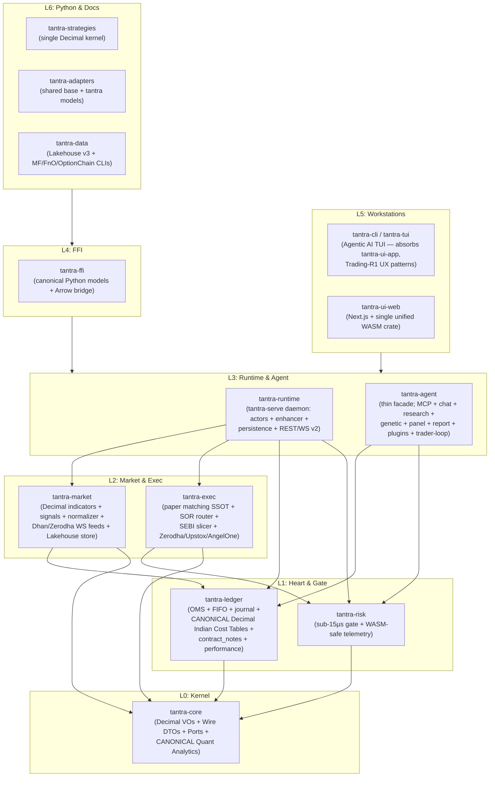
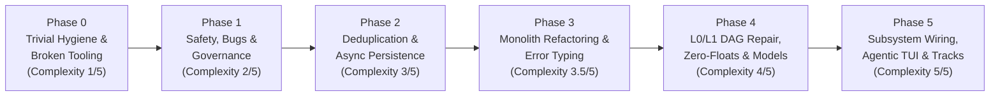

# 0019 — Codebase Audit, Architectural Consolidation, Unwired Subsystem Activation & Agentic TUI Unification

**Status:** Approved Plan (2026-11-21)  
**Scope:** Platform-wide — all 15 repositories (`tantra-core`, `tantra-ledger`, `tantra-risk`, `tantra-market`, `tantra-exec`, `tantra-agent`, `tantra-runtime`, `tantra-ffi`, `tantra-ui`, `tantra-ui-web`, `tantra-strategies`, `tantra-adapters`, `tantra-data`, `tantra-examples`, `tantra-docs`)  
**Baseline Audited:** 2,276 source files · 483,538 LOC · 70 Rust crates · 8,702 audited functions (5,203 Rust, 2,883 Python, 616 TypeScript/TSX)  
**Governance References:** `AGENTS.md`, `.agents/rules/architecture-and-coupling.md`, `.agents/rules/interface-first-and-modularity.md`, `.agents/rules/testing-and-verification.md`, `.agents/rules/scalability-and-concurrency.md`, `.agents/rules/gap-tracking.md`, `.agents/rules/handoff-hygiene.md`.

---

## 1. Locked Architectural Decisions (2026-11-21)

1. **Naming Hygiene, Broken Tooling & Test Placement (Phase 0 & Phase 1)**:
   - Rename all remaining live `honba` / `vyapaar` production symbols, runtime defaults (including `jwt_issuer: "honba"`), worker names, MCP tool descriptions, and rule doc references to canonical `tantra` / `TANTRA_`.
   - Fix broken conformance tooling (`tantra-docs/scripts/verify_conformance.py`, which currently filters `honba-*` and silently skips all 15 `tantra-*` repos).
   - Move both inline `#[cfg(test)]` blocks out of `src/` into parallel `tests/` directories (`tantra-agent-analytics/src/volatility.rs`, `tantra-runtime-api/src/strategy_loop.rs`).
   - **Re-evaluation of `std::time::Instant::now()` in `tantra-risk/src/engine.rs` (lines 454 & 829)**: Confirmed that `Instant::now()` is **NOT** used for any risk decision, OTR window, or refusal (all domain logic uses explicit injected `now: DateTime<Utc>`). It exists solely for sub-15 µs SLA latency telemetry (`metrics.record_evaluation_duration(...)`). **Decision**: Do **not** remove latency telemetry; instead guard it with `#[cfg(not(target_arch = "wasm32"))]` (or an optional zero-cost `LatencyObserver` trait with a `NoopObserver` default on `wasm32`) so `tantra-risk` preserves sub-15 µs production SLA observability while compiling and running panic-free on `wasm32-unknown-unknown`.
2. **Unwired / Unreachable / Unused Code Policy (Investigate & Wire First — Never Blindly Delete)**:
   - Unwired crates and test-only modules were intentionally built under prior roadmap tracks (`E12`, `ADR 0031`, `plan 0003`, `gap 0003`, `T12`–`T22`) and represent **~24,800 LOC** of tested production capability lacking composition-root wiring.
   - Only genuine junk (1-line abandoned `.rs` stubs, stale `.pyc` bytecode trees, orphaned unused TS files, verbatim copy-pasted duplicates) is deleted. Every substantive unwired crate and Python/TS module is mapped in §4 with **purpose, usefulness, integration point, and target wiring phase**.
3. **Agentic AI-First TUI (`tantra-tui`) & Retirement of `tantra-ui-app` (Inspired by `~/tmp/Trading-R1`)**:
   - `tantra-ui-app` (originally a Leptos 0.8 CSR web shell + feature state models) is now **superseded** by `tantra-ui-web` (Next.js) in the browser and **`tantra-tui` (Ratatui)** in the terminal.
   - **Decision**: Import all unique, non-duplicated feature models from `tantra-ui-app` (`paper.rs`, `studio_ee.rs`, `system.rs`, `simulator.rs`) into `tantra-ui-core` / `tantra-tui`, evolve `tantra-tui` into an **agentic, AI-native terminal workstation** incorporating key UX patterns from `~/tmp/Trading-R1` (side Plan & Sources/Citations panel, fuzzy command palette, interactive capability browser, structured agent-to-user questionnaires, reasoning/tool-detail toggles, session persistence, Typst/PDF/MD report export, scheduled brief jobs, and daemon mode), and then **retire `tantra-ui-app`**.
4. **Canonical Layer Ownership for Analytics (L0) & Indian Statutory Cost Tables (L1)**:
   - **Pure Quant Analytics → L0 (`tantra-core::analytics`)**: Consolidate pure, zero-I/O statistical and validation engines (`WalkForward`, `Holdout`, `MonteCarlo`, `DSR`, `PBO`, `CostStress`, `EquityStats`, `TradeStats`, `FactorAttribution`, `GARCH`, `HMM`, `Cointegration`, `Copula`, `ChangePoint`, `erf`/normal CDF) into `tantra-core::analytics`. Removes the **illegal L2→L3 dependency** (`tantra-market-store` → `tantra-agent-analytics`) and eliminates 3-way analytics duplication across `tantra-core`, `tantra-agent-analytics`, and `tantra-runtime-enhancer`.
   - **Canonical Indian Statutory Cost Tables (`Decimal`-only) → L1 (`tantra-ledger-journal`)**: Consolidate all NSE/BSE/NFO/MCX/CDS STT, exchange turnover, SEBI, stamp duty, and GST schedules in `rust_decimal::Decimal` inside `tantra-ledger-journal` (L1). Removes the **illegal L1→L2 dependency** (`tantra-ledger-journal` → `tantra-market-finance`), eliminates all `f64` statutory tax schedules in `tantra-market-finance/src/india/costs/`, and lets `tantra-market-finance` (L2) consume L1 downward (and expose costs to `tantra-ui-web` via WASM/REST instead of duplicating rates in `indian-charges.ts`).

---

## 2. Ecosystem Audit Baseline & Verified Findings

| Audit Dimension | Verified Count | Severity | Primary Files / Crates |
|---|---:|---|---|
| **L0–L6 Tier DAG Violations** | **2** | Critical | `tantra-ledger-journal` (L1→L2 `tantra-market-finance`), `tantra-market-store` (L2→L3 `tantra-agent-analytics`) |
| **Async / DoS / Memory Hazards** | **78** | Critical–High | 7 `unbounded_channel` (feeds/broker WS/MCP), 5 `axum::body::to_bytes(..., usize::MAX)`, 7 `std::sync::Mutex`/`RwLock`, 59 `std::fs` in async repos |
| **Zero-Floats Violations** | **405 lines / 48 files** | Critical–High | `tantra-market-finance/src/india/costs/{stt,model,cash_equity}.rs` (`f64` STT!), `tantra-market-pricing`, 25+ `tantra-market-indicators` files (gap `0009`) |
| **Production Functional Bugs** | **2** | Critical–High | `tantra-runtime-actors/src/portfolio.rs:152` (`is_delivery = true` tax bug), `tantra-runtime-api-rest/src/bootstrap.rs:185` (`jwt_issuer: "honba"`) |
| **Inline Tests in `src/`** | **2 files (7 attrs)** | Medium | `tantra-agent-analytics/src/volatility.rs:313`, `tantra-runtime-api/src/strategy_loop.rs:1106` |
| **Verbatim Cross-Repo Clones** | **28 Rust / 13 Py / 2 TS pairs** | High | `tantra-exec-paper` ↔ `tantra-runtime-backtest/src/sim/{l2_book,slippage,mis,latency}.rs` (148 shared 10-line windows) |
| **Duplicated Public Types** | **211 Rust / 53 Py** | High | `Bar` (4x Py), `Order*`/`Position`/`Strategy`/`SMA`/`EMA`/`RSI` (3x Py), 6 duplicated Repo Protocols in `bridge_exporter.py`, `tantra-market-store/{wire,ports}.rs`, `tantra-agent` facade duplicating `replay` |
| **Unreachable Crates** | **24 / 70** (18 substantive + 6 facades) | High | ~24,800 LOC of tested crates not linked by any of the 7 shipping binaries/cdylibs (detailed in §4) |
| **Unreachable / Test-Only Fns** | **218 unwired / 568 test-only** | Medium | Rust: 179 unwired `pub`, 439 test-only, 26 `#[allow(dead_code)]`; Py: 30 unwired, 123 test-only; TS: 9 unwired, 6 test-only |
| **Orphaned Source Files** | **7** | Low | 4 one-line `.rs` stubs (`tearsheet.rs` ×2, `parquet.rs`, `excel.rs`), 3 unimported TS files (`screener-indicators.ts`, `tooltip.tsx`, `tabs.tsx`) |
| **God Files / God Functions** | **110 files / 119 fns** | Medium | 71 Rust (>=600L, max 3,296L), 17 Py (>=500L, max 1,523L), 22 TS (>=500L, max 2,967L); functions up to 858 LOC |
| **Production `.unwrap()` / Suppressions** | **339 `.unwrap()` / 186 suppressions** | Medium | 339 Rust `.unwrap()` in `src/`; 135 `# type: ignore`, 34 `# noqa`, 17 `eslint-disable` (14 `exhaustive-deps`), 8 silent `except: pass` |
| **Forgotten Items & Workspace Drift** | **10 categories** | High–Low | Broken `verify_conformance.py`, stale closed gap docs (`data 0015/0023/0024/0025`), 1,102L `HANDOFF.md`, `see-me.txt`, `vyapaar_strategies/__pycache__`, `tantra-ui-web` missing from `.gitmodules`, dirty `tantra-ui` submodule, deprecated `/api/v1/experimental-analysis/*` calls in `tantra-ui-web` |

---

## 3. Architectural Target State (DAG Repair & Layer Ownership)

---

## 4. Investigation of All Unwired / Unreachable Subsystems — Usefulness & Wiring Blueprint

Out of **70 Rust crates**, only **46** are transitively linked by the **7 shipping entrypoints** (`tantra-cli`, `paper_serve`, `mcp_stdio_server`, `tantra-exec-audit`, `tantra-ffi-codegen`, `tantra-ffi-py`, `tantra-ui-web-wasm`). The remaining **24 crates** comprise 6 repo facades (`tantra-agent`, `tantra-exec`, `tantra-ffi`, `tantra-market`, `tantra-runtime`, `tantra-ui`) and **18 substantive implementation crates (~24,800 LOC)** plus unwired Python/TS modules. Below is the verified disposition, usefulness, and wiring plan for every single one.

### 4.1 Execution & Live Market Feed Crates (8 Crates · 8,563 LOC)

| Crate | LOC | Original Plan / Purpose | Usefulness | Exact Wiring Target & Integration Design | Target Phase |
|---|---:|---|---|---|---|
| `tantra-exec-router` | 898 | OTR-aware Smart Order Router (`ResilientRouter`, broker health, failover, mandatory `RiskEngine` gate) | Production multi-broker order routing with health circuit-breaking & SEBI OTR compliance | Wire as the `ExecutionGateway` implementation inside `tantra-runtime-actors::ExecutionActor` and `tantra-serve` live composition root (wrapping concrete broker executors) | **Phase 5.1** |
| `tantra-exec-slicer` | 1,270 | SEBI scrip-freeze-limit slicer + TWAP / VWAP / Iceberg child-order execution algorithms | Required for live NSE/NFO institutional order sizes exceeding exchange freeze limits | Wire upstream of `tantra-exec-router` inside `tantra-runtime-actors::ExecutionActor` (auto-slice orders > freeze qty; expose `ExecAlgo::{Twap,Vwap,Iceberg}` via `/api/v2/orders`) | **Phase 5.1** |
| `tantra-exec-angelone` | 1,164 | Angel One SmartAPI 2.0 exact-decimal REST/WS execution adapter (plan 0002) | First-party Indian broker execution alternative to Zerodha | Register in `tantra-serve` broker factory (`config.execution.broker = "angelone"`) behind `Arc<dyn BrokerExecutor>` | **Phase 5.1** |
| `tantra-exec-upstox` | 1,333 | Upstox v2 exact-decimal REST/WS execution adapter | First-party Indian broker execution alternative | Register in `tantra-serve` broker factory (`config.execution.broker = "upstox"`) behind `Arc<dyn BrokerExecutor>` | **Phase 5.1** |
| `tantra-market-dhan` | 957 | DhanHQ v2 real binary WebSocket live market feed (`gap 0003`) | Live Indian tick/depth ingestion for `MarketDataActor` & `/ws/live` | Register in `tantra-serve` feed factory (`config.market.feed = "dhan"`) implementing `MarketFeed` port | **Phase 5.1** |
| `tantra-market-zerodha` | 771 | Zerodha Kite Connect 3 real binary WebSocket live market feed (`gap 0003`) | Live Indian tick/depth ingestion for `MarketDataActor` & `/ws/live` | Register in `tantra-serve` feed factory (`config.market.feed = "zerodha"`) implementing `MarketFeed` port | **Phase 5.1** |
| `tantra-market-normalizer` | 457 | Instrument master mapping & corporate-actions adjustment engine (splits, bonuses, symbol renames) | Point-in-time backtest split adjustment + broker token ↔ canonical `InstrumentId` resolution | Wire into `tantra-runtime-backtest::CatalogLoader` (split/bonus adjustment) and `tantra-runtime-actors::MarketDataActor` (`symbol_mapper`) | **Phase 4.3 / 5.1** |
| `tantra-market-signals` | 1,713 | Explainable causal buy/sell signal detectors (ADR 0031, ROADMAP E12: ORB, breakout, divergence, regime) | Reusable Rust signal engine for Screener, Study API, and Strategy Loop | Wire into `tantra-runtime-api-rest` (`/api/v2/studies/signals` & screener scans) and `tantra-agent-chat-tools` (`scan_signals`) | **Phase 4.3 / 5.1** |

### 4.2 Runtime Pipeline, Persistence, Optimizer & Ledger Crates/Modules (2 Crates + 3 Test-Only Subsystems · ~6,931+ LOC)

| Crate / Module | LOC | Purpose | Usefulness | Exact Wiring Target & Integration Design | Target Phase |
|---|---:|---|---|---|---|
| `tantra-runtime-persistence` (unwired DB write hooks) | — | SQLx persistence for `OrderLedger`, `ApprovalQueue`, `TradingState`, `Positions`, `AuditLog` (`persist_positions_to_db`, `persist_to_db`) | Prevents state loss on restart; replaces unsafe `std::sync::Mutex` + sync `std::fs` JSON files in `tantra-runtime-api-rest` | Wire into `tantra-runtime-api-rest` `AppState` (`portfolio_store`, `run_store`, `journal`, `approval`, `orders`) | **Phase 2.7** |
| `tantra-runtime-enhancer` | 3,458 | Multi-objective GA, Bayesian optimizer, Walk-Forward Optimization, Monte Carlo, Stress Testing, Odysseus evolution | Real hyperparameter tuning & overfitting guardrails (DSR/PBO) instead of grid-only stubs | Wire into `tantra-runtime-api-rest` (`POST /api/v2/sweeps` modes `ga|bayesian|wfo|monte_carlo|stress`), `tantra-agent-mcp::optimize_strategy`, `tantra-agent-chat-tools::strategy_tune`, and `tantra-cli tune` | **Phase 5.1** |
| `tantra-runtime-actors` | 3,473 | Tokio supervision tree (`MarketDataActor` → `StrategyActor` → `SizingActor` → `RiskActor` → `ExecutionActor` → `PortfolioActor`) | Core live/paper event-driven trading runtime (NautilusTrader architecture) | Expose unified **`tantra-serve`** binary (`tantra-runtime/src/bin/tantra_serve.rs` or `tantra serve --mode live\|paper`) booting the supervised actor pipeline alongside REST/WS API | **Phase 5.1** |
| `tantra-ledger-journal::contract_notes` & `tantra-ledger-performance` | 678+ | Broker contract-note STT/net-amount reconciliation & closed-trade performance attribution store | Post-trade broker reconciliation & real-time journal P&L analytics | Wire into `tantra-runtime-api-rest` (`/api/v2/reconcile/contract-notes`, `/api/v2/portfolio/performance`) and `tantra-cli reconcile` | **Phase 5.1** |

### 4.3 Autonomous AI Agent Crates (6 Crates · 5,781 LOC)

| Crate | LOC | Purpose | Usefulness | Exact Wiring Target & Integration Design | Target Phase |
|---|---:|---|---|---|---|
| `tantra-agent-report` | 438 | Embedded Typst & Markdown quantitative research tearsheet generator (PDF/MD) | Publication-grade PDF/MD research reports directly from CLI, TUI (`Trading-R1` export pattern), and Web | Wire into `tantra-cli export` (`--format pdf\|md`), `tantra-tui` `/export` command, and `POST /api/v2/reports/export` | **Phase 5.2 / 5.3** |
| `tantra-agent-panel` | 1,277 | Research-grade panel econometrics (Fixed/Random Effects, Fama-MacBeth, cross-sectional factor models, plan 0003) | Institutional alpha factor validation & academic econometric testing via AI agent | Expose ReadOnly tools (`panel_regression`, `fama_macbeth`) in `tantra-agent-chat-tools` & `tantra-agent-mcp` | **Phase 5.2** |
| `tantra-agent-plugins` | 144 | Extensible plugin manifest & capability loader for custom user research skills | User-authored research skills & toolpacks (mirrors `Trading-R1` capability browser) | Wire into `tantra-agent-chat` tool registry startup (`~/.tantra/plugins/`) and `tantra-tui` Capability Browser | **Phase 5.2 / 5.3** |
| `tantra-agent-research` | 2,151 | Autonomous quantitative research loop (hypothesis → backtest → statistical verification → mutation → report) | End-to-end unattended AI quant researcher | Wire into `tantra-runtime-jobs` (`JobKind::ResearchLoop`), `tantra-agent-mcp` (`start_research_cycle`), and `tantra-tui` live Plan Panel | **Phase 5.2** |
| `tantra-agent-genetic` | 1,660 | StockSharp Odysseus port: genetic expression-tree strategy synthesizer | Evolutionary rule discovery & strategy code generation | Wire into `tantra-runtime-enhancer::odysseus` + `tantra-agent-mcp` (`genetic_synthesize_strategy`) | **Phase 5.2** |
| `tantra-agent-trader-loop` | 111 | Per-strategy async closed-grammar LLM decision loop (`Decision` → `RiskEngine`) | Autonomous AI trader execution (NoFX pattern) | Wire into `tantra-runtime-actors` as `AiStrategyActor` under `tantra-serve --enable-ai-trader` (non-bypassable `RiskEngine` gate) | **Phase 5.2** |

### 4.4 UI, Python Data, Adapter & Web Unwired Subsystems

| Subsystem / Module | Unwired Items | Usefulness | Wiring / Consolidation Action | Target Phase |
|---|---|---|---|---|
| `tantra-ui-app` (2,134L) & `tantra-ui-assets` (672L) | `paper.rs`, `studio_ee.rs`, `system.rs`, `simulator.rs`, `themes.rs`, `branding.rs` | Pure paper order ticket, EE+ view rows, subsystem health panel, streaming equity progress | **Import unique modules into `tantra-ui-core` & `tantra-tui`**, evolve `tantra-tui` with `Trading-R1` agentic UX (§5), then **retire `tantra-ui-app`** | **Phase 5.3** |
| `tantra-data` stores & readers | `DuckDbMutualFundsStore` (11 methods), `DuckDbFnoSpreadStore` (5), `bridge_exporter.export_option_chain*`, `PythonMutualFundReader`, `PythonIpoReader`, `read_bse_ixbrl`, `download_session_bhavcopy` | Complete MF holdings lookthrough, F&O basis/spreads, option-chain Parquet bridge, BSE iXBRL shareholding | Wire into `tantra-data/cli/{export_bridge,catalog,ingest_*}.py` and expose via `TantraDataService` + Lakehouse v3 Rust bridge | **Phase 5.2** |
| `tantra-ffi/python/tantra/adapters/` | `AdapterCapabilities.supports_*` (7 methods), `FileSecretStore.rotate_key`, `TokenSession.ensure_valid`, `RateLimiter.available_tokens`, `AdapterRegistry.discovery_errors` | Pre-flight order/product/TIF capability validation, automatic broker token refresh, credential rotation, diagnostics | Wire `AdapterCapabilities` checks into `BaseExecutionPort.submit_order`, wire `TokenSession.ensure_valid` into HTTP/WS transport middleware, expose `rotate_key` & `discovery_errors` in CLI diagnostics | **Phase 2.5 / 5.2** |
| `tantra-ui-web` WASM & Overlay utilities | 18 dead `tantra-ui-web-wasm` chart fns + 5 dead `tantra-wasm-client.ts` exports (`chartSetSceneLayerVisibility`, `chartFitContent`, `chartListDrawings`, `wasmRefreshThemeAll`), `overlay-scene.ts` (`withLayerVisibility`, `splitSceneIndicators`, `paneSeriesLabel`), `buildStudySummaryMarkdown`, `buildPeriodReturnsCsv` | Required by **Track `T21.5`** (Interactive Layer Pill Bar, sub-pane indicator sync, study Markdown/CSV export) & chart toolbar | Wire `chartSetSceneLayerVisibility`, `withLayerVisibility`, `splitSceneIndicators`, `chartFitContent`, `buildStudySummaryMarkdown`, `buildPeriodReturnsCsv` during **`T21.5`**; consolidate WASM crate into `tantra-ui-api-wasm` (gap `0002`) | **Phase 5.3 / 5.4** |

---

## 5. Agentic TUI Unification Plan: Importing `tantra-ui-app` into `tantra-tui` (`Trading-R1` Blueprint)

### 5.1 Feature Migration Audit (`tantra-ui-app` → `tantra-ui-core` / `tantra-tui`)

| `tantra-ui-app` Module | LOC | Disposition | Target Destination |
|---|---:|---|---|
| `paper.rs` (`PaperOrderTicket`, `PaperWorkingOrder`, `PaperFill`, `PaperDepthRow`, `PaperPosition`) | 379 | **Import** | Move pure model to `tantra-ui-core::paper`; render interactive Paper Order Ticket + L2 Depth + Working Orders inside `tantra-tui` |
| `studio_ee.rs` (`StudioEeFeature`, level/signal/position row builders) | 116 | **Import** | Merge into `tantra-ui-core::strategy` & `tantra-tui::{positioning,strategy_lab}` |
| `system.rs` (`SystemFeature`, `SubsystemStatus`, `SubsystemState`) | 102 | **Import** | Move to `tantra-ui-core::system`; render in `tantra-tui` `/status` drawer & footer health indicator |
| `simulator.rs` (`SimulatorFeature`, `SimulatorPhase`, `EquityCurvePoint`) | 92 | **Import** | Merge into `tantra-tui::strategy_lab` / backtest live progress bar & sparkline |
| `studio.rs` (`StudioCanvas`, `StudioNode`, `Connection`) | 181 | **Retire** (or archive) | Node-graph canvas is superseded by `tantra-ui-web` visual workbench & `tantra_library` declarative recipes |
| `watchlist.rs`, `portfolio.rs`, `screener.rs`, `backtest.rs`, `algos.rs`, `router.rs` | 603 | **Retire (Duplicated)** | Already superseded by `tantra-tui::live_data` (558L) + `tantra-tui::app` (1,607L) + `tantra-ui-web` |
| `web.rs` (Leptos 0.8 CSR app shell) | 621 | **Retire (Superseded)** | Superseded by `tantra-ui-web` (Next.js) |
| `tantra-ui-assets` | 672 | **Split & Slim** | Keep terminal palette/branding constants in `tantra-ui-core::theme`; retire redundant web CSS/fonts duplicated in `tantra-ui-web` |

### 5.2 Agentic AI TUI Enhancements Adopted from `~/tmp/Trading-R1`

`~/tmp/Trading-R1` demonstrates an exceptionally clean **AI-first agentic financial terminal** architecture (`tui/src/{components,ui,lib,setup}` + `MANUAL.md`). Rather than adding a Bun/TS TUI, we adopt its highest-leverage interaction patterns natively inside **Ratatui (`tantra-tui` + `tantra-cli`)** while keeping the single static Rust binary invariant:

1. **Agentic Split Workspace (Transcript + Live Side Rail)**:
   - Left/main pane: Streaming agent conversation (`agent_chat.rs`) with collapsible reasoning trace (`Show reasoning` toggle), `Tool details: brief | full`, inline structured `DisplayBlock` cards (`result_block.rs`), and interactive chart/scene projection (`strategy_lab.rs`).
   - Toggleable right **Side Panel** (inspired by `plan-panel.tsx` + `sources-rail.tsx`): displays the agent's live multi-step research/execution **Plan**, active tool **Data Records / Citations**, and active `SystemFeature` / Risk Engine health.
2. **Command Palette, Capability Browser & Structured Questionnaires**:
   - Fuzzy **Command Palette** (`Ctrl+P`, inspired by `command-palette.tsx`) unifying all slash commands (`/ee-study`, `/loop-eval`, `/loop-sweep`, `/hedge`, `/status`, `/export`, `/jobs`, `/paper`).
   - **Capability Browser** (`capability-browser.tsx`): Inspect all live MCP tools, `tantra_library` concepts/indicators, and loaded `tantra-agent-plugins` skills interactively.
   - **Structured Agent Questionnaire** (`questionnaire.tsx` / `ask-user.ts`): Native TUI modal for trade approval (`ApprovalQueue`), risk-parameter confirmation, and multi-choice strategy refinement.
3. **Sessions, Verification, Report Export, Scheduled Jobs & Daemon Mode**:
   - **Session Persistence & Auto-Compact**: `tantra sessions list|resume|delete` + context window auto-compaction.
   - **One-Command Report Export**: `tantra export <SESSION_ID> --format pdf|md|html` powered directly by **`tantra-agent-report` (Typst/Markdown)**.
   - **Scheduled Briefs & Delivery**: `tantra jobs add --cron ... --prompt ...` backed by **`tantra-runtime-jobs`**, with optional folder/webhook/email/Telegram delivery channels.
   - **Seamless Backend Daemon**: `tantra serve` / `tantra daemon status|logs` (unified `tantra-serve` binary) powering both `tantra tui` and `tantra-ui-web`.

---

## 6. Phase-Wise Remediation Roadmap (Sorted Strictly by Complexity)

---

### Phase 0 — Trivial Hygiene, Broken Tooling & Legacy Naming Cleanup
**Complexity:** `1 / 5` · **Estimated Effort:** 0.5–1 day · **Risk:** Very Low

| ID | Task | Concrete Targets | Verification Gate |
|---|---|---|---|
| **P0.1** | Remove stray root/temp files & stale `.pyc` tree | Delete `see-me.txt`; delete `tantra-strategies/vyapaar_strategies/` (stale `.pyc` bytecode only); remove/archive `docs/plans/Here is an architectural analysis of the.md` (items already landed) | `git status` clean at root & `tantra-strategies` |
| **P0.2** | Delete 4 abandoned 1-line orphan `.rs` stubs | `tantra-agent/crates/tantra-agent-analytics/src/tearsheet.rs`, `tantra-market/crates/tantra-market-store/src/export/{tearsheet,parquet,excel}.rs` | `make check` in `tantra-agent` & `tantra-market` |
| **P0.3** | Delete 3 orphaned TS files & 2 dead local helpers | `tantra-ui-web/src/lib/screener-indicators.ts`, `src/components/ui/{tooltip,tabs}.tsx`, unused `toRounded2` (`TradeWorkbenchView.tsx:14`), unused `dayOfWeek` (`JournalTrades.tsx:22`) | `npx tsc --noEmit && npx vitest run && npm run build` |
| **P0.4** | Clean up closed gap docs & trim `HANDOFF.md` | Delete `tantra-data/docs/gaps/{0015,0023,0024,0025}-*.md` (all already marked `closed`) and update `tantra-data/docs/gaps/README.md`; trim `.agents/HANDOFF.md` from 1,102L to <150L active state per `handoff-hygiene.md` | Broken-link check passes |
| **P0.5** | Fix broken docs conformance checker | Update `tantra-docs/scripts/verify_conformance.py:52` (`honba-` → `tantra-`) and `extract_tutorials.py` | Run `python3 tantra-docs/scripts/verify_conformance.py` and confirm all 15 repos are scanned |
| **P0.6** | Reconcile dirty `tantra-ui` submodule & register `tantra-ui-web` | Commit/resolve dirty edits in `tantra-ui/crates/{tantra-cli/src/block_render.rs,tantra-tui/src/result_block.rs}`; add `tantra-ui-web` to `.gitmodules` & root `README.md` | `git submodule status` clean |
| **P0.7** | Rename all live production `"honba"` / `"vyapaar"` symbols → `"tantra"` | `tantra-runtime-api-rest/src/bootstrap.rs:185` (`jwt_issuer: "tantra"`, optional env override for legacy tokens), `tantra-runtime-actors/src/python.rs:112` (`"tantra-py-{}"`), `tantra-agent-mcp/src/tools.rs` descriptions & payloads, `tantra-agent-genetic/src/synthesizer.rs:294`, `tantra-agent/src/lib.rs:1` header, `.agents/rules/architecture-and-coupling.md:16,34` (`vyapaar-ui-web` → `tantra-ui-web`) | `grep -rn "honba" --include="*.rs"` zero runtime hits; auth & MCP tests pass |

---

### Phase 1 — Governance Compliance, Security Hardening & High-ROI Bug Fixes
**Complexity:** `2 / 5` · **Estimated Effort:** 2–3 days · **Risk:** Low

| ID | Task | Concrete Targets | Verification Gate |
|---|---|---|---|
| **P1.1** | Cap all 5 unbounded `axum::body::to_bytes(..., usize::MAX)` reads | `tantra-runtime-api-rest/src/{dispatch.rs:108,150,160, ws_live.rs:202, lib.rs:240}` — introduce `MAX_HTTP_BODY_BYTES` constant (e.g., 16 MiB) and return HTTP 413 on overflow | New oversized-payload regression test in `tests/` passes |
| **P1.2** | Move both inline `#[cfg(test)]` blocks out of `src/` into `tests/` | `tantra-agent-analytics/src/volatility.rs:313` → `tests/volatility_tests.rs`; `tantra-runtime-api/src/strategy_loop.rs:1106` → `tests/strategy_loop_tests.rs` | `grep -rn "cfg(test)" */src */crates/*/src` returns 0 hits |
| **P1.3** | Fix `is_delivery = true` statutory tax miscalculation bug | `tantra-runtime-actors/src/portfolio.rs:152` — derive delivery vs intraday vs F&O from `Order`/`ProductType` | Unit tests covering CNC delivery, MIS intraday, and NFO fill statutory charges |
| **P1.4** | Guard `Instant::now()` in `tantra-risk` for WASM compatibility (per Decision 1) | `tantra-risk/src/engine.rs:454,829` — gate latency timing behind `#[cfg(not(target_arch = "wasm32"))]` (or optional zero-cost `LatencyObserver` trait) while preserving sub-15 µs native telemetry | `cargo check --target wasm32-unknown-unknown` green in `tantra-risk`; `cargo bench` sub-15 µs intact |
| **P1.5** | Replace all 7 `mpsc::unbounded_channel` calls with bounded channels + `BackpressurePolicy` | `tantra-market-{core/src/ws_client.rs:325, dhan/src/lib.rs:99, zerodha/src/lib.rs:87}`, `tantra-exec-{angelone/src/ws.rs:336, zerodha/src/ticker.rs:352, upstox/src/ws.rs:365}`, `tantra-agent-mcp/src/transport.rs:158` | `grep -rn "unbounded_channel"` returns 0; backpressure tests pass |
| **P1.6** | Harden DuckDB `DESCRIBE` interpolation & replace 8 silent `except: pass` | Allowlist table names in `tantra-data/tantra_data/store/mutual_funds.py:746`; replace silent `except: pass` blocks with explicit logging/typed errors | `ruff check && mypy --strict && pytest` green |
| **P1.7** | Align Cargo dependency versions across workspaces | Standardize `sha2` (`0.10`), `getrandom` (`0.4`), `tokio-tungstenite` (`0.26`), `proptest`, `bytes` across all `Cargo.toml` files | `cargo check --workspace --profile prod` green across all Rust workspaces |
| **P1.8** | Migrate `tantra-ui-web` off deprecated `/api/v1/experimental-analysis/*` | Retarget `tantra-ui-web/src/lib/experimental-analysis-client.ts:1456-1526` to canonical `/api/v2/studies/experimental-analysis/*` | `npx vitest run` green; 0 calls to deprecated `/v1/experimental-analysis` |

---

### Phase 2 — High-Impact Deduplication, Async Persistence & Adapter Wiring
**Complexity:** `3 / 5` · **Estimated Effort:** 4–6 days · **Risk:** Moderate

| ID | Task | Concrete Targets | Verification Gate |
|---|---|---|---|
| **P2.1** | Eliminate `tantra-exec-paper` ↔ `tantra-runtime-backtest/src/sim/` verbatim clone (148 windows!) | Delete duplicated `tantra-runtime-backtest/src/sim/{l2_book,slippage,mis,latency}.rs`; depend on `tantra-exec-paper` (L2) and re-export matching/slippage/MIS/latency types | T14 golden byte-identical fill parity test green across backtest/paper/Python/WASM |
| **P2.2** | Thin out `tantra-agent` facade crate (Facade Convention `docs/design/0001 §4.2`) | Remove duplicated `audit.rs`, `error.rs`, `parser.rs`, `replayer.rs` in `tantra-agent/crates/tantra-agent/src/`; re-export from `tantra-agent-core` & `tantra-agent-replay`; relocate `memory.rs` into `tantra-agent-chat` or `tantra-agent-core` | `tantra-agent` `make prod && make test` green |
| **P2.3** | Delete 6 duplicated Repository Protocols in `tantra-data` | Remove duplicated `FilingsRepository`, `CorporateActionsRepository`, `BlockDealsRepository`, `NewsRepository`, `InstitutionalFlowRepository`, `DeliveryRepository` from `tantra_data/service/bridge_exporter.py:94-170` and import from `tantra_data.ports.repositories` | `mypy --strict && pytest` green |
| **P2.4** | Deduplicate `tantra-adapters` broker boilerplate | Extract shared `_subscribe_channels`, order-id guards, and `Bar`/`Order` mapping helpers into `tantra_adapters/common/base.py` across `angelone`, `dhan`, `fyers`, `iifl`, `kotak`, `upstox`, `zerodha` | `tantra-adapters` contract & unit test suite green |
| **P2.5** | Wire unwired Python adapter safeguards & clean up `#[allow(dead_code)]` | Wire `AdapterCapabilities.supports_*`, `TokenSession.ensure_valid`, `RateLimiter.available_tokens`, `FileSecretStore.rotate_key`, `AdapterRegistry.discovery_errors` into `BaseExecutionPort` & broker transport; remove obsolete dead helpers (`_india.py`, `_pair.py`, `_BracketStrategy._reset_trade`); audit & eliminate unjustified `#[allow(dead_code)]` (26 sites) | Workspace clippy (`-D warnings`) & Python pytest green |
| **P2.6** | Deduplicate `tantra-market-store` Parquet projections | Extract generic `ParquetProjectionStore<T>` across the 8 `tantra-market-store/src/import/*_projection.rs` files | `tantra-market` `make prod && make test` green |
| **P2.7** | Wire `tantra-runtime-persistence` & remove blocking `std::sync::Mutex`/`std::fs` from Axum | Replace sync `std::sync::Mutex` + `std::fs` in `tantra-runtime-api-rest/src/{portfolio_store,profile_store,chat,run_store,journal,ticks_file,auth}.rs` with `tokio::sync::RwLock`, `tokio::fs`, and wired `tantra-runtime-persistence` SQLx stores (`persist_positions_to_db`, `persist_to_db`) | REST persistence & async concurrency integration tests green |

---

### Phase 3 — Monolith Decomposition, Typed Errors & Frontend Hardening
**Complexity:** `3.5 / 5` · **Estimated Effort:** 1–2 weeks · **Risk:** Moderate

| ID | Task | Concrete Targets | Verification Gate |
|---|---|---|---|
| **P3.1** | Decompose Top Rust God Files & God Functions | Split `tantra-agent-mcp/src/tools.rs` (3,296L / 858L fn) into per-domain modules; split `tantra-runtime-api-rest/src/{experimental_analysis.rs (3,163L), strategy_loop.rs (2,500L), openapi.rs (2,647L)}`; split `tantra-agent-chat/src/turn.rs` (`run_turn` 789L), `tantra-cli/src/runner.rs` (2,049L), `tantra-tui/src/app.rs` (1,607L), `tantra-ledger-portfolio/src/lib.rs` (1,646L), `tantra-runtime-backtest/src/catalog.rs` (1,683L) | Zero public API regressions; `make prod && make test` |
| **P3.2** | Unify `tantra-risk/src/engine.rs` dual check pipelines | Merge overlapping `evaluate_core_checks` (308L) and `check_order_fast_checks` (302L) into one composable, zero-alloc check pipeline; split 1,304L `engine.rs` by rule domain | Proptests + `cargo bench` sub-15 µs SLA verified |
| **P3.3** | Replace 17 `pub fn -> Result<_, String>` & audit top `.unwrap()` hotspots | Introduce `thiserror` error enums in `tantra-ledger-portfolio`, `tantra-risk`, `tantra-runtime-strategy/synthetic_oco.rs`, `tantra-runtime-actors`, `tantra-agent-research`, `tantra-agent-chat-tools`, `tantra-tui`; replace panic-prone `.unwrap()` in `tantra-runtime-api-rest` (50) & `tantra-runtime-backtest` (44) | `cargo clippy --all-targets -- -D warnings` green |
| **P3.4** | Refactor `tantra-ui-web` God Components & Hook Suppressions | Split `ChartCanvas.tsx` (1,443L) into chart-lifecycle, overlay-scene, and drawing hooks; replace 1,350L manual DTOs in `experimental-analysis-client.ts` with generated `api-schema.d.ts`; resolve all 14 `react-hooks/exhaustive-deps` suppressions | `npx tsc --noEmit && npm run lint && npx vitest run && npm run build` |
| **P3.5** | Refactor Python God Files, Reduce `# type: ignore` (135) & Unify CLI Tokio Runtime | Split `bridge_exporter.py` (1,523L), `elephant_edge.py` (1,417L), `tantra_library/catalog.py` (1,068L), `l2_sim.py` (918L); unify single top-level Tokio runtime in `tantra-cli/src/main.rs` (removing 4 nested `Builder::new_current_thread()` calls in `runner.rs` & `jobs_runtime.rs`) | `ruff check && mypy --strict && pytest` + `tantra-cli` tests green |

---

### Phase 4 — Architectural DAG Repair (L0 Analytics, L1 Cost Tables), Zero-Floats & Canonical Models
**Complexity:** `4 / 5` · **Estimated Effort:** 2–3 weeks · **Risk:** High (cross-repo type migrations)

| ID | Task | Concrete Targets | Verification Gate |
|---|---|---|---|
| **P4.1** | **Repair `L1 → L2` DAG Violation & Consolidate Decimal Cost Tables in `tantra-ledger` (Decision 4)** | Move canonical Indian segment cost/STT/stamp/SEBI/GST tables (100% `rust_decimal::Decimal`, zero `f64`) into **`tantra-ledger-journal` (L1)**; remove `tantra-market-finance` from `tantra-ledger-journal/Cargo.toml`; have `tantra-market-finance` (L2) delegate downward to L1 `tantra-ledger-journal` and delete `f64` `india/costs/{stt,model,cash_equity}.rs`; expose cost preview via WASM/REST to replace `tantra-ui-web/src/lib/indian-charges.ts` | Golden Indian statutory fee vectors byte-identical; L1→L2 edge = 0 |
| **P4.2** | **Repair `L2 → L3` DAG Violation & Consolidate Pure Analytics in `tantra-core` L0 (Decision 4)** | Move pure zero-I/O quant analytics (`EquityStats`, `TradeStats`, `WalkForward`, `Holdout`, `MonteCarlo`, `DSR`, `PBO`, `CostStress`, `FactorAttribution`, `GARCH`, `HMM`, `Cointegration`, `Copula`, `ChangePoint`, `erf`/normal CDF) into **`tantra-core::analytics` (L0)**; remove `tantra-agent-analytics` from `tantra-market-store/Cargo.toml`; turn `tantra-agent-analytics` into thin re-exports (or retire) and remove duplicate `WalkForward*`/`MonteCarlo*` in `tantra-runtime-enhancer` | Zero L2→L3 upward edges; all analytics proptests & wasm32 check green |
| **P4.3** | **Eliminate `tantra-market-store` Local Wire Redefinitions & Study DTO Duplication** | Retire duplicate `Bar`, `Instrument`, `InstrumentMaster`, `MarketEvent`, `PortError`, `UnixNanos`, `BarSpecification` in `tantra-market-store/src/{wire,ports}.rs` in favor of `tantra-core`; share study DTOs between `tantra-market-finance` and `tantra-runtime-api` directly without copy-paste | `tantra-core`, `tantra-market`, `tantra-runtime` `make prod && make test` |
| **P4.4** | **Complete Zero-Floats Migration in `tantra-market-indicators` (Close Gap `0009`)** | Migrate remaining ~25 `f64` indicator files (`adx`, `rsi`, `bollinger`, `stochastic`, `supertrend`, `ichimoku`, `parabolic_sar`, `williams_r`, `vortex`, `cpr`, `hull_ma`, `aroon`, `donchian`, `cci`, `mfi`, etc.) to `rust_decimal::Decimal` with golden parity vectors against `tantra_library` | Close `tantra-market` gap `0009`; `wasm32` + golden parity green |
| **P4.5** | **Unify Python Domain Models Across `tantra-ffi`, `tantra-adapters` & `tantra-strategies`** | Establish `tantra` (`tantra-ffi/python`) as the single canonical Python home for `Bar`, `Tick`, `Order`, `OrderSide`, `OrderType`, `TimeInForce`, `OrderStatus`, `Position`, `OrderEvent`, `Parameter`, `Strategy`; retire `tantra/indicators/_legacy.py` and duplicate model classes in `tantra-adapters` & `tantra-strategies` | Full Python pytest + `mypy --strict` green across all 4 Python repos |
| **P4.6** | **Enforce Workspace-Wide Architecture & Invariant CI Gate** | Add fast automated CI gate in root `Makefile` verifying: (1) strict L0–L6 Tier DAG & zero cycles, (2) zero `#[cfg(test)]` in `src/`, (3) zero `unbounded_channel`, (4) zero `usize::MAX` body reads, (5) zero `f32`/`f64` in L0/L1/statutory costs, (6) zero live `honba` runtime strings | `make verify-architecture` passes in <5s |

---

### Phase 5 — Unwired Subsystem Activation, Agentic TUI Unification & Platform Closure
**Complexity:** `5 / 5` · **Estimated Effort:** 3–5 weeks · **Risk:** High (end-to-end integration)

| ID | Task | Concrete Targets | Verification Gate |
|---|---|---|---|
| **P5.1** | **Ship Unified `tantra-serve` Daemon Wiring Live Actors, SOR, Slicer, Feeds, Enhancer & Reconciliation (12 Crates)** | Create/upgrade `tantra-serve` binary (`--mode paper\|live`) wiring: `tantra-runtime-actors` supervision tree, `tantra-exec-router` (SOR), `tantra-exec-slicer` (SEBI freeze + TWAP/VWAP/Iceberg), `tantra-exec-{zerodha,angelone,upstox}`, `tantra-market-{dhan,zerodha,normalizer,signals}`, `tantra-runtime-enhancer` (GA/Bayesian/WFO/MC/Stress into `/api/v2/sweeps` & `tantra-cli tune`), and `tantra-ledger-journal::contract_notes` + `tantra-ledger-performance` into REST/CLI reconciliation endpoints | End-to-end paper & simulated-broker integration tests green; crate reachability jumps from 65.7% → >90% |
| **P5.2** | **Wire Autonomous Agent & Data Lakehouse Subsystems (6 Agent Crates + Data Stores)** | Wire `tantra-agent-report` (Typst/MD export into `tantra export` & `/api/v2/reports/export`), `tantra-agent-panel` (`panel_regression`/`fama_macbeth` MCP tools), `tantra-agent-plugins` (skill manifest loader), `tantra-agent-research` + `tantra-agent-genetic` (background `tantra-runtime-jobs` research & Odysseus synthesis), `tantra-agent-trader-loop` (`AiStrategyActor` behind `RiskEngine`); wire `DuckDbMutualFundsStore`, `DuckDbFnoSpreadStore`, `bridge_exporter.export_option_chain*`, `PythonMutualFundReader`, `PythonIpoReader`, `read_bse_ixbrl` into `tantra-data` CLIs & bridge | All agent dependency rules R1–R4 + MCP tool count pins + data CLI E2E tests green |
| **P5.3** | **Evolve `tantra-tui` into `Trading-R1`-Style Agentic Workstation, Import `tantra-ui-app`, & Unify WASM (Decision 3)** | (a) Import `paper.rs`, `studio_ee.rs`, `system.rs`, `simulator.rs` from `tantra-ui-app` into `tantra-ui-core` & `tantra-tui`; (b) add `Trading-R1`-inspired agentic UX to `tantra-tui` (Plan + Sources/Citations side rail, fuzzy `Ctrl+P` Command Palette, Capability Browser, structured Agent Questionnaire/Approval modal, reasoning & tool-detail toggles, session resume/compact, `tantra export` via `tantra-agent-report`, scheduled brief jobs); (c) move `evaluate_offline_strategy_loop` (532L) out of `tantra-ui-core/src/scene_projector.rs` into L2/L3; (d) **retire `tantra-ui-app`** & trim `tantra-ui-assets`; (e) merge `tantra-ui-web-wasm` into `tantra-ui-api-wasm` (closing `tantra-ui-web` gap `0002`) | `tantra-ui` & `tantra-ui-web` full `make prod && make test` + `npm run build` green; 0 duplicate WASM crates |
| **P5.4** | **Complete Remaining Cross-Repo Roadmap Tracks (`T21.5`, `T21.6`, `T17` Phase 4)** | Land `T21.5` (Web interactive Layer Pill Bar, Hint Inspector, Strategy Loop & Hedge Workbench — wiring the remaining `overlay-scene.ts` / `tantra-wasm-client.ts` / study CSV+MD export helpers + live Playwright check), `T21.6` (`tantra-agent` plan 0018 loop/sweep/hedge/scene MCP tools), and Lakehouse v3 Phase 4 (legacy flat-catalog fallback removal once Rust v3 parity is verified) | Playwright E2E + MCP E2E + `mkdocs build --strict` green |

---

## 7. Tracking & Exit Criteria

Plan `0019` is complete when:
1. All 6 phases (`P0`–`P5`) pass their verification gates and `make verify-architecture` (`P4.6`) is enforced in CI.
2. L0–L6 Tier DAG upward violations = **0**; inline `#[cfg(test)]` in `src/` = **0**; `unbounded_channel` = **0**; `usize::MAX` HTTP body reads = **0**; `f64` statutory tax schedules = **0**; live `honba` runtime strings = **0**.
3. Substantive unwired Rust crates drop from **18 → 0** (either wired into `tantra-serve` / `tantra-cli` / `tantra-agent-mcp` / `tantra-tui` or explicitly retired per Decision 3).
4. `tantra-ui-app` unique capabilities are imported into `tantra-tui` and `tantra-ui-app` is cleanly retired.
5. Per `.agents/rules/gap-tracking.md §4`, once completed, this plan file is archived/removed and recorded in `docs/plans/README.md` with closing commits.
