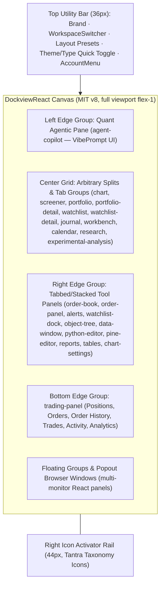

# 0020 — `tantra-ui-web` Dockview Shell, Taxonomy Icon Porting, Theme/Typography Bridge & VibePrompt AI/Agentic Pane Migration

**Status:** Proposed Plan — Approved for Documentation Only (2026-11-21; implementation not yet started)  
**Scope:** `tantra-ui-web` (with read-only contract alignment to `tantra-runtime` `/api/chat` and `/api/v2/profile`)  
**Supersedes / Consolidates Shell UX:** `tantra-ui-web/docs/plans/0010` (Unified Workspace Shell), `tantra-ui-web/docs/plans/0008` (RightIconDock / TradingDock layout shell)  
**Governance References:** `AGENTS.md`, `.agents/rules/gap-tracking.md`, `.agents/rules/testing-and-verification.md`

---

## 1. Locked Architectural Decisions

1. **Dockview MIT Tier Only (`dockview-react` v8.x)**:
   - Use the **MIT-licensed** `dockview-react` package exclusively (zero runtime dependencies, official React 19 peer dependency support).
   - Do **not** depend on `dockview-enterprise`. All target capabilities—split/grid layouts, nested tabs, `left`/`right`/`bottom` edge groups (`addEdgeGroup`), floating groups (`addFloatingGroup`), multi-window popouts (`addPopoutGroup`), custom tab renderers, header action slots, tab context menus, watermark empty states, themes, and full `toJSON()`/`fromJSON()` serialization—are available in MIT `dockview-react`.
   - Edge-group toggling via our lean icon activator rail provides clean collapse/expand ergonomics without Enterprise auto-hide overlay dependencies.

2. **Redirect Everything to Dockview (Single Unified Workstation Shell)**:
   - `/workspace` (`DockviewWorkspace`) becomes the **sole interactive application shell**.
   - Every secondary route currently under `tantra-ui-web/src/app/(app)/` (`/portfolio`, `/portfolio/[id]`, `/watchlists/[id]`, `/alerts`, `/chats`, `/screener`, `/support`) redirects cleanly into `/workspace?open=<panelKind>&...` so bookmarks, external links, and Command Palette deep links resolve directly into the appropriate Dockview panel (reusing existing `next/navigation` `redirect()` pattern already established in `(app)/portfolio/page.tsx` and `(app)/screener/page.tsx`).
   - `AppSidebar.tsx` and `src/app/(app)/layout.tsx` are retired after route redirection; `CommandPalette.tsx` (`Ctrl+K`) moves into the global Dockview shell and dispatches actions directly through `dockviewApi` (`openOrFocusPanel`) rather than full-page navigation.

3. **Retain & Complete the 324-Icon Taxonomy**:
   - **Retain all 7 categories** in `tantra-ui-web/src/assets/icons/index.ts`, `manifest.json`, and `public/assets/icons/*.svg` (`drawing-tools` 126, `general` 123, `docks-and-panels` 22, `chart-controls` 21, `chart-styles` 21, `decorative` 7, `ai-assistant` 4).
   - Do **not** discard, flatten, or replace the taxonomy with Dockview's default icons or ad-hoc `lucide-react` imports.
   - Port every layout/docking icon not supplied by Dockview and every AI/agentic trace icon required by the VibePrompt pane **into the existing taxonomy categories** (`docks-and-panels`, `ai-assistant`, `general`), keep `npm run icons:showcase` green, and wire a shared `<TantraIcon>` atom across Dockview tabs, header actions, toolbars, and the AI pane.

4. **Lean, Tokenized Theme & Typography Bridge**:
   - Keep runtime dependencies minimal: `dockview-react` is the **only** new runtime dependency.
   - Unify Tantra's `--color-*` palette tokens, Dockview's `--dv-*` theme variables, and WASM `openalgo-charts` canvas theming behind a single `data-theme` + `DockviewTheme` bridge supporting both **dark** (`tantra-obsidian` default, `abyss`, `dracula`, `vs-dark`) and **light** (`tantra-paper`, `github-light`) themes.
   - Preserve `Space Grotesk` (`--font-display`) and `IBM Plex Mono` (`--font-mono` for quotes, tickers, tables, run IDs, and raw tool payloads), add a crisp UI sans (`Plus Jakarta Sans` / `Inter` as `--font-sans`) for readable agent prose, and unlock density (`compact`/`comfortable`) and font-scale controls in `SettingsModal.tsx`.

5. **AI / Agentic Pane Built on `vibeprompts.dev` Patterns**:
   - Rebuild `ChatRail.tsx`, `ResearchLanding.tsx`, `ResearchTurn.tsx`, `ToolCallGroup.tsx`, and `FollowUpComposer.tsx` into a first-class Dockview panel (`agent-copilot`, docked in the `left` edge group by default) using zero-dependency Tailwind + React adaptations of `vibeprompts.dev` layouts:
     - **Agent Run Trace** (`bonus-agent-run-trace`)
     - **Prompt Token Counter** (`bonus-prompt-token-counter`)
     - **Support Chat Widget & Inbox Split View** (`contact-support-chat-widget`, `dashboards-inbox-split-view`)
     - **Markdown Live Preview & JSON Tree Viewer** (`bonus-markdown-live-preview`, `bonus-json-tree-viewer`)
     - **Selective Diff Staging** (`bonus-selective-diff-staging`)
     - **Skeleton Loading State, Empty State & Command Palette** (`bonus-skeleton-loading-state`, `bonus-empty-state`, `bonus-command-palette`)

---

## 2. Current Shell Audit & Gap Summary

| Area | Current Implementation | Limitation Solved by Migration |
| :--- | :--- | :--- |
| **Main Layout** | `WorkspaceShell.tsx` manages a single active tab (`WorkspaceTabBar.tsx`) and renders one view at a time | Cannot view two charts side by side, chart + screener, or drag tabs into splits/floating/popout windows |
| **AI Pane** | `ChatRail.tsx` uses manual `window` mouse listeners (`20–40%` clamp); `ResearchTurn.tsx` renders plain `<p>` text + flat `ToolCallGroup.tsx` | Cannot float, tab, pop out, inspect per-step token/duration traces, replay runs, preview token budgets, or stage strategy code diffs |
| **Right Tool Panels** | `RightIconDock.tsx` toggles 1 `activeDockId`; 13 panels live as inline conditionals inside `ChartWorkspace.tsx` (`lines 336–426`) | Only 1 tool open at once; tools vanish on non-chart tabs (`Screener`, `Research`, `Experimental-Analysis`) |
| **Bottom Trading Panel** | `TradingDock.tsx` hardcoded to `h-64` below `ChartWorkspace` only | Cannot resize, float, pop out, or stay docked alongside `Workbench` / `Portfolio` |
| **Chart Resizing** | Neither `ChartCanvas.tsx` nor `tantra-bridge.js` subscribes to container `ResizeObserver` | Splitting/resizing panes in Dockview requires reactive canvas dimension sync |
| **Icons** | `src/assets/icons/` has 324 categorized SVGs, but UI components import `lucide-react` or inline `svgPath` strings in `chart-controls.ts` | Visual inconsistency; rich domain taxonomy is unused outside `icons.html` showcase |
| **Themes & Appearance** | `globals.css` hardcodes dark `:root`; `SettingsModal.tsx` Appearance button is `disabled` (`lines 120–129`) | No light mode, no density/typography customization, no unified Dockview/chart theme |
| **Fragmented Routes** | `(app)/portfolio/[id]`, `(app)/watchlists/[id]`, `(app)/alerts`, `(app)/chats`, `(app)/support` live outside `/workspace` with separate `AppSidebar` | Context switch breaks active chart/agent state; duplicate navigation chrome |

---

## 3. Target Dockview Architecture & Route Redirection

### 3.1 Target Shell Topology



### 3.2 Unified Panel Registry (`PANEL_REGISTRY`)

Every panel in `tantra-ui-web` registers a typed entry in `src/lib/dockview/panel-registry.ts` with strictly JSON-serializable `params` (no JSX or callbacks in `params` or `title` so `api.toJSON()` never breaks):

| Panel Kind (`id`) | Source Component | Default Dock Target | Taxonomy Icon (`ChartIconName`) | Multi-Instance | Popout Safe |
| :--- | :--- | :--- | :--- | :--- | :--- |
| `agent-copilot` | `AgentPane.tsx` (replaces `ChatRail` + `ResearchLanding`) | `left` edge group | `copilot` | Single (or multi-thread tabs) | Yes |
| `chart` | `ChartWorkspace.tsx` (stripped of 13 inline right-dock panels) | `center` grid | `show-chart` | Yes (per symbol/timeframe) | No (main-window WASM; floatable) |
| `portfolio` | `PortfolioScreen.tsx` | `center` grid | `coins` | Singleton | Yes |
| `portfolio-detail` | `PortfolioDetailScreen.tsx` (`params: { portfolioId }`) | `center` grid | `performance` | Per `portfolioId` | Yes |
| `watchlist` | `WatchlistPanel.tsx` | `center` grid | `watchlist` | Singleton | Yes |
| `watchlist-detail` | Extracted from `(app)/watchlists/[id]/page.tsx` (`params: { watchlistId }`) | `center` grid | `watchlist-classic` | Per `watchlistId` | Yes |
| `screener` | `ScreenerTabContent.tsx` | `center` grid | `screener` | Singleton | Yes |
| `journal` | `JournalDashboard.tsx` (or `JournalDockPanel.tsx` in right edge) | `center` / `right` | `journal` | Singleton | Yes |
| `workbench` | `TradeWorkbenchView.tsx` | `center` grid | `workbench` *(new)* | Singleton | Yes |
| `calendar` | `CalendarBoard.tsx` (or `CalendarDockPanel.tsx` in right edge) | `center` / `right` | `calendar` | Singleton | Yes |
| `research` | `ResearchTabContent.tsx` | `center` grid | `lightbulb` | Singleton | Yes |
| `experimental-analysis` | `ExperimentalAnalysisTab.tsx` (`params: { symbol?, assetClass? }`) | `center` grid | `experimental-analysis` *(new)* | Singleton | Yes |
| `alerts` | `AlertsPanel.tsx` / full alerts manager (`params: { mode?: "dock" \| "full" }`) | `right` / `center` | `alerts` | Singleton | Yes |
| `order-panel` | `OrderPanelDock.tsx` | `right` edge group | `order-panel` | Singleton | Yes |
| `order-book` | `OrderBookPanel.tsx` | `right` edge group | `order-book` | Singleton | Yes |
| `watchlist-dock` | `WatchlistDockPanel.tsx` | `right` edge group | `watchlist` | Singleton | Yes |
| `object-tree` | `ObjectTreePanel.tsx` | `right` edge group | `object-tree` | Singleton | Yes |
| `data-window` | `DataWindowPanel.tsx` | `right` edge group | `data-window` | Singleton | Yes |
| `reports` | `ReportsPanel.tsx` | `right` edge group | `reports` *(new)* | Singleton | Yes |
| `tables` | `TablesPanel.tsx` | `right` edge group | `tables` | Singleton | Yes |
| `python-editor` | `PythonEditorPanel.tsx` | `right` / `center` | `python-editor` *(new)* | Yes | Yes |
| `pine-editor` | `PineEditorPanel.tsx` | `right` / `center` | `pine-editor` | Yes | Yes |
| `chart-settings` | `ChartSettingsPanel.tsx` | `right` edge group | `chart-settings` | Singleton | Yes |
| `trading-panel` | `TradingDock.tsx` | `bottom` edge group | `trading-panel` | Singleton | Yes |
| `support` | Extracted from `(app)/support/page.tsx` | `center` / `right` | `help` | Singleton | Yes |

### 3.3 Route Redirection Plan ("Redirect Everything to Dockview")

All routes outside `/workspace` (except `/` marketing landing if kept, or optional quick redirect, plus `/components` dev showcase and `/api/*`) redirect cleanly into Dockview via `/workspace`:

| Existing Route | Redirect Target | Notes |
| :--- | :--- | :--- |
| `/portfolio` | `/workspace?open=portfolio` | Already redirects; retain & pass through |
| `/portfolio/[id]` | `/workspace?open=portfolio-detail&portfolioId=<id>` | Replaces standalone `(app)/portfolio/[id]/page.tsx` |
| `/watchlists/[id]` | `/workspace?open=watchlist-detail&watchlistId=<id>` | Replaces standalone `(app)/watchlists/[id]/page.tsx`; extracts body into `WatchlistDetailPanel.tsx` |
| `/alerts` | `/workspace?open=alerts&mode=full` | Unifies full Alerts page (Price + Alpha alerts) with `AlertsPanel.tsx` |
| `/chats` | `/workspace?open=agent-copilot&view=threads` | Focuses/expands the `agent-copilot` Dockview panel with thread drawer open |
| `/screener` | `/workspace?open=screener` | Already redirects; retain |
| `/support` | `/workspace?open=support` | Extracts support assistant view into `SupportPanel.tsx` |
| `/workspace` | Primary Dockview workstation | Parses deep-link query params (`workspaceId`, `open`, `symbol`, `assetClass`, `portfolioId`, `watchlistId`, `mode`, `view`) via extended `workspace-deeplink.ts`, executes `openOrFocusPanel`, and cleans transient URL params via `router.replace` if desired |

- **`AppSidebar.tsx` & `src/app/(app)/layout.tsx`**: Removed once every `(app)` route is a thin redirect stub (or handled in `next.config` / page `redirect()`).
- **`CommandPalette.tsx` (`Ctrl+K`)**: Mounted inside the Dockview shell root so `Ctrl+K` works globally across all panels and dispatches `openOrFocusPanel(...)` in-place without reloading the page; still supports fallback URL links if invoked externally.

### 3.4 Shared Cross-Panel State (`WorkspaceBusProvider`)

Because Dockview panels render in decoupled subtrees (and popout windows), state currently passed as props between `WorkspaceShell`, `ChartWorkspace`, `RightIconDock`, and `TradingDock` moves into `WorkspaceBusProvider` (`src/lib/workspace-bus.tsx`):
- **Focused Chart Context**: `focusedChartPanelId`, `symbol`, `timeframe`, `chartHandle`, `bars`, `hoverBar`, `drawingState`, `activeIndicators`, `limitLinePrice`, `slTpRequest` — updated automatically via Dockview's `onDidActivePanelChange` whenever the user focuses any `chart` panel (with optional "Lock to Symbol" pin on inspector panels like `DataWindow`, `ObjectTree`, and `OrderPanel`).
- **Agent & Snip Bridge**: `pendingAttachment`, `isSnipping`, `triggerChartSnip()`, `sendToCopilot(prompt, options)`, `openCodeDiffTarget(lang, code)`.
- **Dockview Imperative Controller**: `openOrFocusPanel(kind, params)`, `applyPreset(presetId)`, `toggleEdgePanel(kind, edge)`, `floatPanel(panelId)`, `popoutPanel(panelId)`.

---

## 4. Icon Taxonomy Retention & Porting Plan

### 4.1 Retaining All 7 Categories (324 Existing Icons)

`tantra-ui-web/src/assets/icons/index.ts`, `manifest.json`, and `public/assets/icons/*.svg` remain the **Single Source of Truth**. Zero existing slugs or categories are removed:
1. `drawing-tools` (126)
2. `general` (123)
3. `docks-and-panels` (22)
4. `chart-controls` (21)
5. `chart-styles` (21)
6. `decorative` (7)
7. `ai-assistant` (4)

### 4.2 New `<TantraIcon />` Atom & `IconButton` Bridge

- Create `src/components/atoms/TantraIcon.tsx`:
  - Props: `{ name: ChartIconName; size?: number; className?: string; title?: string }`.
  - Renders clean inline `<svg>` (using `currentColor` and crisp `viewBox` from `CHART_ICONS_METADATA` / `CHART_ICONS` or a build-time SVG sprite in `public/assets/icons/sprite.svg`) so all icons automatically inherit `--color-fg`, `--color-fg-muted`, and `--color-accent` across light and dark themes.
- Update `src/components/atoms/IconButton.tsx` to accept `iconName?: ChartIconName` alongside legacy `icon?: LucideIcon` during incremental call-site migration, then deprecate direct `lucide-react` imports where taxonomy equivalents already exist.
- Maintain `npm run icons:showcase` (`scripts/generate-icon-showcase.js`) so the icon catalog (`public/icons.html`) reflects all ported additions.

### 4.3 Porting Icons Missing from Dockview & VibePrompt

Dockview ships only minimal internal close/chevron CSS glyphs. We port the missing docking, layout, and agentic icons directly into the existing taxonomy categories:

| Target Taxonomy Category | Current Count | New Icons to Port | Purpose |
| :--- | :---: | :--- | :--- |
| **`docks-and-panels`** | 22 → **37** (+15) | `dock-left`, `dock-right`, `dock-bottom`, `float-group`, `popout-window`, `redock-group`, `split-horizontal`, `split-vertical`, `pin-panel`, `unpin-panel`, `reset-layout`, `python-editor`, `workbench`, `reports`, `experimental-analysis` | Dockview group header actions (`rightHeaderActionsComponent`), tab context menu, layout preset switcher, and panel tab icons (alongside existing `alerts`, `calendar`, `copilot`, `data-window`, `object-tree`, `order-panel`, `screener`, `trading-panel`, `watchlist`, `script-editor`, `pine-editor`) |
| **`ai-assistant`** | 4 → **14** (+10) | `agent-trace`, `step-thought`, `step-tool`, `step-output`, `token-meter`, `replay-run`, `chart-snip`, `context-attach`, `stop-stream`, `scene-overlay` | VibePrompt `AgentRunTrace` step badges, replay button, `PromptBudgetBar`, `AgentComposer` snip/attach/stop actions, and `"Render on Chart"` action |
| **`general`** | 123 → **127** (+4) | `theme-dark`, `theme-light`, `typography-scale`, `density-compact` | Top-bar quick theme/typography menu and `SettingsModal` Appearance controls |

### 4.4 Dockview & Toolbar Wiring

- **Dockview `defaultTabComponent` (`TantraDockTab.tsx`)**: Renders `<TantraIcon name={meta.icon} size={13} />`, plain-text `props.api.title`, optional symbol/pinned badge, and `<TantraIcon name="remove" size={11} />` close button.
- **Dockview `leftHeaderActionsComponent` / `rightHeaderActionsComponent`**:
  - Left: `+` (`plus`) panel launcher dropdown grouped by taxonomy (`Charts & Markets`, `Analysis & Tools`, `Account & Support`).
  - Right: `maximize-pane` / `restore-pane`, `float-group`, `popout-window`, and `collapse-pane` (for edge groups).
- **Close / Overflow / Chevron overrides**: Style Dockview's `.dv-default-tab-action` / `.dv-chevron` via CSS or custom React tab/action renderers so every glyph matches Tantra's stroke weight.
- **Progressive Cleanup**: Replace hardcoded `svgPath` strings in `src/lib/chart-controls.ts` (`DRAWING_TOOL_GROUPS`) with canonical `drawing-tools` slugs (`trend-line`, `ray`, `fib-retracement`, `gann-fan`, etc.) and migrate `RightIconDock.tsx` / `ChartToolbar.tsx` from `lucide-react` to `<TantraIcon>`.

---

## 5. Themes, Typography & Lean Styling Plan

### 5.1 Multi-Theme Token System (`--color-*` ↔ `--dv-*` ↔ WASM Chart)

Add theme presets in `src/styles/themes.css` (imported by `src/app/globals.css`), keyed by `<html data-theme="...">`:

1. **`tantra-obsidian` (default dark)**: Preserves existing warm terminal dark (`--color-bg: #0a0a0a`, `--color-bg-elevated: #121210`, `--color-fg: #f2f0ea`, `--color-accent: #c9a05a`).
2. **`tantra-paper` (light)**: High-legibility editorial light inspired by VibePrompt (`--color-bg: #fafaf9`, `--color-bg-elevated: #ffffff`, `--color-fg: #171717`, `--color-fg-muted: #525252`, `--color-border: rgba(0, 0, 0, 0.09)`, `--color-accent: #9a722d`).
3. **Dockview Built-in Presets**: `abyss`, `dracula`, `vs-dark`, `github-light` — exposed via `DockviewTheme` objects (`themeAbyss`, `themeDracula`, `themeVisualStudio`, `themeLight`) paired with matching `--color-*` variable overrides so Tailwind utilities (`bg-bg`, `bg-bg-elevated`, `text-fg`, `border-border`) remain consistent inside every panel.

### 5.2 Dockview CSS Bridge (`src/styles/dockview-theme.css`)

Map Dockview's `--dv-*` CSS variables directly onto Tantra's semantic tokens:

```css
.dockview-theme-tantra {
  --dv-paneview-header-border-color: var(--color-border);
  --dv-tabs-and-actions-container-background-color: var(--color-bg-elevated);
  --dv-tabs-and-actions-container-height: var(--ui-tab-height, 30px);
  --dv-tabs-and-actions-container-font-size: var(--ui-tab-font-size, 12px);
  --dv-group-view-background-color: var(--color-bg);
  --dv-tabs-container-scrollbar-color: var(--color-border-strong);
  --dv-activegroup-visiblepanel-tab-background-color: var(--color-bg);
  --dv-activegroup-hiddenpanel-tab-background-color: var(--color-bg-elevated);
  --dv-activegroup-visiblepanel-tab-color: var(--color-fg);
  --dv-activegroup-hiddenpanel-tab-color: var(--color-fg-muted);
  --dv-inactivegroup-visiblepanel-tab-background-color: var(--color-bg);
  --dv-inactivegroup-hiddenpanel-tab-background-color: var(--color-bg-elevated);
  --dv-inactivegroup-visiblepanel-tab-color: var(--color-fg-muted);
  --dv-separator-border: var(--color-border);
  --dv-active-sash-color: var(--color-accent);
  --dv-drag-over-background-color: color-mix(in srgb, var(--color-accent) 16%, transparent);
  --dv-drag-over-border-color: var(--color-accent);
  --dv-floating-box-shadow: 0 16px 40px rgba(0, 0, 0, 0.45);
}
```

### 5.3 Typography, Density & Settings Unlock

- **Font Stack** (`src/app/layout.tsx` + `tailwind.config.ts`):
  - `--font-display`: `Space Grotesk` (brand & headings).
  - `--font-mono`: `IBM Plex Mono` (prices, tabular numeric cells, tickers, timestamps, run IDs, JSON payloads, code).
  - `--font-sans`: `Plus Jakarta Sans` (or `Inter`) — added for clean, low-fatigue reading in AI assistant answers, journal notes, and research cards.
- **Settings Persistence (`src/lib/settings-store.ts`)**:
  - Extend `SettingsPreferences` with:
    - `theme: "tantra-obsidian" | "tantra-paper" | "abyss" | "dracula" | "vs-dark" | "github-light"`
    - `density: "compact" | "comfortable"` (drives `--ui-tab-height: 28px | 34px` and cell padding tokens)
    - `fontScale: "sm" | "md" | "lg"` (drives `--ui-font-scale: 0.92 | 1 | 1.08`)
    - `proseFont: "sans" | "mono"` (lets terminal purists keep mono everywhere or use sans for prose)
- **Unlock Appearance in `SettingsModal.tsx`**: Remove the `disabled` gate in `GeneralSection` (`lines 120–129`) and implement the full `Appearance` section (theme swatch cards, density toggle, font scale slider, live preview) plus a quick switcher in the top utility bar.
- **WASM Chart Theme & Resize Sync**:
  - Update `ChartCanvas.tsx` to observe theme changes (`data-theme` / `preferences.theme`) and push matching background/grid/text/candle palette updates to `openalgo-charts`.
  - Add `ResizeObserver` + Dockview `props.api.onDidDimensionsChange` inside `ChartCanvas.tsx` so chart canvases resize fluidly during sash drags, edge collapses, and split creation.

---

## 6. AI / Agentic Pane (`vibeprompts.dev` Design System)

Replace `ChatRail.tsx` + `ResearchLanding.tsx` + `ResearchTurn.tsx` + `ToolCallGroup.tsx` + `FollowUpComposer.tsx` with a modular `src/components/organisms/agent/` suite modeled directly on `vibeprompts.dev` components, rendered strictly with Tantra's Tailwind semantic tokens (`bg-bg`, `bg-bg-elevated`, `border-border`, `text-fg`, `text-fg-muted`, `text-accent`, `text-constructive`, `text-destructive`).

### 6.1 Component Architecture (`src/components/organisms/agent/`)

| Component | VibePrompt Source | Responsibilities & Behavior |
| :--- | :--- | :--- |
| **`AgentPane.tsx`** | `contact-support-chat-widget` + `dashboards-inbox-split-view` | Root Dockview panel (`agent-copilot`). Top compact header with active session title, **Thread Drawer** toggle (workspace-scoped local/profile conversation history, replacing `/chats`), model badge, and **New Thread** button. |
| **`AgentEmptyState.tsx`** | `bonus-empty-state` | Contextual desk greeting (Morning/Afternoon/Evening), active workspace/symbol pill, `QUICK_TRY_CHIPS`, and categorized suggested prompts (`Today`, `Markets`, `Research`, `Portfolio`, `Macro`, `Automate`). |
| **`AgentTurnCard.tsx`** | `blog-comment-thread-with-replies` + `bonus-markdown-live-preview` | User prompt bubble with attached chart snip thumbnails (`width×height`, `symbol`); Assistant response card with model chip, streaming status pulse, **AgentRunTrace**, formatted Markdown output (`markdown-blocks.ts` — headings, lists, tables, code blocks with copy button, clickable ticker chips that open/focus `chart` panels), and **StrategyDiffCard** when code changes are proposed. |
| **`AgentRunTrace.tsx`** | `bonus-agent-run-trace` | Replaces `ToolCallGroup.tsx`. Header shows run title, status pill (`Running` / `Completed` / `Error`), monospace `run_<id> · <model> · N steps`, right-aligned live/final **Duration** and **Tokens**, plus a **Replay** button that staggers step reveal with live accumulating counters. Below: ordered steps connected by a `1px` vertical rail (`thought`, `tool`, `scene`, `output` monospace badges, status dot, step name, 1-line summary, duration & token figures). Clicking a step opens one raw monospace inspector panel at a time (including `ToolPayloadTree` and inline **"Render on Chart"** for `ChatSceneBlock`s via `scene-bus.ts`). |
| **`ToolPayloadTree.tsx`** | `bonus-json-tree-viewer` | Collapsible key/value JSON inspector inside expanded `AgentRunTrace` steps for inspecting tool arguments and structured outputs. |
| **`StrategyDiffCard.tsx`** | `bonus-selective-diff-staging` | Renders hunk-level diff blocks when Quant proposes Python (`python-editor`) or Pine (`pine-editor`) script edits, with per-hunk accept/reject toggles and **"Apply to Editor Panel"** (opens/focuses the editor Dockview panel and loads the patched script). |
| **`AgentComposer.tsx`** | `contact-support-chat-widget` + `bonus-command-palette` | Sticky bottom composer: attachment chips (chart snips + image uploads), `/` slash-command autocomplete popup (`/chart <SYM>`, `/screener`, `/snip`, `/journal`, `/trace`, `/clear`), Journal context toggle chip, model selector (`QUANT_MODELS`), snip (`Scissors` / `chart-snip`), attach (`paperclip`), voice dictation (`use-voice-input.ts`), stop streaming button, and compact `PromptBudgetBar` trigger. |
| **`PromptBudgetBar.tsx`** | `bonus-prompt-token-counter` | Live debounced token/cost meter (`~Math.ceil(chars / 4)` across system/journal/thread/draft input) vs selected model's context window, showing characters, words, estimated tokens, estimated input cost, and a context progress bar shifting amber (`>70%`) → red (`>90%`) with remaining token count. |
| **`AgentSkeletonTurn.tsx`** | `bonus-skeleton-loading-state` | Crisp shimmer lines displayed while waiting for the first `text_delta` / `tool_started` frame from `/api/chat`. |

### 6.2 Streaming Protocol Compatibility (`/api/chat`)

`src/app/api/chat/route.ts` currently streams NDJSON events: `text`, `tool_call`, `tool_call_update` (with `scenes`), `error`, `done`.
- **Immediate client-side derivations (no upstream blocker):**
  - Generate `runId`, track per-step `startMs`/`elapsedMs`, synthesize initial `thought` + `tool` + `scene` + `output` trace steps, and estimate per-step tokens (`chars / 4`).
- **Forward-compatible native fields:**
  - If `tantra-runtime` emits `thought_delta`, `token_usage`, `raw_input`, `raw_output`, or `code_diff` events later, `AgentPane` hydrates them natively without refactoring the trace UI.

---

## 7. Layout Persistence & Presets (`workspaces-store.ts`)

### 7.1 Schema Migration (`v1` → `v2`)

Extend `WorkspaceMeta` in `src/lib/workspaces-store.ts`:
- Retain `tabs?: StoredWorkspaceTab[]` and `activeTabId?: string` during migration compatibility, and add:
  - `layout?: SerializedDockview` (from `dockviewApi.toJSON()`)
  - `layoutVersion?: 2`
  - `presetId?: WorkspacePresetId`
- **Automatic one-way v1 → v2 migration**: When loading a workspace with `tabs` and no `layout`, construct a valid `SerializedDockview` (or hydrate via `dockviewApi` on first mount) placing `agent-copilot` in the `left` edge group and the workspace's existing `tabs` in the `center` group with `activeTabId` focused.
- Debounce `onDidLayoutChange` (`~300ms`) before persisting to `localStorage` and syncing via `profile-sync.ts`.

### 7.2 Built-in Starter Presets

Expose a **Layouts** menu in the 36px top bar (accessible via `layout-1` / `workspaces` taxonomy icons):
1. **`trading-desk` (Default)**: `agent-copilot` (`left` edge, 26% width) · `chart` (`center`) · `order-panel` + `watchlist-dock` (`right` edge) · `trading-panel` (`bottom` edge, collapsed or compact).
2. **`research-quant`**: `agent-copilot` (`left` edge, 34%) · `research` + `experimental-analysis` (`center` split) · `reports` (`right` edge).
3. **`multi-chart-2x2`**: `agent-copilot` (`left` edge, collapsed) · 2×2 grid of synchronized/independent `chart` panels (`center`) · `object-tree` (`right` edge).
4. **`focus-chart`**: Full-bleed `chart` (`center`), all edge groups collapsed to activator icons.

---

## 8. Phased Implementation Roadmap (Not Yet Started)

| Phase | Deliverables | Key Files Touched / Created | Exit Gate |
| :--- | :--- | :--- | :--- |
| **Phase 0: Foundations (Deps, Icons, Themes)** | Install `dockview-react` (MIT); port 29 new icons into `public/assets/icons/` + `src/assets/icons/{index.ts,manifest.json}`; build `<TantraIcon />`; create `themes.css` + `dockview-theme.css`; add theme/density/typography preferences in `settings-store.ts` and unlock Appearance in `SettingsModal.tsx`. | `package.json`, `src/assets/icons/*`, `src/components/atoms/{TantraIcon,IconButton}.tsx`, `src/styles/{themes,dockview-theme}.css`, `src/app/{globals.css,layout.tsx}`, `src/lib/settings-store.ts`, `src/components/organisms/SettingsModal.tsx` | `npm run icons:showcase` regenerates cleanly; `npm run build` + `npm run test` green; dark & light tokens verified. |
| **Phase 1: Workspace Bus & Panel Decoupling** | Implement `WorkspaceBusProvider`; extract the 13 right-dock panels out of `ChartWorkspace.tsx`; extract `WatchlistDetailPanel.tsx`, `SupportPanel.tsx`, and full-mode `AlertsPanel.tsx`; wire `ResizeObserver` + theme listener into `ChartCanvas.tsx`. | `src/lib/workspace-bus.tsx`, `src/components/organisms/{ChartWorkspace,ChartCanvas,WatchlistDetailPanel,SupportPanel,AlertsPanel}.tsx`, `src/components/organisms/panels/*` | `ChartCanvas` resizes smoothly on container resize; all panels mount standalone from `WorkspaceBusProvider`. |
| **Phase 2: Dockview Shell & Full Route Redirection** | Build `DockviewWorkspace.tsx`, `PANEL_REGISTRY`, `TantraDockTab.tsx`, header action components, watermark, right activator rail, top utility bar, and 4 layout presets; upgrade `workspaces-store.ts` (`v1→v2` migration) & `workspace-deeplink.ts`; move `CommandPalette` into shell; redirect all `(app)/*` routes (`/portfolio/[id]`, `/watchlists/[id]`, `/alerts`, `/chats`, `/support`) to `/workspace?open=...`; remove `AppSidebar.tsx` & `(app)/layout.tsx`. | `src/components/organisms/dockview/*`, `src/lib/{workspaces-store,workspace-deeplink}.ts`, `src/app/workspace/page.tsx`, `src/app/(app)/**`, `src/components/organisms/CommandPalette.tsx` | All legacy routes redirect into Dockview panels; multi-chart splits, edge groups, floating & popout panels serialize/restore across reload. |
| **Phase 3: VibePrompt AI / Agentic Pane** | Build `src/components/organisms/agent/*` (`AgentPane`, `AgentEmptyState`, `AgentTurnCard`, `AgentRunTrace`, `ToolPayloadTree`, `StrategyDiffCard`, `AgentComposer`, `PromptBudgetBar`, `AgentSkeletonTurn`); wire chart snip, `publishScene`, ticker deep-focus, code diff apply, and local/profile thread persistence. | `src/components/organisms/agent/*`, `src/lib/{quant-copilot,chat-threads-store}.ts`, `src/components/organisms/dockview/panel-registry.ts` | End-to-end streaming `/api/chat` run renders step timeline, replay, token meter, markdown, JSON tree, chart overlay scene, and code diff staging. |
| **Phase 4: Cleanup & Verification** | Delete superseded shell files (`WorkspaceTabBar.tsx`, legacy `ChatRail.tsx`, `ResearchLanding.tsx`, `ResearchTurn.tsx`, `ToolCallGroup.tsx`, `FollowUpComposer.tsx`, `AppSidebar.tsx`, `WorkspaceShell.tsx` once replaced); migrate remaining `lucide-react` & inline `svgPath` calls to `<TantraIcon />`; add unit tests (`node --test src/lib/*.test.ts`). | `src/lib/*.test.ts`, `src/lib/chart-controls.ts`, `tantra-ui-web/docs/plans/README.md` | `npm run lint`, `npm run test`, `npm run build`, `npm run check:api-contract`, and manual dark/light/resize/popout checks all pass. |

---

## 9. Key Risks & Mitigations

| Risk | Mitigation |
| :--- | :--- |
| **WASM Chart in Popout Windows** (`openalgo-charts` binds to `window.tantraCharts` in main window) | Restrict `addPopoutGroup` to React-only panels (`agent-copilot`, `watchlist`, `journal`, `order-book`, `screener`, `tables`, `reports`, `alerts`, `trading-panel`); keep `chart` panels splittable and viewport-floatable until `tantra-bridge.js` supports cross-window canvas registration. |
| **Multi-Chart Inspector Ambiguity** (2+ `chart` panels open) | Track `focusedChartPanelId` in `WorkspaceBusProvider` via `onDidActivePanelChange`; inspector panels display the bound symbol badge and support a `pin-panel` lock toggle. |
| **Next.js 15 SSR Hydration Mismatch** | Render `DockviewReact` strictly behind `"use client"` after `useWorkspaces().migrated === true` so layout measurements never execute during SSR. |
| **Profile Sync Payload Bloat** | Keep panel `params` minimal (`{ kind, symbol?, portfolioId?, watchlistId?, mode? }`) and exclude transient conversation transcripts from `SerializedDockview`. |
| **Upstream Gap Tracking** | Any new `AgentRunTrace` capabilities requiring backend metadata (`thought_delta`, native per-step token counts, server-side thread persistence) remain client-estimated/local until tracked or closed in `tantra-runtime` / `tantra-agent` gap docs. |
