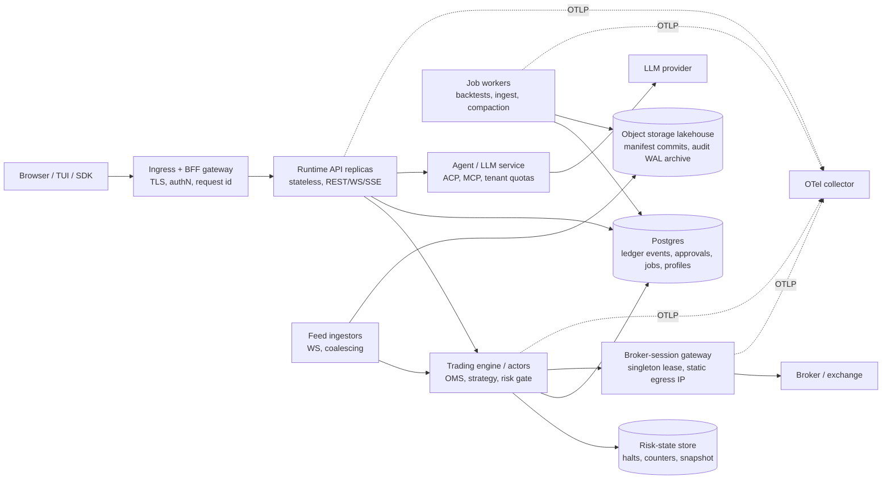

# 0022 — Future deployment architecture: from workstation to deployable platform

**Status**: Proposed (2026-11-23)
**Scope**: workspace root (cross-repo) · **Umbrella**: [0021](0021-workspace-design-review-2026-11.md) · **Sibling**: [0023](0023-build-ci-release-engineering.md)

## 0. Executive Summary & Objective

Today the workspace runs as a single-user workstation stack: one `tantra serve` process (paper-only `ExecGateway::default_sim()`), a Next.js dev server and an optional llama.cpp. There is no Dockerfile, compose file, k8s manifest or systemd unit anywhere. None of the trading-critical state (OMS, positions, risk counters, halts, broker session) survives a restart, and none of it is safe across replicas.

This plan defines the path from that workstation to a deployable, restart-safe, observable, SEBI-aware platform, in five target modes (workstation, single-node compose, multi-node/k8s multi-tenant, exchange-proximate low-latency node, offline browser/WASM) and six phases (D0–D5).

Non-goals: the wiring of the 18 unwired crates and the `tantra-serve` composition root itself (owned by 0019 P5.1); API-surface consolidation (design 0006); CI/release mechanics (plan [0023](0023-build-ci-release-engineering.md)). Regulatory numbers are deliberately not stated: every threshold below is "verify the current SEBI circular and broker/exchange notices".

## 1. Context & Gaps Covered

### 1.1 Current-state inventory (condensed)

| Process | Source | Default bind | Notes |
|---|---|---|---|
| `tantra serve <data_dir>` | `tantra-ui/crates/tantra-cli` (`args.rs:222,725`) | `127.0.0.1:8000` | REST+WS+ACP+SSE; paper-only; built inside the UI workspace (38 MB fat-LTO), so every runtime fix rebuilds `tantra-ui` |
| `paper_serve` | `tantra-runtime/.../api-rest/src/bin/paper_serve.rs:21,134` | `127.0.0.1:8001` | second bootstrap of the same server |
| `tantra-agent-acp`, MCP stdio/SSE | `tantra-agent` | stdio / ws; SSE `/health` is a static string, no auth | in-memory ACP sessions |
| Library MCP child | spawned by runtime (`TANTRA_LIBRARY_MCP_CMD`) | stdio | Python; one per replica |
| Next.js app | `tantra-ui-web` | `:3000` | BFF `/api/runtime/[...path]`; `NEXT_PUBLIC_TANTRA_RUNTIME_URL` baked at build |
| llama.cpp / vLLM | `scripts/start-llm.sh` | external OpenAI-compat HTTP | no quota or egress-proxy option |

| State | Medium | Survives restart | Multi-replica safe |
|---|---|---|---|
| OMS / order ledger / positions / FIFO lots | in-memory aggregates, no serde, no event log; hard-coded `"default"` account (`portfolio.rs:134`) | No | No |
| Risk halts, OTR/rate counters, daily loss, algo registry | in-memory `HashMap` | No (restart clears halts) | No |
| Approval queue, trading-state/halt | in-memory (+ `jobs.json` for approvals) | Halt: No | No |
| Jobs, run journals | `~/.tantra/jobs.json`, NDJSON dirs | Yes | Single host only |
| Profiles, portfolios | JSON in cwd-relative `data/{profiles,portfolios}` (`bootstrap.rs:119-121`) | Yes | No (last writer wins) |
| Order audit WAL | fsynced hash-chained JSONL, local dir | Yes | No lock, no shipping, no retention |
| Operator/auth audit | plain NDJSON, not chained | Yes | No |
| Broker sessions/tokens | memory | No (re-login evicts other sessions) | No (singleton per API key) |
| Rate-limit buckets / OPS | process-local | No | No |
| Lakehouse, ingest catalogs | local FS, single-writer DuckDB | Yes | No |
| Chat sessions | memory; SQLx only if `TANTRA_DATABASE_URL` set | Only with URL | Only with Postgres + sticky routing |

| Concern | Today |
|---|---|
| Config | flags plus 18 env names across four brand prefixes (`TANTRA_`, `HONBA_`, `QUANTCEPT_`, `VYAAPAAR_`); no registry; no env for JWT, broker credentials, bind, CORS, OTLP; state dirs split across `TANTRA_HOME`, `TANTRA_JOBS_PATH`, positional `data_dir` |
| Observability | `/health` always ok (`routes.rs:197`), no `/ready`; Prometheus router in `tantra-runtime-actors/src/metrics.rs` never mounted; `opentelemetry`/`tracing-opentelemetry` declared in exec but not initialised; no request id, no JSON logs |
| Security | non-loopback unauthenticated bind only warns; `tantra serve` cannot configure JWT; no in-process TLS; token in WS URL logged (`ws_client.rs:215`); MCP SSE unauthenticated; web token in `sessionStorage` |

### 1.2 Gaps covered

Per-repo gaps this plan sequences (not duplicated here):

- Durable state: [ledger 0019](../../tantra-ledger/docs/gaps/0019-event-log-and-snapshots.md), [risk 0010](../../tantra-risk/docs/gaps/0010-shared-risk-state-and-kill-switch.md), [runtime 0021](../../tantra-runtime/docs/gaps/0021-durable-trading-state.md), [runtime 0032](../../tantra-runtime/docs/gaps/0032-jobs-single-runner-and-ist-cron.md), [exec 0005](../../tantra-exec/docs/gaps/0005-durable-order-id-map-and-reconcile.md), [exec 0006](../../tantra-exec/docs/gaps/0006-slicer-durable-state-and-clock.md), [agent 0017](../../tantra-agent/docs/gaps/0017-acp-session-lifecycle.md).
- Broker session, secrets, egress: [exec 0008](../../tantra-exec/docs/gaps/0008-session-token-lifecycle.md), [exec 0012](../../tantra-exec/docs/gaps/0012-credential-sourcing-and-legacy-env.md).
- Exposure and composition: [runtime 0020](../../tantra-runtime/docs/gaps/0020-fail-closed-bind-and-cors.md), [runtime 0026](../../tantra-runtime/docs/gaps/0026-single-composition-root-serve.md), [agent 0016](../../tantra-agent/docs/gaps/0016-mcp-network-transport-auth.md), [ui 0010](../../tantra-ui/docs/gaps/0010-state-dir-and-boot-recover.md).
- Observability and audit: [runtime 0022](../../tantra-runtime/docs/gaps/0022-observability-health-readiness.md), [runtime 0033](../../tantra-runtime/docs/gaps/0033-audit-ledger-unification.md).
- Web tier: [ui-web 0082](../../tantra-ui-web/docs/gaps/0082-runtime-url-runtime-config.md), [ui-web 0083](../../tantra-ui-web/docs/gaps/0083-server-wasm-loading.md).
- Data at scale: [market 0013](../../tantra-market/docs/gaps/0013-store-memory-bounds-and-object-store.md), [data 0028](../../tantra-data/docs/gaps/0028-ref-cas-and-catalog-locking.md), [data 0031](../../tantra-data/docs/gaps/0031-provenance-scheduling-observability.md).
- Wire compatibility: core 0004 (closed `tantra-core` `7926c59`: N-2 recursive schema gate, `WireEnvelope<T>`). Operator docs: [docs 0002](../../tantra-docs/docs/gaps/0002-operator-docs.md).
- Root: [0011](../gaps/0011-secrets-leak-debug-logs-urls.md), [0013](../gaps/0013-risk-gate-single-shared-fail-closed.md), [0018](../gaps/0018-lakehouse-manifest-ref-contract.md), [0020](../gaps/0020-time-semantics-ist-trading-day.md), [0023](../gaps/0023-tamper-evident-audit-trail-unification.md), [0027](../gaps/0027-live-broker-session-gateway-and-static-egress.md), [0028](../gaps/0028-configuration-contract-and-legacy-env.md).

Plan-only items (no standalone gap doc):

- R1 — Runtime-owned server binary (`tantra-serverd`) so `tantra serve` becomes a thin launcher and runtime fixes stop requiring a UI rebuild; evidence `tantra-ui/target/prod/tantra`, `paper_serve.rs`.
- R2 — Container build context: a monorepo context with path-dependent sibling repos (9 workspaces); `deploy/` with multi-stage Dockerfiles (runtime on the `prod` profile, Next standalone, Python slim, llama.cpp).
- R3 — Worker mode: `tantra-worker` claiming job leases; rayon pool sized from the cgroup (default is all host cores); sandboxed strategy runner for generated Python.
- R4 — `EgressConfig { bind_addr, proxy_url, no_proxy }` shared by exec, market, agent (Rust) and `tantra_adapters.common.transport` (Python).
- R5 — Slim exchange-proximate binary profile (exec+risk+feed, no web/LLM/Python); needs removal of the market-store to agent-analytics upward edge (0019 P4.2).

## 2. Component Specifications & Phases

### 2.1 Target deployment modes

**(a) Workstation (today).** One `tantra serve`, Next.js, optional llama.cpp; local FS under `data_dir` and `~/.tantra`. Keep it working. Blockers are sharp but non-fatal: cwd-relative defaults ([ui 0010](../../tantra-ui/docs/gaps/0010-state-dir-and-boot-recover.md)), `/health` that lies ([runtime 0022](../../tantra-runtime/docs/gaps/0022-observability-health-readiness.md)), legacy env prefixes ([0028](../gaps/0028-configuration-contract-and-legacy-env.md)), no build info (R1).

**(b) Single-node compose.**
- Service split: `runtime` (axum; paper or live exec), `web` (Next standalone), `llm` (llama.cpp/vLLM), `library-mcp` (Python sidecar), optional `ingest` one-shot, `docs` static. Volumes `/data` (lakehouse, journals, profiles), `/state` (`jobs.json`, audit WAL), `/models`.
- State externalisation: every path from env/flags under one root; `TANTRA_DATABASE_URL` to SQLite-on-volume or a Postgres container; WAL on its own volume.
- Blockers: no images (R2); fail-open non-loopback bind ([runtime 0020](../../tantra-runtime/docs/gaps/0020-fail-closed-bind-and-cors.md)); build-time runtime URL and cwd-relative WASM read ([ui-web 0082](../../tantra-ui-web/docs/gaps/0082-runtime-url-runtime-config.md), [0083](../../tantra-ui-web/docs/gaps/0083-server-wasm-loading.md)); `tantra serve` cannot set JWT/risk flags ([runtime 0026](../../tantra-runtime/docs/gaps/0026-single-composition-root-serve.md)); no `/ready`; two serve entry points.

**(c) Multi-node / k8s multi-tenant.**
- Service split: stateless API replicas behind Ingress; Postgres (`tantra-runtime-persistence`) for ledger/OMS events, approvals, halts, jobs, profiles, portfolios, chat sessions; object storage for the lakehouse with a single ingest writer; a singleton broker-session gateway per credential (Lease / `Recreate`); central or sharded risk state; worker pool for backtests; per-tenant LLM gateway.
- State externalisation: each "No" row in the state table moves to SQL or object storage.
- Blockers: no ledger event log ([ledger 0019](../../tantra-ledger/docs/gaps/0019-event-log-and-snapshots.md)); in-memory risk counters ([risk 0010](../../tantra-risk/docs/gaps/0010-shared-risk-state-and-kill-switch.md), [0013](../gaps/0013-risk-gate-single-shared-fail-closed.md)); hard-coded `"default"` account versus `Caller` tenancy; file job registry ([runtime 0032](../../tantra-runtime/docs/gaps/0032-jobs-single-runner-and-ist-cron.md)); in-process permission `oneshot` ([agent 0017](../../tantra-agent/docs/gaps/0017-acp-session-lifecycle.md)); single-writer DuckDB ([data 0028](../../tantra-data/docs/gaps/0028-ref-cas-and-catalog-locking.md)); no readiness/metrics/tracing.

**(d) Exchange-proximate low-latency node.**
- Service split: slim exec+risk+feed binary co-located near the broker/exchange (R5); in-process Rust or local Python strategy; remote asynchronous control plane; audit WAL on local NVMe with async shipping to object storage; market recorder with deferred compaction.
- State: local-first (WAL, risk snapshot, ledger event log) with replication; no network I/O on the order path.
- Blockers: embedded versus central risk is undecided and the sub-15 µs gate is only meaningful embedded ([0013](../gaps/0013-risk-gate-single-shared-fail-closed.md)); no static-egress knob ([0027](../gaps/0027-live-broker-session-gateway-and-static-egress.md)); ticker gives up after 8 attempts with no supervisor (`ticker.rs:317-345`); no live composition root; no latency histograms; market store drags the agent crate tree.

**(e) Offline browser/WASM paper mode.**
- Service split: static bundle plus WASM (`tantra-ui-api-wasm`, `tantra-ui-web/wasm`) with core, indicators, portfolio, paper exec; IndexedDB/OPFS state; bars from fetched parquet/CSV; no LLM or a remote one.
- Blockers: no wasm32 check in any CI ([0023](0023-build-ci-release-engineering.md) B2); `tantra-ledger-journal` to L2 `tantra-market-finance` and market-store to L3 agent-analytics upward edges (0019 P4.1/P4.2); `getrandom`/chrono features; Google fonts at build; the pyarrow wheel cannot run in Pyodide.

### 2.2 Target multi-node topology

### 2.3 SEBI and broker constraints

All figures are "verify the current SEBI circular and broker/exchange notices"; the workspace docs cite only the "SEBI Retail Algo Circular" (`tantra-risk/docs/design/architecture.md:34`).

| Constraint | Current code status | Gap to close |
|---|---|---|
| Static egress IP registered per API key | Not implemented; no exec/adapter/feed client has a bind-address or proxy option | R4; startup egress-IP self-check, fail-closed in live mode ([0027](../gaps/0027-live-broker-session-gateway-and-static-egress.md)) |
| Exchange algo-id tagging | Risk checks registry membership (`algo_registry.rs`, in-memory); exec carries `algo_id` in `AuditSpec`; REST gateway is sim only | Per-strategy algo-id binding from config mapped to the broker tag field and validated end to end |
| Orders-per-second threshold | Risk limiter and exec token buckets both process-local, lost on restart; two processes on one key double the rate | Shared/leased counter or single gateway owner; threshold from config, never inferred; alert metric ([risk 0010](../../tantra-risk/docs/gaps/0010-shared-risk-state-and-kill-switch.md)) |
| One session per API key | Broker login invalidates prior tokens; tokens in memory; research and trading on one key evict each other | Session-gateway service with a lease; research processes get market-data-only credentials ([exec 0008](../../tantra-exec/docs/gaps/0008-session-token-lifecycle.md)) |
| Audit retention / tamper evidence | Exec WAL hash-chained and fsynced but local, no lock/shipping/retention; operator audit plain NDJSON | One `AuditSink`, anchor hashes, object-lock shipping, `retention_days` from the verified circular ([0023](../gaps/0023-tamper-evident-audit-trail-unification.md), [runtime 0033](../../tantra-runtime/docs/gaps/0033-audit-ledger-unification.md)) |

### 2.4 Phased roadmap

**D0 — Hygiene and honesty (workstation hardening).** `/health` reflects real state and `/ready` exists; non-loopback without auth is fatal unless an explicit insecure flag is passed; one `StatePaths` resolver, absolute paths, resolved dirs logged; shim then delete `HONBA_/QUANTCEPT_/VYAAPAAR_` envs; generate the env reference; CI rg-guard on new non-`TANTRA_` names.
**Gate**: `cargo fmt --check`, `cargo clippy --all-targets -- -D warnings`, `make check`, `cargo test -p tantra-runtime-api-rest --test <bootstrap bin> --profile prod`, `make prod`.
Exit: `tantra serve` from any cwd uses identical state; an open non-loopback bind is refused at startup.

**D1 — Build and package.** R1 runtime-owned binary with `--version` build info; R2 Dockerfiles and compose with `/data /state /models`; web runtime URL read at request time, `output: "standalone"`, WASM under `public/`; wheel workflow (see 0023 B3).
**Gate**: image build in CI; `docker compose up` smoke on `/health` plus one paper order; `npx tsc --noEmit`, `npm run lint`, `npx vitest run`.
Exit: a clean host reaches a working paper-mode stack from the compose file alone.

**D2 — Durable state.** Ledger `LedgerEvent` log plus snapshot; `RiskSnapshot::restore(now)`; halts, approvals, jobs, profiles, portfolios behind repository ports with SQLite/Postgres; boot sequence restore, reconcile with broker order book, then accept orders; unified `AuditSink` with shipping and retention config.
**Gate**: replay/determinism proptests; kill-and-restart integration test; `make test` per touched repo (or `make check` plus targeted test binaries on LTO OOM); `make prod`.
Exit: `kill -9` mid paper session preserves orders, positions and halts; audit chain verifies after restore; N API replicas on Postgres pass a concurrency test.

**D3 — Observability and ops.** Mount `/metrics` (separate auth-exempt port); one `tantra-telemetry` init (JSON logs, request id, OTLP via standard `OTEL_*`); readiness tied to feed age, broker session, gate state, DB; SIGTERM drain across actors/MCP/ACP; dashboards and alert rules (halt, feed stall, OPS near threshold).
**Gate**: readiness-flip test on fake feed stall; drain test; `make check`, `make prod`.
Exit: chaos test (stall feed, expire token) flips readiness and fires alerts; drain completes in-flight orders before exit.

**D4 — Live-broker topology.** `SessionLease` port and singleton execution gateway; R4 egress config plus startup self-check; per-strategy algo-id binding; shared OPS accounting; supervised reconnect; live `ExecGateway` composition root behind explicit opt-in. Verify against the current circular before enabling live.
**Gate**: two-contender lease test; reconnect chaos test; loopback-proxy source-address test; `pytest -q` for adapters transport; `make prod`.
Exit: rolling restart re-acquires the session without evicting a second process; orders from a wrong egress IP are refused locally.

**D5 — Scale-out and edge.** Object-store lakehouse with manifest commits and scheduled compaction ([0018](../gaps/0018-lakehouse-manifest-ref-contract.md)); R3 worker mode and job queue; sandboxed strategy runners; LLM gateway quotas; wire-compat corpora with `schema_version`; wasm32 targets and removal of L2/L3 upward edges; R5 slim binary.
**Gate**: fault-injection on partial manifest commit; lease-claim race test; `schema/golden/<ver>/` replay; `cargo check --target wasm32-unknown-unknown --profile prod` for compute crates; `make verify-architecture`.
Exit: multi-replica k8s deployment on Postgres plus object storage passes soak and rolling-upgrade tests; wasm32 build of core/indicators/portfolio green in CI; order-path p99 for the proximate node measured and published.

## 3. Relationship to Other Plans

- 0019 P5.1 (`tantra-serve`) is the composition root every mode here depends on; this plan consumes it and adds R1 (a runtime-owned binary). 0019 P2.7 (persistence wiring) is the starting point of D2; P4.1/P4.2 edge removals and P4.6 `make verify-architecture` feed D5 and mode (e).
- Design 0006 (API consolidation, `/api/v2`) fixes the client contract that D1 and D5 version against.
- Plan [0023](0023-build-ci-release-engineering.md) supplies the CI, lockfiles, images, SBOM/signing and wasm32 gates that D1 and D5 exit criteria rely on.
- Root gaps [0011](../gaps/0011-secrets-leak-debug-logs-urls.md), [0013](../gaps/0013-risk-gate-single-shared-fail-closed.md), [0018](../gaps/0018-lakehouse-manifest-ref-contract.md), [0020](../gaps/0020-time-semantics-ist-trading-day.md), [0023](../gaps/0023-tamper-evident-audit-trail-unification.md), [0027](../gaps/0027-live-broker-session-gateway-and-static-egress.md), [0028](../gaps/0028-configuration-contract-and-legacy-env.md) are the cross-repo trackers; per-repo gaps in section 1.2 own the implementation.
- Umbrella: [0021](0021-workspace-design-review-2026-11.md).

## 4. Exit Criteria

1. `tantra serve` (or its successor) behaves identically from any working directory and refuses an unauthenticated non-loopback bind.
2. `/health`, `/ready` and `/metrics` reflect real feed, session, gate and database state; readiness flips under chaos tests.
3. `docker compose up` produces a working paper-mode stack on a clean host; images are built and smoke-tested in CI.
4. After `kill -9`, orders, positions, risk halts and approvals are restored and reconciled against the broker before new orders are accepted.
5. Exactly one process holds a broker session per API key; live orders from an unregistered egress IP are refused locally.
6. One verifiable audit chain covers signal, approval, order and fill, shipped off-box with a configured retention window.
7. N runtime replicas on Postgres pass a concurrency and rolling-upgrade test with N-1 wire corpora.
8. Compute crates build for `wasm32-unknown-unknown` in CI; the proximate-node latency budget is measured and published.
9. Every SEBI/broker figure used in configuration was checked against the current circular and recorded in operator docs ([docs 0002](../../tantra-docs/docs/gaps/0002-operator-docs.md)).
