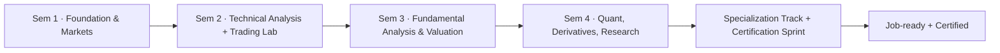

# SEBI Capital Markets Professional — Course Curriculum (High School Passout Track)

> **Purpose.** A robust, end-to-end curriculum that takes a Class 12 (high school)
> passout with **no college-level finance, accounting, or statistics background**
> and builds them into an employable capital-markets professional, ready to clear
> the **NISM / CFTe / CMT certification ladder** and work as a Research Analyst,
> Technical Analyst, Investment Advisor, or Portfolio Manager.
>
> **Sources synthesized.** This curriculum consolidates four certification syllabus
> documents staged in `docs/training/tmp/`:
>
> | Source | What it provides |
> |---|---|
> | `NISM-PGP-PM+IA+RA.md` | Trimester architecture, credit/hour norms, PM / IA / RA specialization tracks |
> | `NIFM-research-analyst.md` | 39-chapter topic map: capital market, derivatives, ODIN, TA, FA, RA profession |
> | `IFMC-research-analyst.md` | 70-item NISM XV (Research Analyst) prep syllabus incl. portfolio theory, modeling, valuation |
> | `CFTe-I-II.md` | IFTA **CFTe I & II** and **CMT** program structures and core reading list |
>
> Every source topic is mapped to a module in the [Coverage Matrix](#9-coverage-matrix).

---

## 1. Program at a Glance

| Attribute | Value |
|---|---|
| **Program title** | SEBI Capital Markets Professional (CMP) |
| **Target learner** | High school passout (Class 12), any stream; basic arithmetic, no finance assumed |
| **Mode** | Full-time classroom + supervised labs + certification sprints (adaptable to online/part-time — see §11) |
| **Duration** | **4 semesters × 16 weeks = 64 weeks (~14 months)** |
| **Learning load** | ~30 hrs/week (12 lecture + 10 lab + 8 self-study/project) ≈ **1,920 hours** |
| **Certification targets** | NISM Series XV (RA), NISM Series VIII (Equity Derivatives), **CFTe I**, optional CFTe II / CMT Level I, plus NISM VIII/IX prep |
| **Career outcomes** | Equity Research Analyst, Technical Analyst, Investment Advisor, Portfolio Manager (support), Trade Support/Operations, Wealth Associate |
| **Exit level** | Exam-ready + 3 portfolio projects (1 research report, 1 modeled company, 1 track capstone) |

### Assumptions (stated explicitly)

- Learner has passed Class 12; no prior finance/accounting/statistics coursework is assumed. The curriculum **teaches all quantitative and accounting foundations from zero** (Semester 1).
- The program is **India/SEBI-first** (NSE/BSE/MCX ecosystem) but includes global markets exposure per the IFMC syllabus (world markets, Eurozone crisis, oil crisis, FX, US equities).
- Certification fees/exam logistics are the learner's responsibility; the program embeds **mock-exam sprints** before each target exam window.
- Deliverables are language-neutral (English) with English professional-communication reinforcement built into every semester.

---

## 2. Learner Profile, Prerequisites & Entry Gate

### 2.1 Who is this for

A student who has just finished Class 12 and wants a structured, **exam-credentialed**
entry into Indian capital markets — without a 3-year degree first. The curriculum
assumes curiosity and discipline, not prior domain knowledge.

### 2.2 Prerequisites (entry gate — assessed in Week 0)

| Domain | Required minimum | Gap-closing action |
|---|---|---|
| Arithmetic | Fractions, percentages, ratios, exponents, negative numbers | Week-1 math bootcamp, nightly drills |
| Algebra | Linear equations, solving for an unknown | Week-1/2 remediation labs |
| Statistics | **None required** (descriptive stats taught from zero in Sem 1) | Built into S1-M1 |
| English | Basic reading/writing | Weekly communication lab |
| Computing | None; touch-typing optional | S1 Excel lab doubles as computing bootcamp |
| Finance | **None required** | Entire curriculum is zero-to-exam-ready |

### 2.3 Skills audit & learning contract

Week 0 includes a diagnostic test (math + aptitude), a one-on-one career interview,
and a signed **learning contract** (attendance, certification commitments, lab
hours). This mirrors the "mid-term and end-term examination" discipline stated in
the IFMC syllabus and gives the mentor a baseline for the first 8 weeks.

---

## 3. Program Learning Outcomes (PLOs)

On completion, the learner can:

1. **PLO-1 — Market literacy.** Explain how primary/secondary markets, exchanges
   (NSE, BSE, MCX), clearing & settlement, and market participants work in India
   and globally.
2. **PLO-2 — Instruments.** Distinguish equity, debt, hybrids, mutual funds, ETFs,
   and derivatives; interpret corporate actions, NAV, and market terminology.
3. **PLO-3 — Technical analysis.** Read any chart type and candlestick, identify
   trends, S/R, chart patterns, gaps, indicators (MA, RSI, MACD, Bollinger, ADX,
   Ichimoku), Fibonacci, and Elliott Wave setups at **CFTe I level**.
4. **PLO-4 — Trading operations.** Operate a live trading terminal (ODIN/NEST and
   modern web platforms), place orders, monitor portfolios, and maintain a paper-trading journal.
5. **PLO-5 — Fundamental analysis.** Read an income statement, balance sheet, cash-flow
   statement, annual report, MD&A, and DRHP; compute and interpret ratios; run DuPont.
6. **PLO-6 — Economics.** Connect GDP, IIP, inflation, PMI, monetary policy, demand-supply,
   and global macro events to market behavior.
7. **PLO-7 — Valuation.** Apply TVM, NPV/IRR, DDM, DCF (FCFF/FCFE), EV/EBITDA, SOTP,
   and relative/comps valuation; build a 3-statement financial model in Excel.
8. **PLO-8 — Quantitative finance.** Use descriptive statistics, correlation, covariance,
   regression, ANOVA, CAPM/CAL/SML/CML, Markowitz portfolio theory, and Sharpe/Treynor/Alpha/Beta.
9. **PLO-9 — Derivatives & risk.** Price/explain forwards, futures, options, put-call
   parity; construct basic hedging strategies; apply position/risk management rules.
10. **PLO-10 — Professional practice.** Write a professional research report, deliver an
    analyst presentation, and operate within the SEBI legal/regulatory and ethics framework.

---

## 4. Program Architecture



| Semester | Title | Weeks | Core outcome | Target exams |
|---|---|---|---|---|
| **S1** | Foundations of Capital Markets | 1–16 | Market literacy, instruments, Excel, financial-statement orientation, first look at TA | NISM Series VIII (intro) |
| **S2** | Technical Analysis & Trading Practice | 17–32 | Full **CFTe I** syllabus + terminal/paper-trading mastery | **CFTe I**, NISM VIII |
| **S3** | Fundamental Analysis, Valuation & Modeling | 33–48 | Full NISM XV fundamentals stack + Excel modeling | NISM XV (part) |
| **S4** | Quantitative Methods, Derivatives, Research & Regulation | 49–64 | Statistics, portfolio theory, derivatives, research reports, SEBI compliance | **NISM Series XV**, NISM IX |
| **S5** | Track Specialization + Capstone | 65–80 | Track capstone (RA / TA / PM / IA) + mock-exam sprint | CFTe II / CMT L1 (optional) |

**Design rationale.** The NISM PGP source (4 trimesters, 3 courses × 30 hrs each)
presumes a graduate's base. For a high-school passout, **Semester 1 rebuilds the
graduate prerequisite layer** (math, Excel, markets, statements) before the PGP
trimester content is layered over S2–S4, and S5 mirrors PGP Trimester-IV tracks.
This "bridge + ladder" structure is what makes the program robust for a
non-graduate entry cohort.

---

## 5. Certification Ladder & Timeline

| Cert | Regulator/Body | When in program | Entry bar | Our preparation sprint |
|---|---|---|---|---|
| NISM Series VIII (Equity Derivatives) | NISM/SEBI | End S2 | Class 12 + risk disclosure | 4-week sprint before S2 end-term |
| **CFTe I** (120 MCQ, Pearson VUE) | IFTA | End S2 | Open; our S2 covers full syllabus | S2 content IS the syllabus + 3 mocks |
| NISM Series XV (Research Analyst) | NISM/SEBI | End S4 | Graduation typically required by SEBI — see caveat | S3+S4 content + 4 mocks |
| NISM Series IX (Merchant Banking) | NISM/SEBI | End S4 (elective) | — | Regulatory module S4 |
| CFTe II (applied chart report) | IFTA | Post-program (TA track) | CFTe I | S5 TA-track capstone ≈ exam practice |
| CMT Level I | CMT Association | Optional post-program | Open | S5 elective readings |

> **Regulatory caveat (read carefully).** NISM *examinations* are open to Class 12
> passouts, but SEBI-registered **Research Analyst / Investment Advisor / Portfolio
> Manager** registrations under the respective SEBI Regulations require the applicant
> to hold a graduate degree (and, for RA, professional qualifications). This program
> therefore: (a) makes the learner **exam-ready** immediately, and (b) structures S5 +
> the capstone portfolio so the learner can upgrade registrations seamlessly once a
> graduate degree is obtained (dual-degree/BCA-BBA-B.Com pathways). The technical/
> trading/operations careers (CFTe, terminal operations, advisory support, prop desk)
> are open to high-school passouts from day one.

---

## 6. Detailed Curriculum

Common conventions for every module table:
- **Hrs** = contact hours (lecture + supervised lab), split as noted.
- **Assess** = module-level assessment (quiz / assignment / lab checklist).
- Semester totals: ~16 hrs/wk contact + ~10 lab + ~8 self-study.

---

### SEMESTER 1 — Foundations of Capital Markets (Weeks 1–16)

**Goal:** erase the graduate prerequisite gap; deliver complete market literacy.

#### S1-M1 — Financial Literacy & Business Math Bootcamp (Weeks 1–2, 24 hrs)

| Item | Detail |
|---|---|
| **Topics** | Money & banking basics; savings vs investment; interest (simple/compound, CAGR); percentages, ratios, growth rates, indexing; logs & exponents for finance; fractions/decimals drills; demand-supply & elasticity intro (IFMC #23); financial calculators (IFMC #60) |
| **Outcomes** | Compute CAGR/IRR-style math by hand and calculator; interpret "15% growth" without error; speak the money vocabulary |
| **Assess** | Week-2 diagnostic re-test (must clear 70%) + daily drill tracker |
| **Source** | IFMC #1, #23, #60; NISM PGP T1-101 |

#### S1-M2 — Excel for Finance (Weeks 2–4, 30 hrs lab-heavy)

| Item | Detail |
|---|---|
| **Topics** | Spreadsheet literacy: cell refs, formulas, `=SUM/AVERAGE/IF/VLOOKUP/XLOOKUP`; data sorting/filtering; charts; financial functions `NPV, IRR, PMT, FV, PV`; PivotTables; named ranges; intro to formatting standards used later in modeling (IFMC #47) |
| **Outcomes** | Build a working cash-flow/DCF starter model; error-free formula audits |
| **Assess** | Lab practical — 3 worksheets submitted (ledger, ratio sheet, mini-model) |
| **Source** | IFMC #47; NIFM Ch 5 (software) |

#### S1-M3 — How Capital Markets Work (Weeks 4–6, 24 hrs)

| Item | Detail |
|---|---|
| **Topics** | What a stock is; primary vs secondary markets; exchanges (NSE, BSE, MCX) and their indices (Sensex, Nifty, sector indices); IPO process & DRHP; how companies raise funds (equity/debt); worldwide market structures: US, EU, Asia (IFMC #7, #69); market regulators (SEBI, SEC) |
| **Outcomes** | Draw the money flow: company → IPO → exchange → investor → settlement; compare Indian vs global structures |
| **Assess** | Quiz + 2-page "how markets work worldwide" essay |
| **Source** | NIFM Ch 1, 28; IFMC #7; PGP T1-101 |

#### S1-M4 — Market Microstructure & Participants (Weeks 6–8, 20 hrs)

| Item | Detail |
|---|---|
| **Topics** | Brokers, sub-brokers, market makers, institutional vs retail; clearing corporations, depositories (NSDL/CDSL), settlement cycles (T+1); trading/clearing/settlement lifecycle; order types (market/limit/SL); margin basics; NSE/BSE/MCX overview (IFMC #1); merchant banking & ECM |
| **Outcomes** | Trace an order from terminal to ledger and back; explain who does what in a trade |
| **Assess** | Mid-term exam #1 (covers M1–M4) — Week 8 |
| **Source** | NIFM Ch 1, 28; IFMC #1 |

#### S1-M5 — Securities & Instruments (Weeks 8–10, 20 hrs)

| Item | Detail |
|---|---|
| **Topics** | Equity (ordinary/preference); debt (bonds, debentures, G-secs); hybrids; mutual funds (types, AMC, NAV); ETFs; REITs/InvITs; alternative assets (gold, commodities, art) — (PGP T2-203); NAV analysis (IFMC #32) |
| **Outcomes** | Classify any instrument into debt/equity/hybrid/derivative; compute NAV; read a fund fact sheet |
| **Assess** | Assignment: build a fund comparison table + NAV worksheet |
| **Source** | NIFM Ch 28; PGP T2-203; IFMC #32 |

#### S1-M6 — Corporate Actions & Financial Terminology (Weeks 10–12, 16 hrs)

| Item | Detail |
|---|---|
| **Topics** | Dividends (interim/final), bonus issues, stock splits, buybacks, rights issues, mergers/acquisitions, delisting; ex-date vs record date; **equity & debt market terminology** (NIFM Ch 29): face value, book value, EPS, market cap, yield, coupon, spread; banking-sector terminology (IFMC #45) |
| **Outcomes** | Read a corporate-action calendar and price-adjust an ex-date; speak professional terminology |
| **Assess** | Quiz + corporate-action price-adjustment lab |
| **Source** | NIFM Ch 29, 35; IFMC #14, #45 |

#### S1-M7 — Introduction to Financial Statements (Weeks 12–14, 24 hrs)

| Item | Detail |
|---|---|
| **Topics** | Why statements matter; income statement (revenue, expenses, PAT), balance sheet (assets, liabilities, equity), cash-flow statement (operating/investing/financing); basic accounting equation; reading an **annual report and DRHP** structure (IFMC #17–19); quarterly results releases (IFMC #15) |
| **Outcomes** | Read any statement and answer "is the company profitable / solvent / cash-rich?" |
| **Assess** | Lab: dissect one real annual report (Infosys or equivalent) |
| **Source** | NIFM Ch 16, 19; IFMC #3, #4, #15–19; PGP T1-103 |

#### S1-M8 — Introduction to Technical Analysis (Weeks 14–15, 16 hrs)

| Item | Detail |
|---|---|
| **Topics** | Fundamental vs technical analysis (IFMC #8); philosophy of TA (price discounts everything); trends, timeframes; why TA works — crowd psychology; first look at chart types (line/bar/candlestick) |
| **Outcomes** | Explain what TA is and when to use it; read a basic chart |
| **Assess** | Quiz |
| **Source** | NIFM Ch 6; IFMC #8; CFTe core reading (Murphy Ch 1) |

#### S1-M9 — Professional Skills & Markets Lab (Weeks 1–16, continuous)

| Item | Detail |
|---|---|
| **Topics** | Weekly markets news reading + discussion; business English; presentation basics; note-taking and research habits; ethics & discipline intro; Bloomberg/NSE news tools |
| **Outcomes** | Present a 3-slide weekly markets summary by Week 16 |
| **Assess** | Continuous rubric (attendance, participation, 4 graded presentations) |
| **Source** | Cross-cutting (reporting/communication skills required by NIFM Ch 38) |

**S1 end-term exam (Week 16).** Covers M1–M9; 2-hr paper + 1-hr lab practical.
Gating: must pass to enter S2.

---

### SEMESTER 2 — Technical Analysis & Trading Practice (Weeks 17–32)

**Goal:** complete the **CFTe I syllabus** (via Edwards & Magee, Murphy, Pring,
Nison, Le Beau/Lucas, plus IFTA appendices) and become operationally fluent on a
trading terminal. This semester *is* the CFTe I preparation sprint.

#### S2-M1 — Dow Theory, Trends & Chart Construction (Weeks 17–19, 24 hrs)

| Item | Detail |
|---|---|
| **Topics** | Dow Theory principles, market phases, confirmation, defects (Edwards & Magee Ch 3–5; Murphy Ch 2); trend definition (primary/secondary/minor); trendlines & channels; support & resistance (E&M Ch 13–14); volume & open interest (Murphy Ch 7); price: major averages (Pring Ch 18) |
| **Outcomes** | Identify trend, draw valid trendlines/S-R, mark swings on any chart |
| **Assess** | Chart-lab practical (30 annotated charts) |
| **Source** | NIFM Ch 7, 9, 13; CFTe I core |

#### S2-M2 — Candlestick Analysis (Weeks 19–21, 24 hrs)

| Item | Detail |
|---|---|
| **Topics** | Candlestick construction (Nison Ch 1–3); single/multi-bar reversal patterns (doji, hammer, engulfing, harami, stars); continuation patterns; magic doji; Japanese context; renko/kagi/three-line-break (CFTe II prep primer) |
| **Outcomes** | Name and interpret all major candlestick patterns with context (trend + volume) |
| **Assess** | 100-pattern recognition drill (timed) + pattern journal |
| **Source** | NIFM Ch 8 (25 videos); CFTe I (Nison) |

#### S2-M3 — Chart Patterns & Reversals (Weeks 21–23, 24 hrs)

| Item | Detail |
|---|---|
| **Topics** | Head & shoulders, double/triple tops & bottoms; triangles (sym/asc/desc); flags, pennants, wedges; consolidation formations; rounding/continuation; measurement objectives & targets (E&M Ch 6–11); trading ranges |
| **Outcomes** | Recognize pattern, state invalidation, project target |
| **Assess** | Chart-lab practical + quiz |
| **Source** | NIFM Ch 10; CFTe I |

#### S2-M4 — Technical Indicators (Weeks 23–25, 24 hrs)

| Item | Detail |
|---|---|
| **Topics** | Moving averages (SMA/EMA, MA crosses, automated trendlines — E&M Ch 36); RSI & oscillators (range rules — Brown Ch 1); MACD; Bollinger Bands; stochastic; momentum II (Pring Ch 12); relative strength (Pring Ch 16); breadth indicators (IFTA App B) |
| **Outcomes** | Choose the right indicator for trend/range; spot divergences; avoid indicator misuse |
| **Assess** | Indicator lab: 10 live setups documented with entry/exit logic |
| **Source** | NIFM Ch 11; CFTe I (Murphy/Pring) |

#### S2-M5 — Gaps, Sentiment & Time Cycles (Weeks 25–26, 16 hrs)

| Item | Detail |
|---|---|
| **Topics** | Gap types: common, breakaway, runaway, exhaustion (E&M Ch 12); gap analysis & trading (NIFM Ch 12); sentiment indicators (Pring Ch 26); time cycles & seasonal patterns (Pring Ch 20; Murphy Ch 14; IFTA App C); Benner/Dewey cycles (Brown Ch 2) |
| **Outcomes** | Classify any gap; judge sentiment extremes; know cycle toolkits |
| **Assess** | Quiz + gap-classification lab |
| **Source** | NIFM Ch 12; CFTe I |

#### S2-M6 — Advanced Indicators & Systems (Weeks 26–28, 20 hrs)

| Item | Detail |
|---|---|
| **Topics** | ADX/DMI; Ichimoku (conversion, base, cloud, lagging span — Higashino primer); Fibonacci retracements/extensions (NIFM Ch 14); Point & Figure (Du Plessis Ch 1–5); Market Profile & Liquidity Data Bank (Steidlmayer) preview; system building & testing (Le Beau/Lucas Ch 1–2; Kirkpatrick Ch 22) |
| **Outcomes** | Apply advanced toolkit; backtest a simple rule; know when a system overfits |
| **Assess** | Mini-system backtest project (Excel) |
| **Source** | NIFM Ch 14; CFTe I/II (advanced) |

#### S2-M7 — Elliott Wave & Market Psychology (Weeks 28–29, 16 hrs)

| Item | Detail |
|---|---|
| **Topics** | Elliott Wave principles: motive vs corrective waves, guidelines, Fibonacci relationships (Frost & Prechter Ch 1–4); wave counting in practice; cycle degree; trading psychology (Elder Ch 1–2); mass psychology |
| **Outcomes** | Count waves on real charts with plausible alternates; manage the psychological loop |
| **Assess** | Elliott Wave chart practical (3 counts + alternates) |
| **Source** | NIFM Ch 15; CFTe I (App A) |

#### S2-M8 — Trading Terminal & Paper Trading Lab (Weeks 29–31, 24 hrs lab)

| Item | Detail |
|---|---|
| **Topics** | ODIN/NEST terminal: market watch, order placement, positions, P&L, alerts (NIFM Ch 5, 13 videos); modern web/desktop platforms; risk controls; **paper-trading practice with a daily journal**; money management & position sizing (Elder Ch 10; E&M Ch 40–42) |
| **Outcomes** | Place and monitor real-style trades on paper; journal entries with reasons & rules |
| **Assess** | 3-week paper-trading journal + terminal certification checklist |
| **Source** | NIFM Ch 5; IFMC #4 |

#### S2-M9 — CFTe I Mock Sprint (Week 32, 16 hrs)

| Item | Detail |
|---|---|
| **Topics** | 3 timed mock exams (120 Q each, IFTA mock available); weak-topic clinics; exam technique |
| **Outcomes** | Consistently score >74/120 (pass bar); register for CFTe I window |
| **Assess** | Final mock score ≥ 75/120 |
| **Source** | CFTe-I-II.md; IFTA mock exam |

**S2 end-term exam (Week 32).** 2-hr theory + 2-hr chart practical (constructed analysis,
mirroring CFTe II style at an intro level).

---

### SEMESTER 3 — Fundamental Analysis, Valuation & Modeling (Weeks 33–48)

**Goal:** the full NISM XV research-analyst fundamentals stack, ending with a
live 3-statement financial model.

#### S3-M1 — Economics for Securities Markets (Weeks 33–35, 24 hrs)

| Item | Detail |
|---|---|
| **Topics** | Macro indicators: GDP, IIP, inflation (WPI/CPI), PMI, IIP, monetary policy (repo/reverse repo, CRR/SLR), fiscal policy (NIFM Ch 17); demand-supply & elasticity (IFMC #23); interest rates & yield curves; top-down macro→market transmission; global trends: Eurozone crisis, oil crisis, IT/visa issues, US Fed, FX (IFMC #69); sector terminology incl. banking (IFMC #45) |
| **Outcomes** | Read an economic calendar, interpret a policy decision, and connect it to sector/stock implications |
| **Assess** | Macro commentary assignment (1,000 words on a live policy event) |
| **Source** | NIFM Ch 17, 31; IFMC #10–13, #68–69; PGP T2-201 |

#### S3-M2 — Industry & Company Qualitative Analysis (Weeks 35–37, 20 hrs)

| Item | Detail |
|---|---|
| **Topics** | Top-down vs bottom-up (IFMC #9); industry life cycle, Porter's 5-forces, competitive dynamics (NIFM Ch 18, 32); management quality, governance, brand, moats (NIFM Ch 20, 33); reading MD&A & Directors' Report (IFMC #17–18); IPO analysis incl. DRHP (IFMC #25); CANSLIM selection framework (IFMC #33); sector peer comparison |
| **Outcomes** | Write a company qualitative thesis: industry context → moat → management → risks |
| **Assess** | Qualitative company-analysis memo (2 pages) |
| **Source** | NIFM Ch 18, 20, 32, 33; IFMC #9, #17–18, #25, #33, #43 |

#### S3-M3 — Financial Statement Analysis (Weeks 37–39, 24 hrs)

| Item | Detail |
|---|---|
| **Topics** | Income statement deep dive: revenue recognition, cost structure, margins (NIFM Ch 19); balance sheet: working capital, debt structure; cash-flow analysis: operating/investing/financing (IFMC #5); quarterly results & annual report dissection (IFMC #15–16); accruals vs cash quality; forensic flags (unusual receivables, related-party) |
| **Outcomes** | Normalize earnings, spot accounting red flags, recompute cash conversion |
| **Assess** | Full-company statement dissection project (report + model skeleton) |
| **Source** | NIFM Ch 19, 34; IFMC #3–5, #15–16; PGP T1-103 |

#### S3-M4 — Ratio Analysis & DuPont (Weeks 39–40, 16 hrs)

| Item | Detail |
|---|---|
| **Topics** | Liquidity (current, quick), solvency (D/E, ICR), profitability (PAT margin, ROE, ROA), efficiency (debtor days, inventory days, asset turnover) (NIFM Ch 21); **step-wise DuPont decomposition** (IFMC #37); PE, EPS, P/B, EV/EBITDA, dividend yield (IFMC #39); peer & industry benchmarking |
| **Outcomes** | Compute a full ratio deck in Excel and write "why did ROE change?" |
| **Assess** | Ratio-deck Excel deliverable + DuPont memo |
| **Source** | NIFM Ch 21; IFMC #36, #37, #39 |

#### S3-M5 — Time Value of Money & Capital Budgeting (Weeks 40–41, 16 hrs)

| Item | Detail |
|---|---|
| **Topics** | TVM: FV, PV, annuities, perpetuities (NIFM Ch 22); HPR/HPY (IFMC #21); NPV & IRR rules (IFMC #20); payback, discounted payback; capital budgeting & cost of capital (IFMC #40) |
| **Outcomes** | Evaluate any project/investment with NPV/IRR and justify decisions |
| **Assess** | 10-problem TVM/capital-budgeting worksheet (Excel functions) |
| **Source** | NIFM Ch 22; IFMC #20, #21, #40 |

#### S3-M6 — Cost of Capital, CAPM & WACC (Weeks 41–42, 16 hrs)

| Item | Detail |
|---|---|
| **Topics** | Decoding Kd, Ke, Kp; WACC construction (IFMC #57); CAPM and its understanding (IFMC #58); beta estimation & its limits; market efficiency: weak/semi-strong/strong forms (IFMC #42); EMH implications for analysis |
| **Outcomes** | Estimate a company's WACC with stated assumptions and sanity checks |
| **Assess** | WACC computation assignment (2 companies) |
| **Source** | IFMC #40, #42, #57, #58; PGP T2-202 |

#### S3-M7 — Valuation Methods (Weeks 43–45, 24 hrs)

| Item | Detail |
|---|---|
| **Topics** | DDM (IFMC #35); DCF: FCFF/FCFE, WACC discounting, terminal value (IFMC #55); EV/EBITDA & SOTP (IFMC #59); relative & comps techniques (IFMC #34); valuation of stocks & firms (NIFM Ch 23–24); undervalued vs overvalued cases (IFMC #66); valuation principles & model selection (NIFM Ch 36); forecasting techniques (IFMC #50) |
| **Outcomes** | Value any company via 2+ methods, reconcile to a price target with a stated confidence band |
| **Assess** | Valuation memo (single company, DCF + multiples + SOTP) |
| **Source** | NIFM Ch 23, 24, 36; IFMC #34, #35, #50, #55, #59, #66; PGP T3-301 |

#### S3-M8 — Financial Modeling (Weeks 45–47, 30 hrs lab)

| Item | Detail |
|---|---|
| **Topics** | **Revenue builders** (IFMC #51); building the asset & depreciation schedule (IFMC #52); capex schedule (IFMC #56); debt schedule (IFMC #54); building assumptions (IFMC #54); building P&L, balance sheet, cash-flow statements (IFMC #53); FCFF/FCFE wiring (IFMC #55); model checks (balancing, sanity, circularity) |
| **Outcomes** | Build a full 3-statement integrated model with clean formatting, from an actual company's historicals |
| **Assess** | **Modeled-company capstone** (graded rubric: accuracy, structure, assumptions) |
| **Source** | IFMC #51–59; PGP T4(RA)-403 |

**S3 end-term exam (Week 48).** Theory (valuation/concepts) + 3-hr modeling practical.

---

### SEMESTER 4 — Quantitative Methods, Derivatives, Research & Regulation (Weeks 49–64)

**Goal:** statistics/portfolio theory, derivatives, professional research output,
and SEBI compliance — the final NISM XV layer.

#### S4-M1 — Statistics for Markets (Weeks 49–51, 24 hrs)

| Item | Detail |
|---|---|
| **Topics** | Descriptive statistics: mean, median, mode, range (IFMC #27); variance & standard deviation (IFMC #28); skewness, kurtosis (IFMC #31); probability basics & distributions (normal, lognormal); statistical concepts & market returns (IFMC #22); HPR/HPY recap; confidence intervals; basic quant for TA (CFTe II App G) |
| **Outcomes** | Characterize a return series statistically; interpret skew/kurtosis for risk |
| **Assess** | Statistics lab: return-series analysis of an index (Excel) |
| **Source** | IFMC #22, #27, #28, #31; CFTe II App G; PGP T1-102 |

#### S4-M2 — Correlation, Regression & ANOVA (Weeks 51–52, 16 hrs)

| Item | Detail |
|---|---|
| **Topics** | Correlation & covariance analysis (IFMC #13); regression analysis & ANOVA distributions (IFMC #11); interpreting R², p-values, coefficients; forecasting with regression (IFMC #50); factor identification (macro/industry regression) |
| **Outcomes** | Run and interpret a regression in Excel; avoid common stat pitfalls |
| **Assess** | Regression mini-project: beta estimation + macro-factor model |
| **Source** | IFMC #11, #13; PGP T1-102 |

#### S4-M3 — Portfolio Theory: Markowitz, CAL, SML, CML (Weeks 53–54, 20 hrs)

| Item | Detail |
|---|---|
| **Topics** | Risk & return fundamentals; diversification (NIFM Ch 37); Markowitz modern portfolio model (IFMC #30); efficient frontier; CAL, SML & CML equations (IFMC #29); capital market theory; CAPM recap; market efficiency forms recap; stock portfolio model (IFMC #26); behavioral finance (PGP T2-202) |
| **Outcomes** | Build a 2-asset efficient frontier in Excel; explain what SML slope means |
| **Assess** | Portfolio-theory worksheet + frontier chart |
| **Source** | IFMC #26, #29, #30; NIFM Ch 37; PGP T2-202 |

#### S4-M4 — Performance Measurement (Weeks 54–55, 12 hrs)

| Item | Detail |
|---|---|
| **Topics** | Sharpe & Treynor ratios, Alpha & Beta (IFMC #38); Jensen's alpha; information ratio; attribution basics; when each measure is appropriate |
| **Outcomes** | Score any fund/strategy on the correct risk-adjusted measure |
| **Assess** | Fund-scorecard assignment (3 mutual funds) |
| **Source** | IFMC #38; PGP T4(PM)-401/402 |

#### S4-M5 — Derivatives: Forwards & Futures (Weeks 55–57, 20 hrs)

| Item | Detail |
|---|---|
| **Topics** | Basics of derivatives (IFMC #61); forwards & futures: pricing, margins, rollover, open interest (NIFM Ch 2); futures on index/stocks/commodity; basis & convergence; NISM VIII scope |
| **Outcomes** | Price a future, compute margin & leverage, explain basis risk |
| **Assess** | Quiz + futures pricing worksheet |
| **Source** | NIFM Ch 2; IFMC #61, #62 |

#### S4-M6 — Options: Pricing & Strategies (Weeks 57–59, 24 hrs)

| Item | Detail |
|---|---|
| **Topics** | Options overview: call/put, intrinsic/time value (NIFM Ch 3); moneyness; option greeks (delta, gamma, theta, vega); put-call parity (IFMC #63); Black-Scholes intuition (not derivation); covered call, protective put, bull/bear spreads, straddles/strangles; option chains (using live exchange data) |
| **Outcomes** | Price/explain an option, construct a strategy, state max profit/loss/breakeven |
| **Assess** | Strategy payoff-diagram lab (Excel, 8 strategies) |
| **Source** | NIFM Ch 3; IFMC #63 |

#### S4-M7 — Hedging & Risk Management (Weeks 59–60, 16 hrs)

| Item | Detail |
|---|---|
| **Topics** | Basic hedging strategies for analysts (IFMC #64); portfolio hedging with futures/options; position sizing, stop discipline, drawdown control; risk-management framework for research calls (price-target risk, macro risk); operational risk in the desk |
| **Outcomes** | Design a hedge for a long portfolio; write a risk plan for a recommendation |
| **Assess** | Hedging case study |
| **Source** | IFMC #64; PGP T3-302 |

#### S4-M8 — Currency & Fixed Income Markets (Weeks 60–61, 16 hrs)

| Item | Detail |
|---|---|
| **Topics** | Currency market: FX pairs, factors affecting FX, RBI/central-bank roles (NIFM Ch 4); currency derivatives; fixed income: bonds, YTM, duration, yield curves, credit (PGP T2-203); alternative asset classes overview |
| **Outcomes** | Explain an FX move; price a bond; use duration for sensitivity |
| **Assess** | Quiz + bond pricing worksheet |
| **Source** | NIFM Ch 4; PGP T2-203 |

#### S4-M9 — Research Report Writing & Analyst Presentations (Weeks 61–62, 20 hrs)

| Item | Detail |
|---|---|
| **Topics** | Fundamentals of research (NIFM Ch 30); qualities of a good research report (IFMC #48; NIFM Ch 38): structure, objectivity, data accuracy, evidence; report anatomy (investment thesis, business overview, industry, financials, valuation, risks, rating, target price); analyst presentations (IFMC #67); points to remember while preparing research (NIFM Ch 25); stock selection for consistent returns (NIFM Ch 26); comparative analysis (IFMC #24); desk/live cases (IFMC #65) |
| **Outcomes** | Write a publishable-grade research report on a live company |
| **Assess** | First full research report (graded, presented to panel) |
| **Source** | NIFM Ch 25, 26, 30, 38; IFMC #24, #48, #65, #67 |

#### S4-M10 — Regulatory Ecosystem & Ethics (Weeks 62–63, 16 hrs)

| Item | Detail |
|---|---|
| **Topics** | SEBI structure & regulations (NIFM Ch 39); legal & regulatory framework for analysts (NIFM Ch 39); codes of conduct: Research Analyst, Investment Advisor, Portfolio Manager; insider-trading (SEBI PIT) basics; disclosure norms; conflicts of interest; IFTA ethical & professional standards (CFTe II App F); registration pathways & KYC/AML |
| **Outcomes** | State the rules that govern research output and trading advice; identify conflicts of interest in a scenario |
| **Assess** | Compliance scenario test (10 scenarios) |
| **Source** | NIFM Ch 39; CFTe II App F; PGP T3-303, T4(PM/IA/RA)-403 |

#### S4-M11 — NISM XV Mock Sprint & Final Exams (Week 64, 16 hrs)

| Item | Detail |
|---|---|
| **Topics** | 4 timed NISM XV-style mocks; regulatory & ethics deep-dive clinics; exam registration support |
| **Outcomes** | Score ≥ pass bar consistently on mocks |
| **Assess** | **Final program exams** (theory + lab) + mock score |

---

### SEMESTER 5 — Track Specialization & Capstone (Weeks 65–80, elective; mirrors PGP Trimester-IV)

Choose **one** track. Each = 3 modules + track capstone + mock sprint.

| Track | Modules | Capstone | Source |
|---|---|---|---|
| **RA — Research Analyst** | Advanced valuation & modeling; technical overlay in reports; report writing & compliance deep-dive | Publish-grade research report + 30-min panel defense | PGP T4(RA)-401/402/403; IFMC full list |
| **TA — Technical Analyst** | CFTe II constructed-analysis practice; system development & testing; market profile/Ichimoku mastery | Constructed chart analysis package (mimics CFTe II) | CFTe-II; CMT guide |
| **PM — Portfolio Management** | Portfolio strategy (equity/fixed income/alternatives); quantitative tools & techniques; operational/regulatory aspects of PM | Model portfolio construction + mandate-compliance memo | PGP T4(PM)-401/402/403 |
| **IA — Investment Advisory** | Overview of financial planning & wealth management; building blocks of FP/WM; risk management, practice & regulation | Client financial plan (case-based) | PGP T4(IA)-401/402/403 |

---

## 7. Assessment & Grading Scheme

| Component | Weight | Where |
|---|---|---|
| Continuous assessment (quizzes, labs, journals, presentations) | 25% | Every module |
| Mid-term exams | 15% | Week 8 (S1), Week 24 (S2), Week 40 (S3), Week 56 (S4) |
| End-term exams | 30% | Weeks 16, 32, 48, 64 |
| Portfolio projects (research report, model, track capstone) | 20% | S3 model, S4 report, S5 capstone |
| Certification mocks | 10% | CFTe I sprint, NISM XV sprint |

**Grading.** ≥ 90% A+, ≥ 80% A, ≥ 70% B+, ≥ 60% B (pass), < 60% remedial + re-sit.
**Gates:** S1→S2 pass required; S3 model and S4 report are non-negotiable deliverables.

**Exam discipline (from IFMC #70).** Mid-term and end-term examinations are held in
every semester; results are reviewed individually in mentor 1:1s within 1 week.

---

## 8. Practical Labs, Tools & Environment

| Lab | Tooling | Used in |
|---|---|---|
| Excel/financial modeling | Microsoft Excel (or LibreOffice fallback) | S1-M2, S3-M8, S4 |
| Chart analysis | TradingView + terminal charts + paper charts | S2 all modules |
| Trading terminal | ODIN/NEST (NIFM Ch 5), web platforms for paper trading | S2-M8 |
| Live market data | NSE/BSE/MCX free APIs, screener tools, economic calendars | S1–S4 continuous |
| Backtesting | Excel-based system testing + spreadsheet simulators | S2-M6, S5-TA |
| Research desk | Mock "desk" with live companies, news terminals, fact sheets | S4-M9, S5 |
| Compliance | Scenario simulators (conflict-of-interest, insider-trading) | S4-M10 |
| Paper-trading journal | Weekly journal template (entry, rationale, SL, outcome, lesson) | S2-M8 continuous |

---

## 9. Coverage Matrix

Legend: **C** = covered fully, **P** = partial/preview, **T** = track (S5).

### 9.1 NIFM Research Analyst (39 chapters)

| Ch | NIFM chapter | Module |
|---|---|---|
| 1 | Capital Market | S1-M3, S1-M4 |
| 2 | Derivative Market | S4-M5 |
| 3 | Options Overview | S4-M6 |
| 4 | Currency Market | S4-M8 |
| 5 | ODIN Software Training | S2-M8 |
| 6 | Intro to Technical Analysis | S1-M8 |
| 7 | Types of Charts | S2-M1 |
| 8 | Candlestick Study | S2-M2 |
| 9 | Support & Resistance | S2-M1 |
| 10 | Chart Patterns | S2-M3 |
| 11 | Technical Indicators | S2-M4 |
| 12 | Gaps & Gap Analysis | S2-M5 |
| 13 | Dow Theory | S2-M1 |
| 14 | Advanced Technical Indicators | S2-M6 |
| 15 | Elliott Wave Theory | S2-M7 |
| 16 | Intro to Fundamental Analysis | S3-M3 |
| 17 | Economic Analysis | S3-M1 |
| 18 | Industry Analysis | S3-M2 |
| 19 | Company Analysis (financial) | S3-M3 |
| 20 | Company Analysis (non-financial) | S3-M2 |
| 21 | Classification of Ratios | S3-M4 |
| 22 | Time Value of Money | S3-M5 |
| 23 | Valuation of Stocks | S3-M7 |
| 24 | Valuation of Firm | S3-M7 |
| 25 | Points for Preparing Research | S4-M9 |
| 26 | Selecting Stocks for Consistent Returns | S4-M9 |
| 27 | Intro to Research Analyst Profession | S4-M9 |
| 28 | Intro to Securities Market | S1-M4, S1-M5 |
| 29 | Terminology in Equity & Debt Market | S1-M6 |
| 30 | Fundamentals of Research | S4-M9 |
| 31 | Economic Analysis (RA view) | S3-M1 |
| 32 | Industry Analysis (RA view) | S3-M2 |
| 33 | Company Analysis — Qualitative | S3-M2 |
| 34 | Company Analysis — Quantitative | S3-M3, S3-M4 |
| 35 | Corporate Actions | S1-M6 |
| 36 | Valuation Principles | S3-M7 |
| 37 | Fundamentals of Risk & Return | S4-M1, S4-M3 |
| 38 | Qualities of a Good Research Report | S4-M9 |
| 39 | Legal & Regulatory Framework | S4-M10 |

### 9.2 IFMC NISM XV Prep (70 items)

| # | IFMC topic | Module |
|---|---|---|
| 1 | Overview NSE/BSE/MCX | S1-M4 |
| 2 | Income statements | S3-M3 |
| 3 | Balance sheet analysis | S3-M3 |
| 4 | Cash flow analysis | S3-M3 |
| 5 | Brief on various software | S1-M2, S2-M8 |
| 6 | How capital markets work worldwide | S1-M3 |
| 7 | Fundamental vs Technical analysis | S1-M8 |
| 8 | Top-down and Bottom-up | S3-M2 |
| 9 | Macro & Micro aspects | S3-M1 |
| 10 | IIP, Inflation, PMI, Monetary Policy | S3-M1 |
| 11 | Regression & ANOVA | S4-M2 |
| 12 | Correlation & Covariance | S4-M2 |
| 13 | Financial terminology (buyback, bonus, corporate actions) | S1-M6 |
| 14 | Quarterly results analysis | S3-M3 |
| 15 | Annual reports analysis | S3-M3 |
| 16 | Management discussion | S3-M2 |
| 17 | Directors' reports | S3-M2 |
| 18 | Read Annual Report & DRHP | S3-M3 |
| 19 | NPV & IRR rules | S3-M5 |
| 20 | HPR & HPY | S3-M5 |
| 21 | Statistical concepts & market returns | S4-M1 |
| 22 | Demand supply & elasticity | S3-M1 |
| 23 | Comparative analysis | S4-M9 |
| 24 | IPO analysis | S3-M2 |
| 25 | Stock portfolio model | S4-M3 |
| 26 | Descriptive statistics models | S4-M1 |
| 27 | Standard deviation & variance | S4-M1 |
| 28 | CAL, SML & CML equations | S4-M3 |
| 29 | Markowitz modern portfolio model | S4-M3 |
| 30 | Skewness, Kurtosis & Range | S4-M1 |
| 31 | NAV analysis | S1-M5 |
| 32 | CANSLIM model | S3-M2 |
| 33 | Relative & comps techniques | S3-M7 |
| 34 | Dividend Discount Model | S3-M7 |
| 35 | Ratio analysis (ICR, D/E, PAT margin, debtor equity) | S3-M4 |
| 36 | Step-wise DuPont analysis | S3-M4 |
| 37 | Sharpe & Treynor, Alpha & Beta | S4-M4 |
| 38 | PE, EPS, ROA, ROE analysis | S3-M4 |
| 39 | Capital budgeting & cost of capital | S3-M5, S3-M6 |
| 40 | Capital Asset Pricing Model | S3-M6 |
| 41 | Market efficiency (weak/semi/strong) | S3-M6 |
| 42 | Company analysis — qualitative | S3-M2 |
| 43 | Company analysis — quantitative | S3-M3, S3-M4 |
| 44 | Banking sector terminology | S1-M6 |
| 45 | Mutual fund analysis | S1-M5 |
| 46 | Basic Excel techniques | S1-M2 |
| 47 | Qualities of a good research report | S4-M9 |
| 48 | Time value of money | S3-M5 |
| 49 | Forecasting techniques | S3-M7, S4-M2 |
| 50 | Revenue builders | S3-M8 |
| 51 | Asset & depreciation schedule | S3-M8 |
| 52 | P&L & balance sheet building | S3-M8 |
| 53 | Assumptions & debt schedule | S3-M8 |
| 54 | FCFF, FCFE | S3-M8 |
| 55 | Capex schedule | S3-M8 |
| 56 | Ke, Kd, Kp with WACC | S3-M6 |
| 57 | CAPM | S3-M6 |
| 58 | EV/EBITDA & SOTP | S3-M7 |
| 59 | Understanding calculators | S1-M1 |
| 60 | Basics of derivatives | S4-M5 |
| 61 | Forwards & futures | S4-M5 |
| 62 | Put-call parity | S4-M6 |
| 63 | Hedging strategies | S4-M7 |
| 64 | Live & desk cases | S4-M9, S5 |
| 65 | Knowledge sessions — undervalued/overvalued | S4-M9, S5 |
| 66 | Analyst presentations | S4-M9 |
| 67 | Current macro & micro trends | S3-M1 |
| 68 | Global trends (Eurozone, oil, IT visa) | S3-M1 |
| 69 | Mid-term & end-term exams | §7 |

### 9.3 NISM PGP (PM+IA+RA) — trimester-to-semester mapping

| PGP module | Code | Covered by |
|---|---|---|
| Overview of Securities Markets | 101 | S1-M3, S1-M4, S1-M5 |
| Quantitative Methods in Securities Markets | 102 | S4-M1, S4-M2, S4-M3 |
| Financial Statement Analysis | 103 | S3-M3, S3-M4 |
| Economics for Securities Markets | 201 | S3-M1 |
| Financial Theories & Behavioral Finance | 202 | S4-M3 (+ S2-M7 psychology) |
| Fixed Income & Alternative Assets | 203 | S1-M5, S4-M8 |
| Security Analysis & Valuation | 301 | S3-M5–M7 |
| Derivatives & Risk Management | 302 | S4-M5–M7 |
| Regulatory Ecosystem | 303 | S4-M10 |
| Track PM 401/402/403 | — | S5-PM |
| Track IA 401/402/403 | — | S5-IA |
| Track RA 401/402/403 | — | S3 + S4-M9 + S5-RA |

### 9.4 CFTe I & II / CMT

| CFTe/CMT area | Module |
|---|---|
| Chart construction & Dow Theory | S2-M1 |
| Reversal/continuation patterns | S2-M3 |
| Candlesticks | S2-M2 |
| Indicators & oscillators | S2-M4 |
| Gaps, sentiment, cycles | S2-M5 |
| Point & Figure, Ichimoku, Market Profile | S2-M6 |
| Elliott Wave, psychology | S2-M7 |
| System building & testing | S2-M6, S5-TA |
| Statistics for quant analysis | S4-M1 |
| Ethics & professional standards | S4-M10 |
| CFTe II constructed analysis | S5-TA |

---

## 10. Reading & Resource List

**Core (from the CFTe syllabus in `CFTe-I-II.md`):**
- Edwards, R.D. & Magee, J. — *Technical Analysis of Stock Trends* (9th ed.)
- Murphy, J.J. — *Technical Analysis of the Financial Markets*
- Pring, M.J. — *Technical Analysis Explained* (4th ed.)
- Nison, S. — *Candlestick Charting Techniques*; *Beyond Candlesticks*
- Le Beau, C. & Lucas, D. — *Technical Trader's Guide to Computer Analysis of the Futures Market*
- Du Plessis, J. — *The Definitive Guide to Point and Figure*
- Frost, A.J. & Prechter, R.R. — *Elliott Wave Principle*
- Kirkpatrick, C. & Dahlquist, J. — *Technical Analysis: The Complete Resource*
- Elder, A. — *Trading for a Living*
- IFTA *CFTe Syllabus & Study Guide* (2026 ed.) + Appendices A–G + official mock exams

**Fundamentals / valuation / modeling:**
- NISM Series XV & Series VIII workbook sets (NISM official)
- Damodaran, A. — *Investment Valuation* (chapters as assigned) / *The Little Book of Valuation*
- Penman, S. — *Financial Statement Analysis and Security Valuation* (concept chapters)
- Benninga, S. — *Financial Modeling* (Excel)
- Ross, Westerfield & Jaffe — *Corporate Finance* (select chapters)

**Statistics / portfolio:**
- Grinold & Kahn — *Active Portfolio Management* (foundation chapters)
- Elton, Gruber, Brown & Goetzmann — *Modern Portfolio Theory and Investment Analysis* (selected)

**Indian context & practice:**
- SEBI regulations: Research Analysts, Investment Advisers, Portfolio Managers, PIT
- NSE/BSE/MCX educational material and exchange circulars
- Annual reports & DRHPs of listed companies (live lab material)

---

## 11. Adaptations & Delivery Variants

| Variant | Change |
|---|---|
| **Part-time / evening** | Double each semester (64 → 128 weeks); evening 3-hr sessions; labs on weekends |
| **Online** | Recorded lectures + live doubt clinics; supervised lab checkpoints via screen-share; certification mocks proctored remotely |
| **Compressed (12 months)** | Merge S5 into S4 (track modules run parallel); drop elective breadth; keep all mocks |
| **Class 12 non-math stream** | Add 2 extra math-lab hours/week in S1; defer S4-M2 until after S1 math confidence gate |
| **English-weak cohort** | Add bridge English lab (2 hrs/wk) throughout S1; reports start bilingual, graduate to English |
| **Career: operations/trade-support first** | S2 → on-the-job track (terminal roles) with S3–S5 completed in parallel over 24 months |

---

## 12. Career Pathways

```
Class 12 passout
   │
   ├── Technical / Trading ops (immediate)
   │      Terminal operator, trade support, technical analyst trainee
   │      Credentials: CFTe I, NISM VIII  (open to 12th pass)
   │
   ├── Advisory / Sales (immediate–1 yr)
   │      Wealth associate, relationship manager, mutual fund distributor
   │      Credentials: NISM Series V-A, X-A, XV exam-ready
   │
   └── Research / Portfolio (exam-ready now, registered after degree)
          Equity research associate, investment advisor, portfolio analyst
          Credentials: NISM XV passed; graduate degree → SEBI RA/IA/PM registration
          Optional: CFTe II / CMT → international technical analyst credential
```

**Portfolio deliverables at exit** (interview-ready):
1. S3 modeled-company Excel workbook (3-statement model + valuation)
2. S4 full research report on a live listed company
3. S5 track capstone (report / chart package / model portfolio / client plan)
4. Paper-trading journal + chart-pattern portfolio (S2)
5. Certification scorecards (CFTe I, NISM VIII, NISM XV)

---

## 13. Governance & Maintenance

- Source syllabi remain staged in `docs/training/tmp/`; this curriculum is the
  canonical consolidated program. If any source syllabus is updated, update the
  [Coverage Matrix](#9-coverage-matrix) and affected module tables **in the same change**.
- Per `.agents/rules/handoff-hygiene.md`, material changes to this curriculum
  (modules, hours, exam targets) must be recorded in `.agents/HANDOFF.md`.
- Semester cadence is pinned to certification windows (CFTe I year-round; CFTe II
  April/October; NISM on demand) — schedule mocks 4–6 weeks before each attempt.
